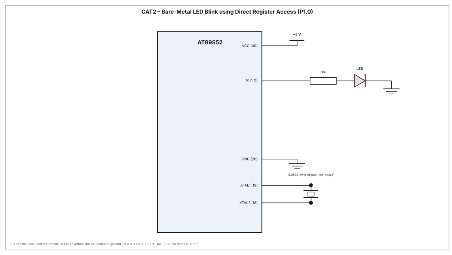

# CAT2 – Bare-Metal LED Blink Using Direct Register Access (P1.0)

| Field | Details |
|---|---|
| **EXP** | CAT2 – Continuous Assessment Task 2 |
| **DATE** | 14/11/2026 |
| **NAME OF EXP** | Bare-Metal LED Blink using Direct Register Access (P1.0) |
| **HARDWARE SETUP / PLATFORM** | AT89S52 (8051 family) microcontroller development board, Embedded C (Keil), register-level bare-metal programming |
| **TASK NO** | Task B – LED blinking using Port 1, pin P1.0 |

## Aim

To write and execute an Embedded C program for the AT89S52 microcontroller to blink an LED connected to P1.0. The LED is switched ON and OFF repeatedly by directly controlling the microcontroller's port register and using a software delay.

## Hardware Setup

**Platform:** AT89S52 (8051 family) microcontroller development board.

**Components:**
- AT89S52 microcontroller development board
- 1 × LED
- 1 × 1 kΩ current-limiting resistor
- Connecting wires
- +5 V power supply
- On-board 11.0592 MHz crystal

## Pin Connections

| AT89S52 pin | Connection | Direction / use |
|---|---|---|
| P1.0 (pin 1) | 1 kΩ resistor → LED anode; LED cathode → GND | Digital output |
| VCC (pin 40) | +5 V | Power supply |
| GND (pin 20) | Common ground | Ground |
| XTAL1 (pin 19), XTAL2 (pin 18) | On-board 11.0592 MHz crystal | Clock |

The LED is connected in series with the 1 kΩ resistor between P1.0 and ground. When P1.0 is HIGH (logic 1), the LED turns ON. When P1.0 is LOW (logic 0), the LED turns OFF.

## Circuit Diagram

## Core Logic

1. Include the 8051 register definition header file `<reg51.h>`.
2. Define `LED` as the P1.0 bit using `sbit LED = P1^0`.
3. Configure Port 1 to LOW initially by writing `P1 = 0x00`.
4. Enter an infinite loop.
5. Set `LED = 1` to turn the LED ON.
6. Call the software delay function.
7. Set `LED = 0` to turn the LED OFF.
8. Call the delay function again and repeat the sequence continuously.

## Software Delay

The `delay()` function uses two nested `for` loops:

- The outer loop runs 500 times.
- The inner loop runs 500 times for each outer-loop iteration.
- This creates a software delay between the LED state changes.

The delay is generated by CPU instruction execution. It is not based on a hardware timer or timer interrupt, so the exact delay depends on the microcontroller clock and compiler-generated instructions.

## Source and Project Files

- `main.c` – Embedded C source code for configuring P1.0 and continuously blinking the LED.
- `TASK2B.uvproj` – Keil µVision project file.
- `TASK2B.hex` – Generated Intel HEX file.
- `circuit.png` – Circuit diagram showing the AT89S52, resistor and LED connections.

## Inference

The LED connected to P1.0 of the AT89S52 was controlled using direct register-level access. The program first initialises Port 1 to LOW and then continuously writes HIGH and LOW to P1.0, with a software delay between each state change. This makes the LED blink repeatedly. The task demonstrates basic GPIO output control on the 8051 microcontroller without using Arduino APIs, HAL libraries, hardware timers or RTOS services.
