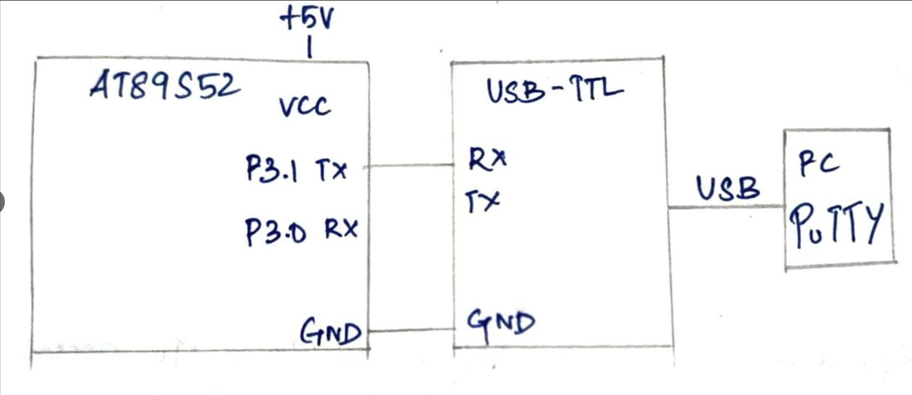

# CAT6 – Task A: UART Initialization and Character Transmission

| Field | Details |
|---|---|
| **EXP** | CAT6 – Continuous Lab Evaluation-6 (25CS2741 Fundamentals of Internet of Things + Lab) |
| **DATE** | 17/08/2026 |
| **NAME OF EXP** | UART Driver and Serial Debugging |
| **HARDWARE SETUP / PLATFORM** | AT89S52 development board (8051 tool chain), Embedded C (Keil), 11.0592 MHz crystal, USB-to-TTL converter, PC with PuTTY terminal, multimeter for hardware debug |
| **TASK NO** | Task A – UART Initialization and Character Transmission |

## Aim

To configure the UART of the AT89S52 for 8-bit asynchronous operation at 9600 baud with 1 stop bit and no parity (9600-8-N-1), and to transmit the message `Hello from 8051` continuously to a PC terminal (PuTTY) through a USB-to-TTL converter, without using Arduino APIs, HAL libraries or RTOS services.

## Hardware Setup

**Platform:** AT89S52 (8051 family) development board

**Components:**
- AT89S52 development board with an 11.0592 MHz crystal
- USB-to-TTL serial converter
- PC with a PuTTY terminal
- USB cable and jumper wires
- Digital multimeter

**Pin connections:**

| Pin | Connected to | Direction |
|---|---|---|
| P3.1 (TXD, pin 11) | USB-to-TTL converter RX | Output |
| GND | USB-to-TTL converter GND (common ground) | – |
| VCC | +5 V supply | Power |

P3.0 (RXD) is not connected in this task.

## Circuit Diagram



## Core Logic / Pseudocode

**UART configuration (9600-8-N-1):**

| Setting | Value | How it is set |
|---|---|---|
| Serial mode | 8-bit asynchronous UART (Mode 1) | `SCON = 0x50` (Mode 1, receiver enabled) |
| Frame | 1 start bit, 8 data bits, 1 stop bit, no parity | Fixed by Mode 1 |
| Baud rate generator | Timer 1, Mode 2 (8-bit auto-reload) | `TMOD` Timer 1 bits = `0x20`, Timer 0 bits kept |
| 9600 baud | Reload value 0xFD | `TH1 = TL1 = 0xFD`, `SMOD = 0`, 11.0592 MHz crystal |

Baud rate = (1 / 32) × (11.0592 MHz / 12) / (256 − 253) = 28800 / 3 = 9600.

**Functions in the program:**
- `uart_init()` configures Timer 1 and the serial port.
- `uart_putchar(c)` writes one character to `SBUF` and waits for the `TI` flag.
- `uart_putstring(s)` sends a string one character at a time.
- `delay_ms(ms)` is a software delay loop.

```
main:
    uart_init()
    loop forever:
        uart_putstring("Hello from 8051\r\n")
        delay 500 ms

uart_init():
    set Timer 1 to Mode 2 (8-bit auto-reload), keep Timer 0 bits
    TH1 = TL1 = 0xFD                   // 9600 baud at 11.0592 MHz
    start Timer 1 (TR1 = 1)
    SCON = 0x50                        // Mode 1, REN = 1
    TI = 0, RI = 0

uart_putchar(c):
    SBUF = c                           // starts the transmission
    wait until TI = 1                  // character has been shifted out
    TI = 0

uart_putstring(s):
    for each character in s:
        uart_putchar(character)
```

**Transmission complete flag:** after a character is written to `SBUF`, the hardware sets `TI` when the stop bit has been sent. The software waits for `TI`, clears it, and only then sends the next character.

**Timing and input method:** no interrupt is used. Transmission is polled on the `TI` flag, and the gap between messages comes from a software delay loop (about 500 ms).

**Source file:** `task1.c` (uses only `<REGX51.H>` for the register definitions, with direct access to `TMOD`, `TH1`, `TL1`, `TR1`, `SCON`, `SBUF` and `TI`).

## Inference

The UART was set to Mode 1 (8-bit, asynchronous, 1 stop bit, no parity) with Timer 1 in auto-reload mode, and `TH1 = 0xFD` gave 9600 baud at 11.0592 MHz. Each character was written to `SBUF`, and the program waited for the `TI` flag before sending the next one. With PuTTY set to 9600 baud, 8 data bits, no parity and 1 stop bit, the message `Hello from 8051` appeared repeatedly on the terminal, about every half second. Readable text confirms that the baud rate and the crystal frequency match, because a mismatch would show garbage characters. The program uses only register-level access, with no Arduino APIs, HAL libraries or RTOS.
