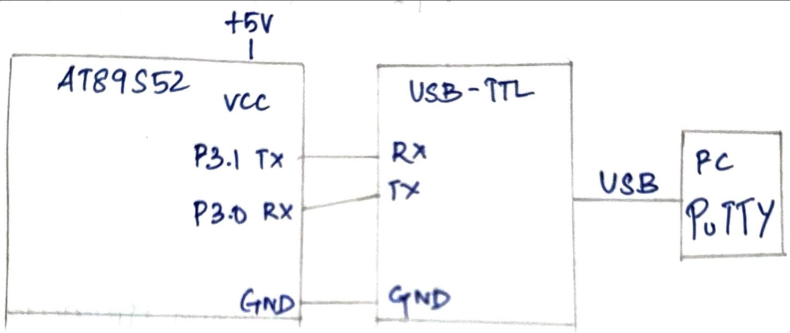

# CAT6 – Task B: UART Echo

| Field | Details |
|---|---|
| **EXP** | CAT6 – Continuous Lab Evaluation-6 (25CS2741 Fundamentals of Internet of Things + Lab) |
| **DATE** | 17/08/2026 |
| **NAME OF EXP** | UART Driver and Serial Debugging |
| **HARDWARE SETUP / PLATFORM** | AT89S52 development board (8051 tool chain), Embedded C (Keil), 11.0592 MHz crystal, USB-to-TTL converter, PC with PuTTY terminal, multimeter for hardware debug |
| **TASK NO** | Task B – UART Echo |

## Aim

To make the UART interactive: every character typed in the PuTTY terminal is received by the AT89S52 and transmitted back to the terminal (for example, typing `ABC123` displays `ABC123`), using a 9600-8-N-1 serial link through a USB-to-TTL converter, without using Arduino APIs, HAL libraries or RTOS services.

## Hardware Setup

**Platform:** AT89S52 (8051 family) development board

**Components:**
- AT89S52 development board with an 11.0592 MHz crystal
- USB-to-TTL serial converter
- PC with a PuTTY terminal
- USB cable and jumper wires
- Digital multimeter

**Pin connections:**

| Pin | Connected to | Direction |
|---|---|---|
| P3.1 (TXD, pin 11) | USB-to-TTL converter RX | Output |
| P3.0 (RXD, pin 10) | USB-to-TTL converter TX | Input |
| GND | USB-to-TTL converter GND (common ground) | – |
| VCC | +5 V supply | Power |

## Circuit Diagram



## Core Logic / Pseudocode

**UART configuration (9600-8-N-1):** the same as in Task A.

| Setting | Value | How it is set |
|---|---|---|
| Serial mode | 8-bit asynchronous UART (Mode 1), reception enabled | `SCON = 0x50` |
| Frame | 1 start bit, 8 data bits, 1 stop bit, no parity | Fixed by Mode 1 |
| Baud rate generator | Timer 1, Mode 2 (8-bit auto-reload) | `TMOD` Timer 1 bits = `0x20`, Timer 0 bits kept |
| 9600 baud | Reload value 0xFD | `TH1 = TL1 = 0xFD`, `SMOD = 0`, 11.0592 MHz crystal |

**Functions in the program:**
- `uart_init()` configures Timer 1 and the serial port.
- `uart_putchar(c)` writes one character to `SBUF` and waits for the `TI` flag.
- `uart_getchar()` waits for the `RI` flag, clears it and returns the received byte from `SBUF`.

```
main:
    uart_init()
    loop forever:
        received = uart_getchar()      // wait for a character from PuTTY
        uart_putchar(received)         // send the same character back

uart_init():
    set Timer 1 to Mode 2 (8-bit auto-reload), keep Timer 0 bits
    TH1 = TL1 = 0xFD                   // 9600 baud at 11.0592 MHz
    start Timer 1 (TR1 = 1)
    SCON = 0x50                        // Mode 1, REN = 1 (reception enabled)
    TI = 0, RI = 0

uart_putchar(c):
    SBUF = c                           // starts the transmission
    wait until TI = 1                  // character has been shifted out
    TI = 0

uart_getchar():
    wait until RI = 1                  // a full byte has arrived
    RI = 0                             // clear the flag for the next byte
    return SBUF
```

**Reception flag:** with `REN = 1`, the hardware sets `RI` after a complete byte (including its stop bit) has been received. The software waits for `RI`, clears it and reads the byte from `SBUF`.

**Timing and input method:** no interrupt is used. Both transmission and reception are polled, on the `TI` and `RI` flags.

**Source file:** `task2.c` `<<CONFIRM>>` (use the exact name of your Task B .c file; the program uses only `<REGX52.H>` for the register definitions, with direct access to `TMOD`, `TH1`, `TL1`, `TR1`, `SCON`, `SBUF`, `TI` and `RI`).

## Inference

Each character typed in PuTTY reached the 8051 on P3.0. The program waited for the `RI` flag, read the byte from `SBUF`, cleared `RI` and sent the same byte back through `SBUF` on P3.1, so typing `ABC123` displayed `ABC123`. With PuTTY's local echo off, the characters shown on the terminal are the ones returned by the 8051, which confirms that both transmission and reception work at 9600-8-N-1. The program uses only register-level access, with no Arduino APIs, HAL libraries or RTOS.
