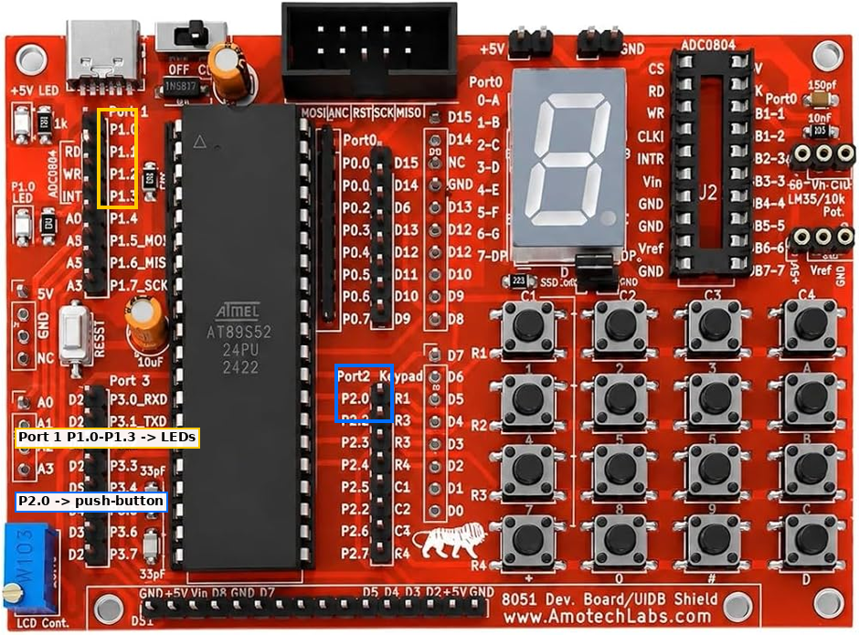

# EXPERIMENT DETAILS

**EXP:** CONTINUOUS LAB EVALUATION-3

**DATE:** 27/07/2026

**NAME OF EXP:** Timer-Based LED Pattern Generator and Button Interrupt Controller

**HARDWARE SETUP / PLATFORM:** AT89S52 Development Board + 4 LEDs + Push-Button + Keil µVision

---

## 1. Circuit Diagram

The experiment demonstrates four LED output patterns controlled by a push-button on an 8051 microcontroller.

* Microcontroller: AT89S52 (8051 core)
* GPIO Port (LEDs): Port 1
* GPIO Pins (LEDs): P1.0, P1.1, P1.2, P1.3
* GPIO Pin (Button): P2.0
* Peripherals: 4 LEDs, each with a current-limiting resistor; 1 push-button to GND (active low)
* Power Supply: 5V DC

---

## 2. Core Logic / Pseudocode / Code Base

**Working Principle:**
Four LEDs are connected to pins P1.0 to P1.3 and a push-button to pin P2.0. The program polls the button in a continuous loop. When a press is detected and confirmed after a debounce delay, the mode counter advances from 1 to 4 and wraps back to 1. The button is then held until released, so one physical press causes exactly one mode change. A `switch` statement runs the routine for the current mode:

* **Mode 1 (Running LED):** LED1 → LED2 → LED3 → LED4 → LED1 …
* **Mode 2 (Binary Counter):** LEDs display 0000 to 1111, then wrap to 0000.
* **Mode 3 (Alternating Pattern):** LEDs alternate between 1010 and 0101.
* **Mode 4 (All-LED Flash):** LEDs alternate between 1111 and 0000.

A software delay function is used to introduce time intervals between LED transitions.

**Pseudocode:**

1. Include the 8051 register definition header file (`reg52.h`).
2. Define P2.0 as the button input and P1.0 to P1.3 as LED outputs.
3. Create a delay function using nested loops.
4. Set P2.7 low, set the mode counter to 1, and turn all LEDs OFF.
5. Repeat continuously:
   1. If the button is pressed, call the delay to debounce it and confirm the press.
   2. If the button is still pressed, increment the mode counter, wrapping from 4 to 1.
   3. Wait until the button is released, then call the delay.
   4. Execute the routine for the current mode using a `switch` statement.
6. Each mode routine sets the LEDs for its pattern and calls the delay between steps.

**Code Base:**
The program is written in Embedded C using Keil C51.

* `reg52.h` provides the 8051 register definitions.
* `sbit BUTTON = P2^0` assigns the button to pin P2.0.
* `sbit LED1 = P1^0` through `sbit LED4 = P1^3` assign the LEDs to pins P1.0 to P1.3.
* `count` stores the current mode (1 to 4).
* `delay()` uses nested loops to generate a software delay.
* `mode1()` to `mode4()` implement the four LED patterns.
* `main()` handles button polling, debouncing, and mode selection.

---

## 3. Inference

The four LEDs display the selected pattern and change mode with each valid button press. The experiment demonstrates bit-level GPIO output and input using `sbit` declarations, debounced polling of a digital input, state-machine control using a `switch` statement, and software delay generation in Embedded C on the 8051 microcontroller.
