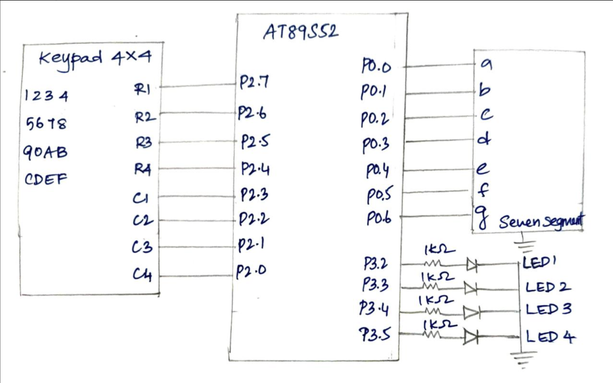

CAT4 – Human-Machine Interface using Matrix Keypad, LEDs and Seven-Segment Display
Field	Details
EXP	CAT4 – Continuous Lab Evaluation-4 (25CS2741 Fundamentals of Internet of Things + Lab)
DATE	03/08/2026
NAME OF EXP	Human-Machine Interface using Matrix Keypad, LEDs, and Seven-Segment Display
HARDWARE SETUP / PLATFORM	AT89S52 microcontroller development board (8051 tool chain), Embedded C (Keil), register-level bare-metal, 4×4 matrix keypad, common-cathode seven-segment display, 4 LEDs, multimeter for hardware debug
TASK NO	Single activity: keypad-driven seven-segment display and LED operations for keys 0 – 9
Aim
To design a simple embedded user interface for an AT89S52 microcontroller development board in which a 4×4 matrix keypad is the input device, a seven-segment display shows the value of the pressed key, and four LEDs show the operation linked to that key (single LED, running LED pattern, alternate LEDs, binary counter, all LEDs blink, all LEDs off and reset), using direct register access and without using Arduino APIs, HAL libraries or RTOS services.
Hardware Setup
Platform: AT89S52 (8051 family) development board
Components:
4×4 matrix keypad
1 × seven-segment display (common cathode)
4 × LEDs (active high)
4 × 1 kΩ resistors (one in series with each LED)
Connecting wires, power supply and digital multimeter
Pin connections:
Pin	Connected to	Direction
P0.0 – P0.6	Seven-segment display segments a, b, c, d, e, f, g (common cathode to GND)	Output
P2.7, P2.6, P2.5, P2.4	Keypad rows R1, R2, R3, R4 (driven low one at a time)	Output
P2.3, P2.2, P2.1, P2.0	Keypad columns C1, C2, C3, C4 (read, pressed = 0)	Input
P3.2	LED1 (via 1 kΩ) → GND	Output
P3.3	LED2 (via 1 kΩ) → GND	Output
P3.4	LED3 (via 1 kΩ) → GND	Output
P3.5	LED4 (via 1 kΩ) → GND	Output
Circuit Diagram

Core Logic / Pseudocode
Whenever a valid key is pressed, its value is shown on the seven-segment display and the matching LED operation is executed.
Key	Seven-segment display	LED operation
1	1	LED1 ON
2	2	LED2 ON
3	3	LED3 ON
4	4	LED4 ON
5	5	Running LED pattern (LED1 → LED4, 3 rounds, 300 ms per step)
6	6	Alternate LEDs (1010 ↔ 0101, 6 times, 400 ms each)
7	7	Binary counter 0 – 15 (500 ms per count)
8	8	All LEDs blink (5 times, 400 ms ON / 400 ms OFF)
9	9	All LEDs OFF
0	0	Reset system (all LEDs OFF, display shows 0)
Keys A – F have no function and are ignored. After a pattern (keys 5 – 8) finishes, all LEDs are switched OFF.
Keypad matrix (row driven low → keys read on the columns):
Row driven low	P2 value written	C1 (P2.3)	C2 (P2.2)	C3 (P2.1)	C4 (P2.0)
R1 (P2.7)	`0x7F`	1	2	3	4
R2 (P2.6)	`0xBF`	5	6	7	8
R3 (P2.5)	`0xDF`	9	0	A	B
R4 (P2.4)	`0xEF`	C	D	E	F
Seven-segment codes (common cathode, bit 0 = a … bit 6 = g): 0 = `0x3F`, 1 = `0x06`, 2 = `0x5B`, 3 = `0x4F`, 4 = `0x66`, 5 = `0x6D`, 6 = `0x7D`, 7 = `0x07`, 8 = `0x7F`, 9 = `0x6F`.
LED output: `external\_led(pattern)` writes the lower 4 bits of `pattern` to P3.2 – P3.5 (bit 0 = LED1 … bit 3 = LED4) and keeps the other P3 bits unchanged.
Functions in the program:
`keypad\_scan()` scans the keypad and returns the pressed key.
`display\_digit(value)` shows a digit 0 – 9 on the seven-segment display.
`external\_led(pattern)` drives the four LEDs.
`running\_led()`, `alternate\_led()`, `binary\_counter()` and `blink\_all()` run the LED patterns of keys 5 – 8.
`delay\_ms(ms)` is a software delay loop (120 inner iterations per millisecond).
`main()` selects the LED operation of the pressed key with a `switch` statement.
```
setup: P0 = segment code of 0 (display shows 0), P2 = 0xFF, P3 = 0x00 (all LEDs OFF)

loop forever:
    key = keypad\_scan()                          // waits until a key is pressed and released
    if key is '0' .. '9': display\_digit(key)     // show the key on the seven-segment display
    switch (key):
        '1': LED1 ON          '2': LED2 ON          '3': LED3 ON          '4': LED4 ON
        '5': running\_led()    '6': alternate\_led()  '7': binary\_counter() '8': blink\_all()
        '9': all LEDs OFF
        '0': all LEDs OFF, display shows 0
        other keys: no action

keypad\_scan():
    loop:
        for each row in (R1 = P2.7, R2 = P2.6, R3 = P2.5, R4 = P2.4):
            drive this row low, keep the other rows high
            if any column (P2.3 .. P2.0) reads 0:
                wait 20 ms                       // debounce
                read the columns again
                if a key is still pressed:
                    wait until the key is released
                    return the key of (row, column)

running\_led():     3 times: LED1, LED2, LED3, LED4 ON one after another (300 ms each); then all OFF
alternate\_led():   6 times: LED2 + LED4 ON, 400 ms; LED1 + LED3 ON, 400 ms; then all OFF
binary\_counter():  for n = 0 to 15: show n on the four LEDs, 500 ms; then all OFF
blink\_all():       5 times: all LEDs ON 400 ms, all LEDs OFF 400 ms
```
Debouncing: when a column goes low, the program waits 20 ms and reads again. Only if a key is still pressed does it wait for the release and return the key, so one physical press gives exactly one key value.
Timing and input method: no hardware timer and no interrupt is used. All timing comes from the software delay loop, and the keypad is polled. The program is blocking, so a key pressed while a pattern is running is handled only after that pattern finishes.
Source file: `ch4.c` (uses only `<reg51.h>` for the register definitions, with direct writes to P0, P2 and P3).
INFERENCE
The keypad was scanned by driving one row low at a time and reading the four columns, with a 20 ms debounce and a wait for release, so every key press returned exactly one key value. The key value was shown on the seven-segment display through a lookup table written to P0, and the matching LED operation was executed on P3.2 – P3.5: single LEDs for keys 1 – 4, the running LED pattern, alternate LEDs, binary counter and all-LED blink for keys 5 – 8, and all LEDs OFF for key 9. Key 0 reset the system by switching all LEDs OFF and showing 0 on the display. Because the program polls the keypad and uses software delays, it only reads a new key after the current pattern finishes. The program uses only register-level access, with no Arduino APIs, HAL libraries or RTOS.
