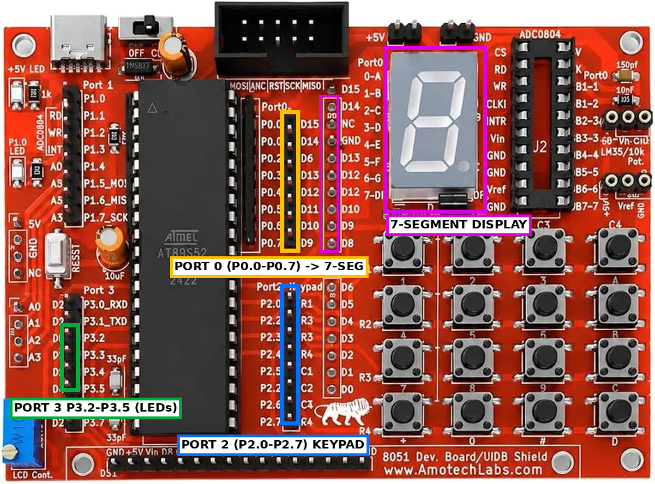

# EXPERIMENT DETAILS

**EXP:** CONTINUOUS LAB EVALUATION-4

**DATE:** 03/08/2026

**NAME OF EXP:** Human-Machine Interface using Matrix Keypad, LEDs, and Seven-Segment Display

**HARDWARE SETUP / PLATFORM:** AT89S52 Development Board + 4x4 Matrix Keypad + Seven-Segment Display + 4 LEDs + Keil µVision

---

## 1. Circuit Diagram

The experiment implements a simple embedded user interface in which a matrix keypad provides input, a seven-segment display shows the pressed digit, and LEDs indicate the active operating mode.

* Microcontroller: AT89S52 (8051 core)
* Keypad: 4x4 matrix, rows on P2.4 to P2.7 (driven low one at a time), columns on P2.0 to P2.3 (read as inputs)
* Seven-Segment Display: common-cathode, segments driven from Port 0 (P0)
* LEDs: LED1 to LED4 on P3.2 to P3.5, each with a current-limiting resistor
* Power Supply: 5V DC

---

## 2. Core Logic / Pseudocode / Code Base

**Working Principle:**
The keypad is scanned by driving one row at a time low and reading the column lines. When a key press is detected, the routine waits for a 20 ms debounce interval, confirms the key, and waits for release. The key is mapped to a digit or letter. Digits 0 to 9 are shown on the seven-segment display. The key then selects an LED function:

* **Key 1 to 4:** Turns on LED1 to LED4 respectively.
* **Key 5 (Running LED):** LED1 → LED2 → LED3 → LED4, repeated three times.
* **Key 6 (Alternate LEDs):** Alternates between 1010 and 0101.
* **Key 7 (Binary Counter):** Counts from 0 to 15 on the four LEDs.
* **Key 8 (All LEDs Blink):** Turns all LEDs on and off five times.
* **Key 9 (All LEDs OFF):** Turns all LEDs off.
* **Key 0 (Reset System):** Turns all LEDs off and displays 0 on the seven-segment display.

A software delay function is used to introduce time intervals between LED transitions and for keypad debouncing.

**Pseudocode:**

1. Include the 8051 register definition header file (`reg51.h`).
2. Define the seven-segment code table for digits 0 to 9.
3. Create a delay function using nested loops.
4. Initialize the seven-segment display to 0, set P2 high, and turn all LEDs off.
5. Repeat continuously:
   1. Call `keypad_scan()` to wait for a valid key press and return its value.
   2. If the key is a digit, call `display_digit()` to show it on the seven-segment display.
   3. Execute the LED function for the key using a `switch` statement.
6. `keypad_scan()` drives each row low in turn, checks the columns, debounces the press, waits for release, and maps the row and column to a key.
7. Each LED routine sets the LED pattern and calls the delay between steps.

**Code Base:**
The program is written in Embedded C using Keil C51.

* `reg51.h` provides the 8051 register definitions.
* `seg_code[10]` stores the seven-segment patterns for digits 0 to 9.
* `delay_ms()` generates a software delay of approximately the requested number of milliseconds.
* `external_led()` writes a 4-bit pattern to LED1 to LED4 on P3.2 to P3.5, leaving the other bits of P3 unchanged.
* `keypad_scan()` scans the 4x4 matrix row by row, debounces each press, waits for release, and returns the key value.
* `display_digit()` writes the segment code for a digit to Port 0.
* `running_led()`, `binary_counter()`, `alternate_led()`, and `blink_all()` implement the LED modes for keys 5, 7, 6, and 8.
* `main()` initializes the hardware, calls the keypad scan, updates the display, and selects the LED function with a `switch` statement.

---

## 3. Inference

The experiment demonstrates a complete human-machine interface on the 8051 microcontroller. It covers matrix keypad scanning, software debouncing, mapping of key codes, output to a seven-segment display through a lookup table, and control of LEDs through a `switch` state selection. The experiment also reinforces bit-masked port access in Embedded C and the use of separate functions for each operating mode.
