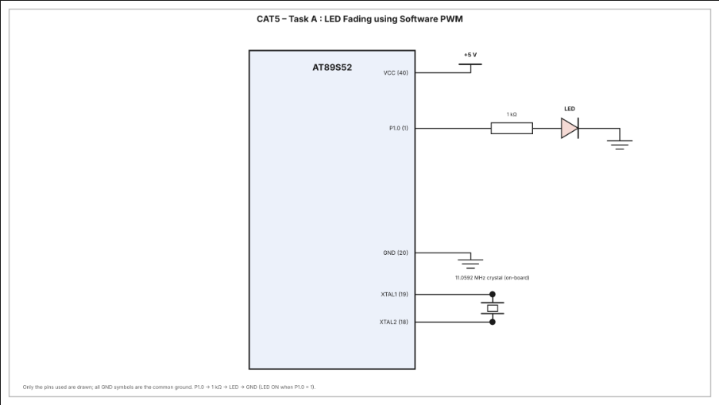

# CAT5 – Task A: LED Fading using Software PWM (Timer 0 Interrupt)

| Field | Details |
|---|---|
| **EXP** | CAT5 – Continuous Lab Evaluation-5 (25CS2741 Fundamentals of Internet of Things + Lab) |
| **DATE** | 10/08/2026 |
| **NAME OF EXP** | Hardware Timer and Interrupt-Based Timing for LED Fading, Pulse Generation, and Stepper Motor Control |
| **HARDWARE SETUP / PLATFORM** | AT89S52 development board (8051 tool chain), Embedded C (Keil), 11.0592 MHz crystal, 1 LED on P1.0, multimeter for hardware debug |
| **TASK NO** | Task A – LED fading using software PWM, with the Timer 0 interrupt as the time base |

## Aim

To use the Timer 0 interrupt of the AT89S52 as the system time base and generate a software PWM signal that gradually varies the duty cycle of an LED from 0 % to 100 % and back to 0 %, producing a visible LED fading effect, without using Arduino APIs, HAL libraries, RTOS services or software delay loops for timing.

## Hardware Setup

**Platform:** AT89S52 (8051 family) development board, 11.0592 MHz crystal

**Components:**
- AT89S52 development board
- 1 × LED (active high)
- 1 × 1 kΩ resistor in series with the LED
- Connecting wires, power supply and digital multimeter

**Pin connections:**

| Pin | Connected to | Direction |
|---|---|---|
| P1.0 | LED (via 1 kΩ) → GND | Output |

## Circuit Diagram



## Core Logic / Pseudocode

Timer 0 runs in Mode 1 (16-bit) and raises an interrupt every time it overflows. Each interrupt is one PWM tick, and 100 ticks make one PWM cycle. The LED is ON for `duty` ticks out of every 100. After each PWM cycle `duty` changes by 1, so the LED gradually gets brighter and then dimmer.

**Timer calculation:**

| Parameter | Value |
|---|---|
| Crystal | 11.0592 MHz |
| Machine cycle | 12 / 11.0592 MHz = 1.085 µs |
| Timer 0 mode | Mode 1 (16-bit), `TMOD = (TMOD & 0xF0) \| 0x01` |
| Reload value | `TH0 = 0xFF`, `TL0 = 0xD4` (65492) |
| Counts to overflow | 65536 − 65492 = 44 |
| Interrupt (PWM tick) period | 44 × 1.085 µs ≈ 47.7 µs |
| PWM resolution | 100 steps (0 – 100 %) |
| PWM period | 100 ticks ≈ 4.77 ms (≈ 210 Hz) |
| Duty step | 1 % per PWM cycle |
| Fade time 0 % → 100 % | 100 PWM cycles ≈ 0.48 s |

```
globals: pwm_count = 0, duty = 0, increasing = 1

Timer0_ISR (every overflow):
    reload TH0, TL0
    if pwm_count < duty: LED = 1 else LED = 0      // software PWM
    pwm_count = pwm_count + 1
    if pwm_count >= 100:                            // one PWM cycle finished
        pwm_count = 0
        if increasing:
            if duty < 100: duty = duty + 1
            else: increasing = 0                    // start dimming
        else:
            if duty > 0: duty = duty - 1
            else: increasing = 1                    // start brightening

Timer0_Init():
    TMOD = Timer 0 Mode 1 (Timer 1 bits kept)
    TH0, TL0 = reload value
    ET0 = 1, EA = 1, TR0 = 1                        // enable interrupt, start timer

main:
    LED = 0
    Timer0_Init()
    loop forever (empty)                            // everything is done in the ISR
```

**Duty cycle and brightness:** with `duty = 0` the LED stays OFF, with `duty = 50` it is ON for half of every PWM cycle (medium), and with `duty = 100` it stays fully ON. The PWM period is short enough that the eye sees only the average brightness and no flicker.

**Non-blocking design:** the main loop is empty. All timing and LED updates are done by the Timer 0 interrupt service routine, and no software delay loops are used.

**Source file:** `cat5.c` (uses only `<reg52.h>` for the register definitions, with direct access to TMOD, TH0, TL0, TR0, ET0, EA and P1.0).

## INFERENCE

The Timer 0 overflow interrupt gave a hardware-generated time base, and the interrupt service routine turned it into a software PWM signal on P1.0 with 100 duty-cycle steps. Increasing and then decreasing the duty value by 1 after every PWM cycle made the LED fade smoothly from OFF to fully ON and back, repeating continuously. Because the PWM cycle repeats about 210 times per second, the LED looked continuously lit rather than flickering. The main loop stayed free because timing was handled entirely by the interrupt, with no software delay loops. The program uses only register-level access, with no Arduino APIs, HAL libraries or RTOS.
