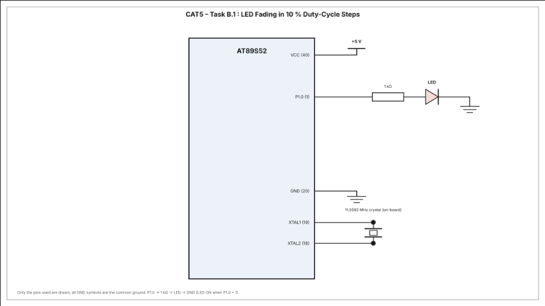

# CAT5 – Task B.1: LED Fading in 10 % Duty-Cycle Steps using Software PWM (Timer 0 Interrupt)

| Field | Details |
|---|---|
| **EXP** | CAT5 – Continuous Lab Evaluation-5 (25CS2741 Fundamentals of Internet of Things + Lab) |
| **DATE** | 10/08/2026 |
| **NAME OF EXP** | Hardware Timer and Interrupt-Based Timing for LED Fading, Pulse Generation, and Stepper Motor Control |
| **HARDWARE SETUP / PLATFORM** | AT89S52 development board (8051 tool chain), Embedded C (Keil), 11.0592 MHz crystal, 1 LED on P1.0, multimeter for hardware debug |
| **TASK NO** | Task B.1 – Software PWM using the Timer 0 interrupt, duty cycle varied 0 % → 100 % → 0 % in 10 % steps for a visible LED fading effect |

## Aim

To use the Timer 0 interrupt of the AT89S52 as the time base for a software PWM signal and to vary its duty cycle in 10 % steps (0 %, 10 %, 20 % … 100 %, 90 % … 10 %, 0 %), producing a visible LED fading effect, without using Arduino APIs, HAL libraries, RTOS services or software delay loops for timing.

## Hardware Setup

**Platform:** AT89S52 (8051 family) development board, 11.0592 MHz crystal

**Components:**
- AT89S52 development board
- 1 × LED (active high)
- 1 × 1 kΩ resistor in series with the LED
- Connecting wires, power supply and digital multimeter

**Pin connections:**

| Pin | Connected to | Direction |
|---|---|---|
| P1.0 | LED (via 1 kΩ) → GND | Output |

## Circuit Diagram



## Core Logic / Pseudocode

Timer 0 runs in Mode 1 (16-bit) and raises an interrupt on every overflow. Each interrupt is one PWM tick, and 100 ticks make one PWM cycle. The LED is ON for `duty` ticks out of every 100. A second counter, `fade_count`, counts PWM cycles, and after every 10 PWM cycles `duty` changes by 10 %, so the brightness moves in steps up to 100 % and back down to 0 %.

**Timer calculation (nominal values):**

| Parameter | Value |
|---|---|
| Crystal | 11.0592 MHz |
| Machine cycle | 12 / 11.0592 MHz = 1.085 µs |
| Timer 0 mode | Mode 1 (16-bit), `TMOD = 0x01` |
| Reload value | `TH0 = 0xFF`, `TL0 = 0xF7` (65527) |
| Counts to overflow | 65536 − 65527 = 9 |
| Interrupt (PWM tick) period | 9 × 1.085 µs ≈ 9.8 µs |
| PWM resolution | 100 steps, one PWM cycle = 100 ticks |
| PWM period | ≈ 0.98 ms (≈ 1 kHz) |
| Duty step | 10 % after every 10 PWM cycles (≈ 9.8 ms) |
| Fade 0 % → 100 % | 10 steps ≈ 98 ms |
| Complete 0 % → 100 % → 0 % cycle | 20 steps ≈ 195 ms |

These are nominal values that assume the interrupt service routine finishes within one tick. On the 8051 the execution time of the ISR (tens of machine cycles) sets a lower limit on the real tick period, so the measured PWM frequency and fade time are somewhat slower than the nominal ones.

**Duty cycle sequence:** 0 % → 10 % → 20 % → … → 100 % → 90 % → … → 10 % → 0 % → 10 % … (repeats).

| Duty cycle | LED brightness |
|---|---|
| 0 % | OFF |
| 25 % | Dim |
| 50 % | Medium |
| 75 % | Bright |
| 100 % | Fully ON |

```
globals: pwm_count = 0, duty = 0, fade_count = 0, direction = 1 (up)

Timer0_ISR (every overflow):
    reload TH0, TL0
    if pwm_count < duty: LED = 1 else LED = 0      // software PWM
    pwm_count = pwm_count + 1
    if pwm_count >= 100:                            // one PWM cycle finished
        pwm_count = 0
        fade_count = fade_count + 1
        if fade_count >= 10:                        // time to change the brightness
            fade_count = 0
            if direction == up:
                duty = duty + 10
                if duty >= 100: direction = down
            else:
                duty = duty - 10
                if duty == 0: direction = up

main:
    TMOD = 0x01                                     // Timer 0, Mode 1
    TH0, TL0 = reload value
    ET0 = 1, EA = 1, TR0 = 1                        // enable interrupt, start timer
    loop forever (empty)                            // everything is done in the ISR
```

**Non-blocking design:** the main loop is empty. All timing and LED updates are done by the Timer 0 interrupt service routine, and no software delay loops are used.

**Source file:** `main.c` (uses only `<reg52.h>` for the register definitions, with direct access to TMOD, TH0, TL0, TR0, ET0, EA and P1.0).

## INFERENCE

The Timer 0 overflow interrupt gave a hardware-generated time base, and the interrupt service routine turned it into a software PWM signal on P1.0 with a PWM frequency of about 1 kHz. Changing the duty cycle by 10 % after every 10 PWM cycles made the LED brightness rise from OFF to fully ON and fall back to OFF in 10 % steps, repeating continuously. Because the PWM cycle repeats about a thousand times per second, the LED looked continuously lit at each brightness level rather than flickering. Timing was handled entirely by the interrupt, so the main loop stayed free and no software delay loops were needed. The program uses only register-level access, with no Arduino APIs, HAL libraries or RTOS.
