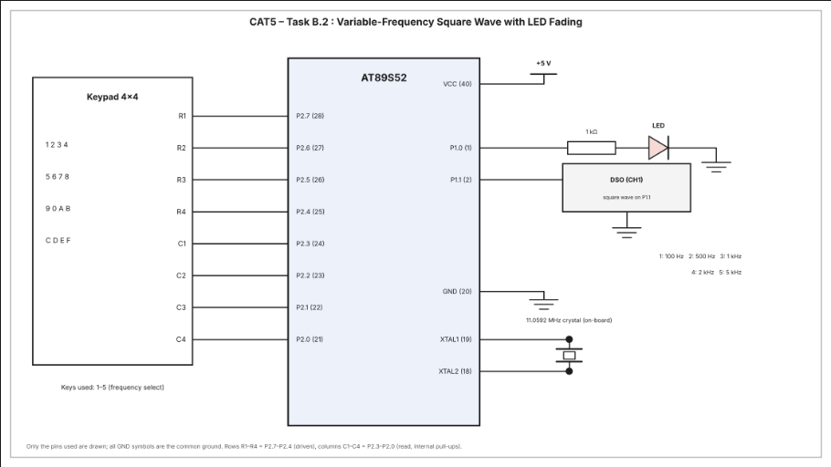

# CAT5 – Task B.2: Variable-Frequency Square Wave Generation using Timer 1 Interrupt (with LED Fading)

| Field | Details |
|---|---|
| **EXP** | CAT5 – Continuous Lab Evaluation-5 (25CS2741 Fundamentals of Internet of Things + Lab) |
| **DATE** | 10/08/2026 |
| **NAME OF EXP** | Hardware Timer and Interrupt-Based Timing for LED Fading, Pulse Generation, and Stepper Motor Control |
| **HARDWARE SETUP / PLATFORM** | AT89S52 development board (8051 tool chain), Embedded C (Keil), 11.0592 MHz crystal, 1 LED on P1.0, 4×4 matrix keypad on Port 2, DSO on P1.1, multimeter for hardware debug |
| **TASK NO** | Task B.2 – Square waves of different frequencies (100 Hz, 500 Hz, 1 kHz, 2 kHz, 5 kHz) on a GPIO pin using the timer interrupt, selected from a keypad, while the LED keeps fading |

## Aim

To use the Timer 1 interrupt of the AT89S52 to generate square-wave signals on a GPIO pin at five selectable frequencies (Mode 1 – 100 Hz, Mode 2 – 500 Hz, Mode 3 – 1 kHz, Mode 4 – 2 kHz, Mode 5 – 5 kHz) chosen with a 4×4 keypad, while the Timer 0 interrupt keeps fading an LED with software PWM, without using Arduino APIs, HAL libraries, RTOS services or software delay loops for timing.

## Hardware Setup

**Platform:** AT89S52 (8051 family) development board, 11.0592 MHz crystal

**Components:**
- AT89S52 development board
- 1 × LED (active high) with a 1 kΩ series resistor
- 4×4 matrix keypad
- Digital storage oscilloscope (DSO) to measure the output frequency and duty cycle
- Connecting wires, power supply and digital multimeter

**Pin connections:**

| Pin | Connected to | Direction |
|---|---|---|
| P1.0 | LED (via 1 kΩ) → GND | Output |
| P1.1 | DSO channel 1 (square-wave output) | Output |
| P2.7, P2.6, P2.5, P2.4 | Keypad rows R1, R2, R3, R4 (driven low one at a time) | Output |
| P2.3, P2.2, P2.1, P2.0 | Keypad columns C1, C2, C3, C4 (read, pressed = 0) | Input |

## Circuit Diagram



## Core Logic / Pseudocode

**Two timers are used:**
- **Timer 0** (Mode 1) is the LED fading time base. Every overflow is one PWM tick, 100 ticks make one PWM cycle, and after every 10 PWM cycles `duty` goes up by 1 %. After 100 % it returns to 0 % and the fade repeats.
- **Timer 1** (Mode 1) is the square-wave time base. Every overflow its interrupt service routine reloads the timer from `reload_high` / `reload_low` and toggles P1.1. One output period is two overflows, so the output is a square wave with a 50 % duty cycle.

**Keypad selection:**

| Key | Mode | Output frequency |
|---|---|---|
| 1 | Mode 1 | 100 Hz |
| 2 | Mode 2 | 500 Hz |
| 3 | Mode 3 | 1 kHz (default at power-up) |
| 4 | Mode 4 | 2 kHz |
| 5 | Mode 5 | 5 kHz |

Keys 6 – 9 are not used and leave the frequency unchanged.

**Timer 1 reload values (machine cycle = 12 / 11.0592 MHz = 1.085 µs, output toggles on every overflow so the half period is 1 / (2 × frequency)):**

| Frequency | Half period | Counts | Reload (TH1 TL1) |
|---|---|---|---|
| 100 Hz | 5 ms | 4608 | `0xEE00` |
| 500 Hz | 1 ms | 922 | `0xFC66` |
| 1 kHz | 0.5 ms | 461 | `0xFE33` |
| 2 kHz | 0.25 ms | 230 | `0xFF1A` |
| 5 kHz | 0.1 ms | 92 | `0xFFA4` |

Reload value = 65536 − counts. The interrupt latency adds a few machine cycles to each half period, so the measured frequency is slightly lower than the nominal one, mainly at 5 kHz.

**Timer 0 (LED fading) values:** reload `TH0 = 0xFF`, `TL0 = 0xF7` (9 counts, ≈ 9.8 µs per tick), PWM period ≈ 0.98 ms (≈ 1 kHz), 1 % duty step every 10 PWM cycles (≈ 9.8 ms), so one 0 % → 100 % fade takes ≈ 1 s (nominal).

```
globals: pwm_count = 0, duty = 0, fade_count = 0
         reload_high = 0xFE, reload_low = 0x33          // 1 kHz default

Timer0_ISR:                                             // LED fading
    reload TH0, TL0
    if pwm_count < duty: LED = 1 else LED = 0
    pwm_count = pwm_count + 1
    if pwm_count >= 100:
        pwm_count = 0
        fade_count = fade_count + 1
        if fade_count >= 10:
            fade_count = 0
            duty = duty + 1
            if duty > 100: duty = 0

Timer1_ISR:                                             // square wave
    TH1 = reload_high, TL1 = reload_low
    P1.1 = NOT P1.1

keypad_scan():
    for each row (P2.7 .. P2.4):
        set all rows HIGH, then drive this row LOW
        for each column (P2.3 .. P2.0):
            if column reads 0: return key number of (row, column)
    return -1                                           // no key pressed

set_frequency(mode):
    load reload_high / reload_low from the table above for mode 1 .. 5

main:
    TMOD = 0x11                                         // Timer 0 and Timer 1, both Mode 1
    preload TH0/TL0 and TH1/TL1
    ET0 = 1, ET1 = 1, EA = 1, TR0 = 1, TR1 = 1
    loop forever:
        key = keypad_scan()
        if key != -1: set_frequency(key)
```

**Non-blocking design:** both timing sources are interrupt driven. The main loop only polls the keypad, and a new frequency takes effect from the next Timer 1 reload. No software delay loops are used.

**Source file:** `main.c` (uses only `<reg52.h>` for the register definitions, with direct access to TMOD, TH0/TL0, TH1/TL1, TR0, TR1, ET0, ET1, EA, P1 and P2).

## INFERENCE

Timer 1 acted as a programmable square-wave source: its overflow interrupt toggled P1.1, and loading a different reload value for each key press changed the half period, giving 100 Hz, 500 Hz, 1 kHz, 2 kHz and 5 kHz outputs with a 50 % duty cycle that can be measured on the DSO. Timer 0 ran independently as the PWM time base, so the LED kept fading while the frequency was being changed. The keypad was scanned in the main loop by driving one row low at a time and reading the columns, and no software delay loops were needed for timing. The program uses only register-level access, with no Arduino APIs, HAL libraries or RTOS.
