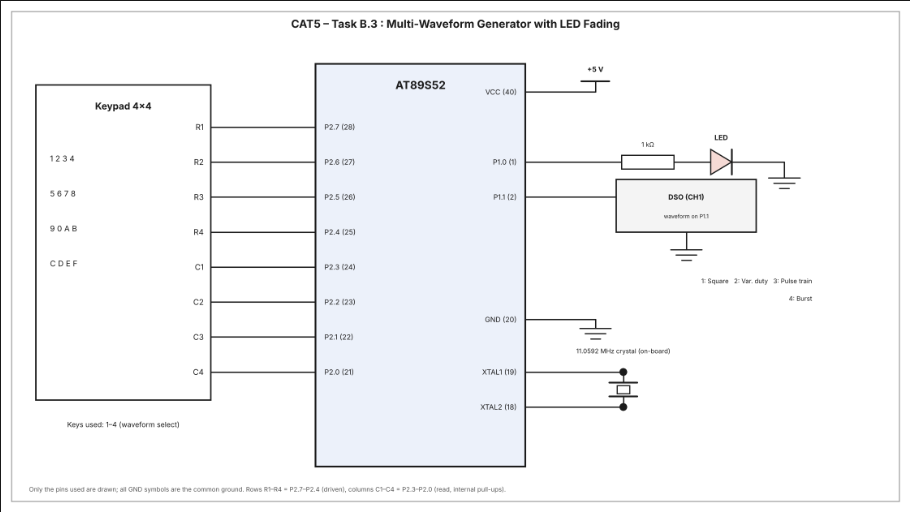

# CAT5 – Task B.3: Multi-Waveform Generation (Square, Variable Duty-Cycle, Pulse Train, Burst) using Timer 1 Interrupt with LED Fading

| Field | Details |
|---|---|
| **EXP** | CAT5 – Continuous Lab Evaluation-5 (25CS2741 Fundamentals of Internet of Things + Lab) |
| **DATE** | 10/08/2026 |
| **NAME OF EXP** | Hardware Timer and Interrupt-Based Timing for LED Fading, Pulse Generation, and Stepper Motor Control |
| **HARDWARE SETUP / PLATFORM** | AT89S52 development board (8051 tool chain), Embedded C (Keil), 11.0592 MHz crystal, 1 LED on P1.0, 4×4 matrix keypad on Port 2, DSO on P1.1, multimeter for hardware debug |
| **TASK NO** | Task B.3 – Different signal types from one square-wave source (square wave, variable duty-cycle wave, pulse train, burst signal) selected from a keypad, while the LED keeps fading |

## Aim

To use the Timer 1 interrupt of the AT89S52 as a 1 ms time base and generate four different signal types on a GPIO pin (square wave, variable duty-cycle wave, pulse train and burst signal) selected with a 4×4 keypad, while the Timer 0 interrupt keeps fading an LED with software PWM, without using Arduino APIs, HAL libraries, RTOS services or software delay loops for timing.

## Hardware Setup

**Platform:** AT89S52 (8051 family) development board, 11.0592 MHz crystal

**Components:**
- AT89S52 development board
- 1 × LED (active high) with a 1 kΩ series resistor
- 4×4 matrix keypad
- Digital storage oscilloscope (DSO) to observe the generated waveforms
- Connecting wires, power supply and digital multimeter

**Pin connections:**

| Pin | Connected to | Direction |
|---|---|---|
| P1.0 | LED (via 1 kΩ) → GND | Output |
| P1.1 | DSO channel 1 (waveform output) | Output |
| P2.7, P2.6, P2.5, P2.4 | Keypad rows R1, R2, R3, R4 (driven low one at a time) | Output |
| P2.3, P2.2, P2.1, P2.0 | Keypad columns C1, C2, C3, C4 (read, pressed = 0) | Input |

## Circuit Diagram



## Core Logic / Pseudocode

**Two timers are used:**
- **Timer 0** (Mode 1) is the LED fading time base. Every overflow is one PWM tick, 100 ticks make one PWM cycle, and after every 10 PWM cycles `duty` changes by 10 %, going 0 % → 100 % → 0 % in 10 % steps.
- **Timer 1** (Mode 1) is the waveform time base. It is reloaded with `TH1 = 0xFC`, `TL1 = 0x66` (922 counts × 1.085 µs ≈ 1 ms), so every overflow is one 1 ms tick. The Timer 1 interrupt service routine sets P1.1 according to the selected waveform mode and the tick counter `wave_tick`.

**Keypad selection and waveforms (1 bit = 1 ms tick):**

| Key | Mode | Signal | Pattern | Period | Frequency | Duty cycle |
|---|---|---|---|---|---|---|
| 1 | 1 | Square wave (default at power-up) | `10` | 2 ms | 500 Hz | 50 % |
| 2 | 2 | Variable duty-cycle wave | `11000000` | 8 ms | 125 Hz | 25 % |
| 3 | 3 | Pulse train | `10000000` | 8 ms | 125 Hz | 12.5 % |
| 4 | 4 | Burst signal | `10101010100000000000` | 20 ms | burst repeats at 50 Hz | 25 % average |

- **Square wave:** P1.1 toggles on every tick.
- **Variable duty-cycle wave:** over 8 ticks P1.1 is HIGH for 2 ticks and LOW for 6 ticks, so the duty cycle differs from the 50 % of the square wave.
- **Pulse train:** over 8 ticks P1.1 is HIGH for 1 tick and LOW for 7 ticks, giving a narrow pulse in every period.
- **Burst signal:** during the first 10 ticks P1.1 alternates HIGH/LOW (5 pulses), and during the next 10 ticks it stays LOW (silent gap), then the burst repeats.

Keys 5 – 9 are ignored. A new key press selects the new mode and resets `wave_tick` to 0 so the waveform starts cleanly, and the mode stays selected after the key is released.

**Timer 0 (LED fading) values:** reload `TH0 = 0xFF`, `TL0 = 0xF7` (9 counts, ≈ 9.8 µs per tick), PWM period ≈ 0.98 ms (≈ 1 kHz), 10 % duty step every 10 PWM cycles (≈ 9.8 ms), so a full 0 % → 100 % → 0 % cycle takes about 195 ms (nominal). The nominal values assume the interrupt routine finishes within one tick, and the interrupt latency makes the real timing slightly slower.

```
globals: pwm_count = 0, duty = 0, fade_count = 0, direction = 1 (up)
         waveform_mode = 1, wave_tick = 0

Timer0_ISR:                                             // LED fading
    reload TH0, TL0
    if pwm_count < duty: LED = 1 else LED = 0
    pwm_count = pwm_count + 1
    if pwm_count >= 100:
        pwm_count = 0
        fade_count = fade_count + 1
        if fade_count >= 10:
            fade_count = 0
            if direction == up:
                duty = duty + 10
                if duty >= 100: direction = down
            else:
                duty = duty - 10
                if duty == 0: direction = up

Timer1_ISR:                                             // 1 ms tick
    TH1 = 0xFC, TL1 = 0x66
    switch waveform_mode:
        1: P1.1 = NOT P1.1                              // square wave
        2: P1.1 = (wave_tick < 2)                       // 25 % duty, 8-tick period
           wave_tick = wave_tick + 1; if wave_tick >= 8: wave_tick = 0
        3: P1.1 = (wave_tick == 0)                      // pulse train, 8-tick period
           wave_tick = wave_tick + 1; if wave_tick >= 8: wave_tick = 0
        4: if wave_tick < 10: P1.1 = (wave_tick is even) else P1.1 = 0     // burst
           wave_tick = wave_tick + 1; if wave_tick >= 20: wave_tick = 0
        default: P1.1 = 0

keypad_scan():
    for each row (P2.7 .. P2.4):
        set all rows HIGH, then drive this row LOW
        for each column (P2.3 .. P2.0):
            if column reads 0: return key number of (row, column)
    return -1                                           // no key pressed

main:
    TMOD = 0x11                                         // Timer 0 and Timer 1, both Mode 1
    preload TH0/TL0 and TH1/TL1
    ET0 = 1, ET1 = 1, EA = 1, TR0 = 1, TR1 = 1
    loop forever:
        key = keypad_scan()
        if key is 1 .. 4:
            waveform_mode = key
            wave_tick = 0
```

**Non-blocking design:** both timing sources are interrupt driven. The main loop only polls the keypad, and no software delay loops are used.

**Source file:** `main.c` (uses only `<reg52.h>` for the register definitions, with direct access to TMOD, TH0/TL0, TH1/TL1, TR0, TR1, ET0, ET1, EA, P1 and P2).

## INFERENCE

Timer 1 provided a 1 ms hardware time base, and its interrupt service routine shaped the level of P1.1 on every tick. Changing only the tick pattern produced four different signals from the same timer: a 500 Hz square wave, a 25 % duty-cycle wave, a narrow pulse train and a burst of five pulses followed by a silent gap, which can be observed on the DSO. Timer 0 ran independently as the PWM time base, so the LED kept fading in 10 % steps while the waveform mode was being changed. The keypad was scanned in the main loop and a key press only changed the mode variable, so the waveform changed without any software delay loops. The program uses only register-level access, with no Arduino APIs, HAL libraries or RTOS.
