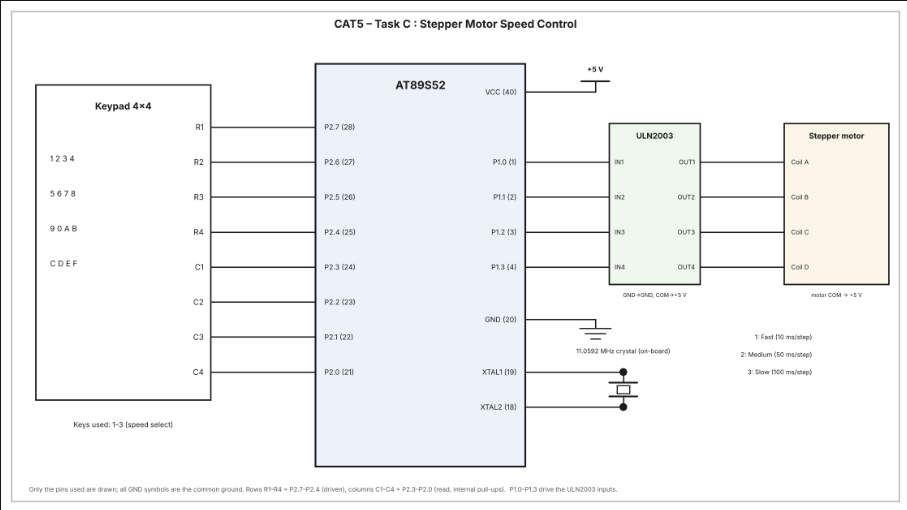

# CAT5 – Task C: Stepper Motor Speed Control

| Field | Details |
|---|---|
| **EXP** | CAT5 – Continuous Assessment Task 5 (CAT5) |
| **DATE** | 14/11/2026 |
| **NAME OF EXP** | Stepper Motor Speed Control Using a 4×4 Keypad |
| **HARDWARE SETUP / PLATFORM** | AT89S52 (8051 family) microcontroller development board, Embedded C (Keil), ULN2003 driver and stepper motor |
| **TASK NO** | Task C – Keypad-based selection of stepper motor speed using Timer 0 |

## Aim

To interface a 4×4 matrix keypad and a stepper motor with the AT89S52 microcontroller. The program scans the keypad to detect speed-selection keys 1, 2 and 3, and uses the Timer 0 interrupt to sequence the motor coils at the selected interval.

## Hardware Setup

**Platform:** AT89S52 (8051 family) development board.

**Components:**
- AT89S52 microcontroller development board
- 4×4 matrix keypad
- ULN2003 Darlington transistor array driver
- Four-phase stepper motor
- +5 V supply and common ground
- Connecting wires

## Pin Connections

### 4×4 Keypad

The keypad is connected to Port 2. The upper nibble is used for the four rows and the lower nibble for the four columns.

| Keypad connection | AT89S52 pin | Port direction / use |
|---|---|---|
| R1 | P2.7 (pin 28) | Row drive |
| R2 | P2.6 (pin 27) | Row drive |
| R3 | P2.5 (pin 26) | Row drive |
| R4 | P2.4 (pin 25) | Row drive |
| C1 | P2.3 (pin 24) | Column input |
| C2 | P2.2 (pin 23) | Column input |
| C3 | P2.1 (pin 22) | Column input |
| C4 | P2.0 (pin 21) | Column input |

The code scans the rows one at a time and reads the columns. The column inputs use the 8051 port's internal pull-up behaviour. Only the first three keys in the first row (1, 2 and 3) are assigned speed-selection functions in the program.

### ULN2003 Driver and Stepper Motor

| AT89S52 pin | ULN2003 input | ULN2003 output | Motor connection |
|---|---|---|---|
| P1.0 (pin 1) | IN1 | OUT1 | Coil A |
| P1.1 (pin 2) | IN2 | OUT2 | Coil B |
| P1.2 (pin 3) | IN3 | OUT3 | Coil C |
| P1.3 (pin 4) | IN4 | OUT4 | Coil D |

- The ULN2003 and microcontroller grounds must be common.
- The ULN2003 COM pin and the stepper motor common terminal are connected to +5 V, as shown in the circuit diagram.
- The AT89S52 is powered from +5 V.

## Circuit Diagram

## Keypad Control and Speed Selection

Press one of the following keys to select the motor speed:

| Key pressed | Selected speed | Step interval used by the program |
|---|---|---|
| 1 | Fast | 1 Timer 0 interrupt interval (approximately 10 ms per step) |
| 2 | Medium | 5 Timer 0 interrupt intervals (approximately 50 ms per step) |
| 3 | Slow | 10 Timer 0 interrupt intervals (approximately 100 ms per step) |

The motor starts rotating with the initial setting (`step_interval = 1`). Pressing a recognised key changes the interval. The motor continues rotating; the program does not define a stop key.

## Core Logic

1. Initialise Timer 0 in Mode 1 (16-bit timer mode).
2. Load `TH0 = 0xDC` and `TL0 = 0x00`.
3. Enable the Timer 0 interrupt and global interrupts, then start Timer 0.
4. Continuously scan the keypad.
5. When key 1, 2 or 3 is detected, update `step_interval` to 1, 5 or 10 respectively.
6. On each Timer 0 interrupt, reload the timer and increment `timer_count`.
7. When `timer_count` reaches `step_interval`, clear the count and advance the motor coil pattern.
8. Write the updated coil pattern to Port 1 to drive the ULN2003 inputs.

## Timer and Motor Operation

**Timer configuration:**
- `TMOD = 0x01` selects Timer 0, Mode 1.
- `TH0 = 0xDC` and `TL0 = 0x00` reload the timer on each interrupt.
- `ET0 = 1` enables the Timer 0 interrupt.
- `EA = 1` enables global interrupts.
- `TR0 = 1` starts Timer 0.

With the 11.0592 MHz crystal shown in the circuit, the reload value is intended to give an approximately 10 ms timer interval. The program uses `step_interval` to divide this interrupt rate and select the motor stepping delay.

**Coil sequence:** The `coil` variable starts at `0x08`. Each motor step shifts the active bit right; after `0x01`, it returns to `0x08`. The repeating output sequence is:

`0x08 → 0x04 → 0x02 → 0x01 → 0x08 → ...`

The pattern is written to P1.0–P1.3, which connect to the four ULN2003 inputs.

## Source and Project Files

- `main.c` – Embedded C source code for keypad scanning, speed selection, Timer 0 interrupt handling and stepper motor sequencing.
- `TASK5C.uvproj` – Keil µVision project file.
- `TASK5C.hex` – Generated Intel HEX file.
- `circuit.png` – Stepper motor speed-control circuit diagram.

## Inference

The AT89S52 interfaces with a 4×4 keypad through Port 2 and controls a four-phase stepper motor through a ULN2003 driver connected to Port 1. Pressing key 1 selects fast rotation, key 2 selects medium rotation and key 3 selects slow rotation. Timer 0 generates periodic interrupts, and the interrupt service routine advances the coil sequence whenever the selected interval is reached. Thus, the motor speed is controlled by changing the time between successive coil-pattern updates.
