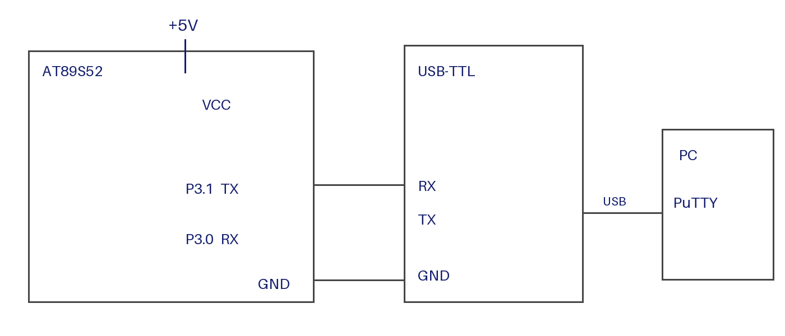

# EXPERIMENT DETAILS

**EXP:** CONTINUOUS LAB EVALUATION-6

**DATE:** 17/08/2026

**NAME OF EXP:** UART Initialization and Character Transmission

**HARDWARE SETUP / PLATFORM:** AT89S52 Development Board (11.0592 MHz crystal) + USB-to-TTL Converter + PC with PuTTY + Keil µVision

---

## 1. Circuit Diagram

The experiment transmits the string "Hello from 8051" continuously from the 8051 to a PC terminal through a USB-to-TTL converter.

* Microcontroller: AT89S52 (8051 core), 11.0592 MHz crystal
* Transmit Pin: P3.1 (TXD) connected to the RX input of the USB-to-TTL converter
* Common Ground: 8051 GND connected to converter GND
* Serial Settings: 9600 baud, 8 data bits, no parity, 1 stop bit (9600-8-N-1)
* Host: PC running PuTTY on the matching COM port
* Power Supply: 5V DC

---

## 2. Core Logic / Pseudocode / Code Base

**Working Principle:**
Timer 1 runs in Mode 2 (8-bit auto-reload) to generate the baud rate. The UART is set to Mode 1 (8-bit, variable baud). Each character is written to SBUF, and the program waits until the TI flag shows that the byte has been sent.

**Baud Rate Calculation:**

* Machine cycle (12-clock 8051): f = 11.0592 MHz / 12 = 921.6 kHz
* SMOD = 0, so baud = f / (32 × (256 − TH1))
* TH1 = 0xFD = 253: baud = 921600 / (32 × 3) = 9600

**Pseudocode:**

1. Include the 8051 register definition header file (`REGX51.H`).
2. Initialize the UART:
   1. Set Timer 1 to Mode 2 (`TMOD` upper nibble = 0x2).
   2. Load TH1 and TL1 with 0xFD for 9600 baud.
   3. Start Timer 1.
   4. Set the UART to Mode 1 with receive enabled (`SCON = 0x50`).
   5. Clear the TI and RI flags.
3. Repeat continuously:
   1. Send the string "Hello from 8051\r\n" one character at a time.
   2. Wait 500 ms.
4. To send a character, write it to SBUF and wait until TI is set, then clear TI.

**Code Base:**
The program is written in Embedded C using Keil C51.

* `REGX51.H` provides the 8051 special function register definitions.
* `uart_init()` sets Timer 1 to Mode 2 (`TMOD &= 0x0F; TMOD |= 0x20`), loads TH1 and TL1 with 0xFD, starts Timer 1 (`TR1 = 1`), configures the serial port (`SCON = 0x50`), and clears TI and RI.
* `uart_putchar()` writes one byte to SBUF and waits for TI to be set before clearing it.
* `uart_putstring()` sends a null-terminated string by calling `uart_putchar()` for each character.
* `delay_ms()` produces a software delay of approximately the requested number of milliseconds.
* `main()` initializes the UART and repeatedly transmits the message with a 500 ms interval.

---

## 3. Inference

The experiment shows that the 8051 can transmit serial data at 9600 baud by using Timer 1 as the baud rate generator and the UART in Mode 1. Transmission is confirmed by the message appearing in PuTTY on the PC.
