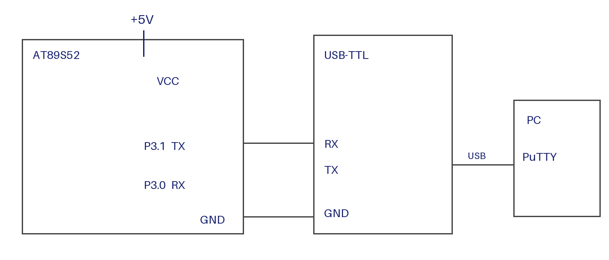

# EXPERIMENT DETAILS

**EXP:** CONTINUOUS LAB EVALUATION-6

**DATE:** 17/08/2026

**NAME OF EXP:** UART Echo using Polled Receive and Transmit

**HARDWARE SETUP / PLATFORM:** AT89S52 Development Board (11.0592 MHz crystal) + USB-to-TTL Converter + PC with PuTTY + Keil µVision

---

## 1. Circuit Diagram

The experiment receives each character typed in PuTTY on the 8051 and transmits the same character back to the PC.

* Microcontroller: AT89S52 (8051 core), 11.0592 MHz crystal
* Receive Pin: P3.0 (RXD) connected to the TX output of the USB-to-TTL converter
* Transmit Pin: P3.1 (TXD) connected to the RX input of the USB-to-TTL converter
* Common Ground: 8051 GND connected to converter GND
* Serial Settings: 9600 baud, 8 data bits, no parity, 1 stop bit (9600-8-N-1)
* Host: PC running PuTTY on the matching COM port
* Power Supply: 5V DC

---

## 2. Core Logic / Pseudocode / Code Base

**Working Principle:**
Timer 1 (Mode 2) generates 9600 baud, and the UART operates in Mode 1 with reception enabled. The program waits until the RI flag shows that a byte has arrived, reads SBUF, clears RI, and writes the same byte to SBUF for transmission. It then waits for TI before the next character.

**Baud Rate Calculation:**

* Machine cycle (12-clock 8051): f = 11.0592 MHz / 12 = 921.6 kHz
* SMOD = 0, so baud = f / (32 × (256 − TH1))
* TH1 = 0xFD = 253: baud = 921600 / (32 × 3) = 9600

**Pseudocode:**

1. Include the 8051 register definition header file (`REGX52.H`).
2. Initialize the UART:
   1. Set Timer 1 to Mode 2 (`TMOD` upper nibble = 0x2).
   2. Load TH1 and TL1 with 0xFD for 9600 baud.
   3. Start Timer 1.
   4. Set the UART to Mode 1 with reception enabled (`SCON = 0x50`).
   5. Clear the TI and RI flags.
3. Repeat continuously:
   1. Wait until RI is set, then read the received byte from SBUF and clear RI.
   2. Write the byte to SBUF and wait until TI is set, then clear TI.

**Code Base:**
The program is written in Embedded C using Keil C51.

* `REGX52.H` provides the 8052/8051 special function register definitions.
* `uart_init()` sets Timer 1 to Mode 2, loads TH1 and TL1 with 0xFD, starts Timer 1, configures the serial port (`SCON = 0x50`), and clears TI and RI.
* `uart_putchar()` writes one byte to SBUF and waits for TI to be set before clearing it.
* `uart_getchar()` waits for RI to be set, clears RI, and returns the byte in SBUF.
* `main()` initializes the UART and then repeatedly receives a character and transmits it back.

---

## 3. Inference

The experiment shows that the 8051 can receive and transmit serial data at 9600 baud in both directions. Each character typed in PuTTY is returned to the terminal unchanged, confirming correct UART configuration for reception and transmission.
