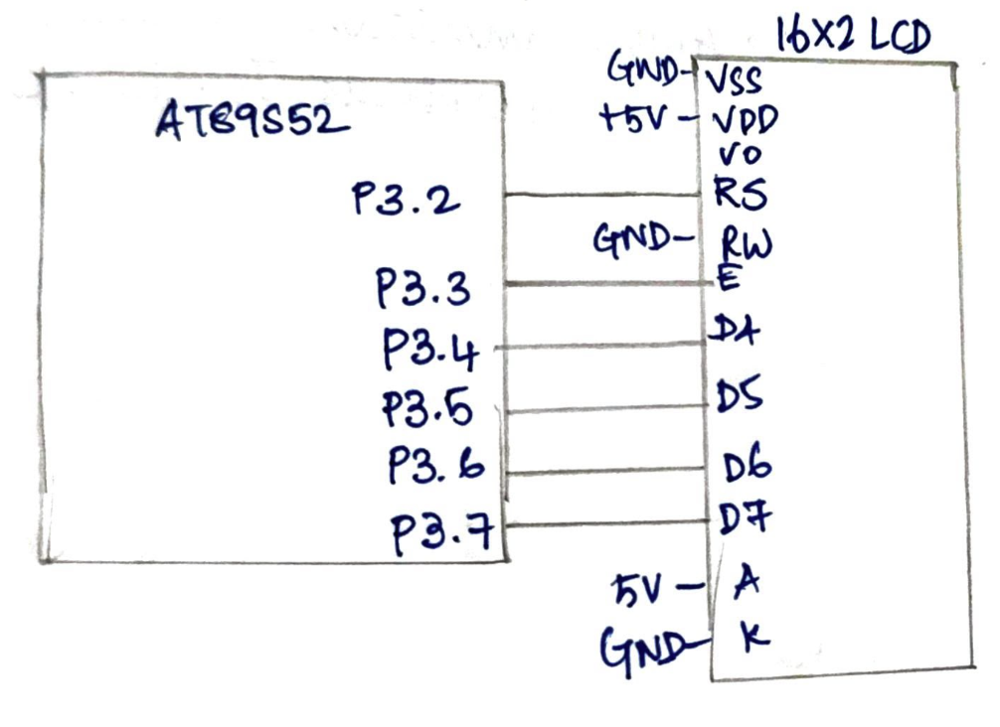

# CAT7 – Task 7A: LCD Initialization and Character/String Display

| Field | Details |
|---|---|
| **EXP** | CAT7 – Continuous Lab Evaluation-7 (25CS2741 Fundamentals of Internet of Things + Lab) |
| **DATE** | 24/08/2026 |
| **NAME OF EXP** | 16×2 LCD Driver Development and Dynamic Display Control |
| **HARDWARE SETUP / PLATFORM** | AT89S52 development board (8051 tool chain), Embedded C (Keil), 16×2 HD44780-compatible LCD in 4-bit mode, multimeter and DSO for hardware debug |
| **TASK NO** | Task 7A – LCD Initialization and Character/String Display |

## Aim

To develop a 4-bit GPIO-based LCD driver for the AT89S52 that initializes a 16×2 HD44780-compatible LCD in 4-bit, 2-line mode from the datasheet command sequence, using `lcd_init()`, `lcd_cmd()` and `lcd_data()`, and to display characters on the LCD, without using Arduino APIs, HAL libraries or RTOS services.

## Hardware Setup

**Platform:** AT89S52 (8051 family) development board

**Components:**
- AT89S52 development board
- 16×2 HD44780-compatible LCD module
- Connecting wires, power supply, multimeter and DSO

**Pin connections:**

| Pin | Connected to | Direction |
|---|---|---|
| P3.2 | LCD RS (register select) | Output |
| P3.3 | LCD E (enable) | Output |
| P3.4 | LCD D4 | Output |
| P3.5 | LCD D5 | Output |
| P3.6 | LCD D6 | Output |
| P3.7 | LCD D7 | Output |
| GND | LCD VSS, RW and K | Ground |
| +5 V | LCD VDD and A | Power |

The LCD is used in 4-bit mode, so D0 – D3 are not connected. RW is tied to GND, because the program only writes to the LCD.

## Circuit Diagram



## Core Logic / Pseudocode / Code Base

**LCD commands used (from the HD44780 datasheet):**

| Command | Meaning |
|---|---|
| `0x30` (three times) | Wake-up sequence, 8-bit interface |
| `0x20` | Switch the interface to 4-bit mode |
| `0x28` | Function set: 4-bit, 2 lines, 5×8 font |
| `0x08` | Display OFF |
| `0x01` | Clear display (needs about 2 ms) |
| `0x06` | Entry mode: cursor moves right, no display shift |
| `0x0F` | Display ON, cursor ON, blink ON |
| `0x04` | Entry mode: cursor moves left, no display shift |
| `0x85` | Set DDRAM address 0x05 (first row, sixth position) |

**Functions in the program:**
- `lcd_nibble(nib)` puts the upper nibble of `nib` on P3.4 – P3.7 (P3.0 – P3.3 are kept) and pulses E.
- `lcd_cmd(cmd)` sends a command with RS = 0, as the high nibble and then the low nibble.
- `lcd_data(dat)` sends a character with RS = 1, as the high nibble and then the low nibble.
- `lcd_init()` runs the datasheet initialization sequence.
- `delay_us(us)` and `delay_ms(ms)` are software delay loops.

```
main:
    lcd_init()
    lcd_cmd(0x04)                      // entry mode: cursor moves left
    lcd_cmd(0x85)                      // go to DDRAM address 0x05 (first row, sixth position)
    lcd_data('F'), lcd_data('I'), lcd_data('O'),
    lcd_data('T'), lcd_data('-'), lcd_data('A')
    loop forever                       // halt

lcd_init():
    RS = 0, EN = 0
    wait 50 ms
    send 0x30, wait 5 ms               // wake-up sequence
    send 0x30, wait 200 us
    send 0x30, wait 200 us
    send 0x20, wait 200 us             // switch to 4-bit mode
    lcd_cmd(0x28)                      // 4-bit, 2 lines, 5x8 font
    lcd_cmd(0x08)                      // display OFF
    lcd_cmd(0x01)                      // clear display
    lcd_cmd(0x06)                      // entry mode: cursor moves right
    lcd_cmd(0x0F)                      // display ON, cursor ON, blink ON

lcd_nibble(nib):
    P3.7..P3.4 = upper 4 bits of nib   // P3.3..P3.0 unchanged
    EN = 1, short delay, EN = 0, wait 50 us

lcd_cmd(cmd):
    RS = 0
    lcd_nibble(high nibble of cmd)
    lcd_nibble(low nibble of cmd)
    wait 2 ms if cmd is 0x01 or 0x02, otherwise wait 50 us

lcd_data(dat):
    RS = 1
    lcd_nibble(high nibble of dat)
    lcd_nibble(low nibble of dat)
    wait 50 us
```

**Header used:** `<reg51.h>` for the register definitions, with direct access to the P3 port.

**Timing:** all LCD timing comes from software delay loops, and the busy flag is not read.

## INFERENCE

The LCD was initialized in 4-bit, 2-line, 5×8 font mode using the datasheet wake-up sequence, followed by the function set, display, clear and entry mode commands. Every command and data byte was sent as two 4-bit transfers on P3.4 – P3.7, with RS on P3.2 selecting command or data and an enable pulse on P3.3. Before the text was written, the entry mode was changed to "cursor moves left" (`0x04`) and the cursor was placed at DDRAM address 0x05. The characters `F I O T - A` were therefore written from right to left, and they appear in reverse order across the first six positions of the first row. The driver uses only register-level access, with no Arduino APIs, HAL libraries or RTOS.
