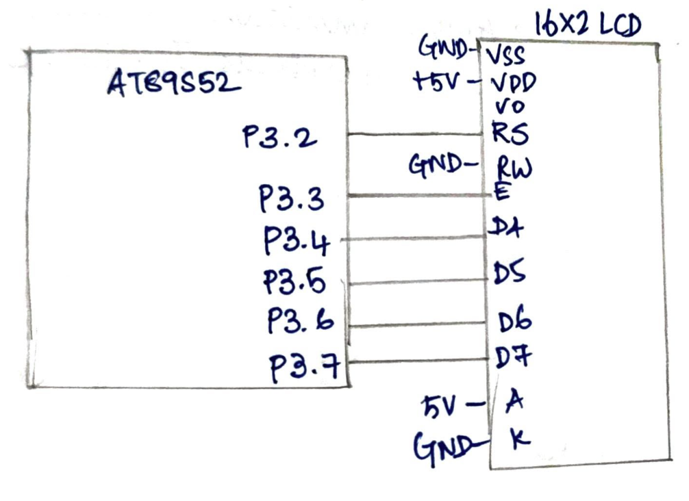

# CAT7 – Task 7B: Cursor Positioning and Dynamic Value Update

| Field | Details |
|---|---|
| **EXP** | CAT7 – Continuous Lab Evaluation-7 (25CS2741 Fundamentals of Internet of Things + Lab) |
| **DATE** | 24/08/2026 |
| **NAME OF EXP** | 16×2 LCD Driver Development and Dynamic Display Control |
| **HARDWARE SETUP / PLATFORM** | AT89S52 development board (8051 tool chain), Embedded C (Keil), 16×2 HD44780-compatible LCD in 4-bit mode, multimeter and DSO for hardware debug |
| **TASK NO** | Task 7B – Cursor Positioning and Dynamic Value Update |

## Aim

To develop LCD cursor-positioning and data-update functions for a 16×2 HD44780-compatible LCD on the AT89S52, so that a character can be displayed at any chosen row and column, without using Arduino APIs, HAL libraries or RTOS services.

## Hardware Setup

**Platform:** AT89S52 (8051 family) development board

**Components:**
- AT89S52 development board
- 16×2 HD44780-compatible LCD module
- Connecting wires, power supply, multimeter and DSO

**Pin connections:**

| Pin | Connected to | Direction |
|---|---|---|
| P3.2 | LCD RS (register select) | Output |
| P3.3 | LCD E (enable) | Output |
| P3.4 | LCD D4 | Output |
| P3.5 | LCD D5 | Output |
| P3.6 | LCD D6 | Output |
| P3.7 | LCD D7 | Output |
| GND | LCD VSS, RW and K | Ground |
| +5 V | LCD VDD and A | Power |

The LCD is used in 4-bit mode, so D0 – D3 are not connected. RW is tied to GND, because the program only writes to the LCD.

## Circuit Diagram



## Core Logic / Pseudocode / Code Base

**Cursor positioning:** the LCD controller keeps the characters in DDRAM. The first row starts at address 0x00 and the second row at 0x40, and the command to set the address is `0x80 | address`.

| Row | Command sent by `lcd_goto(row, col)` |
|---|---|
| 0 (first row) | `0x80 + col` |
| 1 (second row) | `0xC0 + col` |

**LCD initialization commands:**

| Command | Meaning |
|---|---|
| `0x03` (three times), then `0x02` | Wake-up sequence, then switch to 4-bit mode |
| `0x28` | Function set: 4-bit, 2 lines, 5×8 font |
| `0x0C` | Display ON, cursor OFF, blink OFF |
| `0x06` | Entry mode: cursor moves right, no display shift |
| `0x01` | Clear display (needs about 2 ms) |

**Functions in the program:**
- `lcd_write_nibble(nibble)` sets D4 – D7 (P3.4 – P3.7) from the 4-bit value and pulses E.
- `lcd_cmd(cmd)` sends a command with RS = 0, as the high nibble and then the low nibble.
- `lcd_data(dat)` sends a character with RS = 1, as the high nibble and then the low nibble.
- `lcd_init()` runs the datasheet initialization sequence.
- `lcd_goto(row, col)` moves the cursor to the given row (0 or 1) and column (0 to 15).
- `delay_us(us)` and `delay_ms(ms)` are software delay loops.

```
main:
    CHAR_TO_DISPLAY = 'A', ROW = 0, COL = 3     // values that can be changed
    lcd_init()
    lcd_goto(ROW, COL)
    lcd_data(CHAR_TO_DISPLAY)
    loop forever                                // halt

lcd_init():
    wait 20 ms, RS = 0
    send 0x03, wait 5 ms                        // wake-up sequence
    send 0x03, wait 150 us
    send 0x03, wait 150 us
    send 0x02, wait 150 us                      // switch to 4-bit mode
    lcd_cmd(0x28)                               // 4-bit, 2 lines, 5x8 font
    lcd_cmd(0x0C)                               // display ON, cursor OFF
    lcd_cmd(0x06)                               // entry mode: cursor moves right
    lcd_cmd(0x01), wait 2 ms                    // clear display

lcd_goto(row, col):
    if row = 0: address = 0x80 + col
    else:       address = 0xC0 + col
    lcd_cmd(address)

lcd_write_nibble(n):
    D4..D7 = bits 0..3 of n
    E = 1, short delay, E = 0, wait 50 us

lcd_cmd(cmd):
    RS = 0
    lcd_write_nibble(high nibble of cmd)
    lcd_write_nibble(low nibble of cmd)
    wait 2 ms if cmd is 0x01 or 0x02, otherwise wait 50 us

lcd_data(dat):
    RS = 1
    lcd_write_nibble(high nibble of dat)
    lcd_write_nibble(low nibble of dat)
    wait 50 us
```

**Header used:** `<reg52.h>` for the register definitions, with the LCD pins defined as individual port bits (RS = P3.2, E = P3.3, D4 – D7 = P3.4 – P3.7).

**Timing:** all LCD timing comes from software delay loops, and the busy flag is not read.

## INFERENCE

The LCD was initialized in 4-bit, 2-line mode with the display on and the cursor off, and the cursor-positioning function `lcd_goto(row, col)` converted a row and column into a DDRAM address and sent it as a command. A character written after it appeared at that position. With `ROW = 0` and `COL = 3`, the character `A` appeared in the first row at the fourth position, and changing the two values moved it to any other position on the 16×2 display. Commands and data were sent as two 4-bit transfers on P3.4 – P3.7, with RS selecting command or data. The driver uses only register-level access, with no Arduino APIs, HAL libraries or RTOS.
