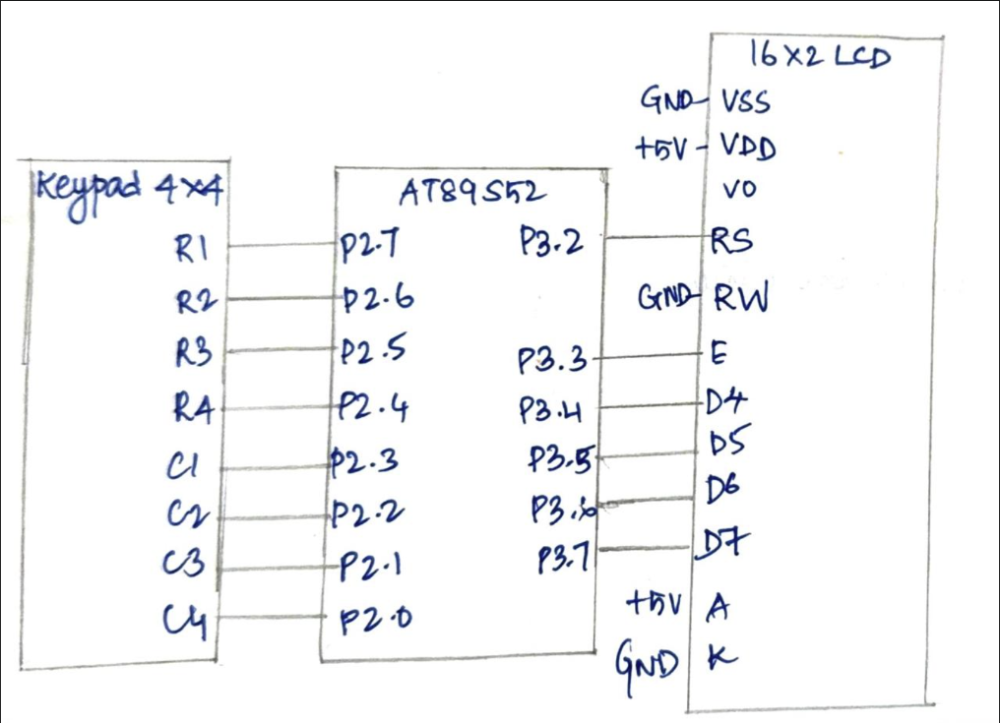

# CAT7 – Task 7C: 4×4 Keypad-Based Character Movement

| Field | Details |
|---|---|
| **EXP** | CAT7 – Continuous Lab Evaluation-7 (25CS2741 Fundamentals of Internet of Things + Lab) |
| **DATE** | 24/08/2026 |
| **NAME OF EXP** | 16×2 LCD Driver Development and Dynamic Display Control |
| **HARDWARE SETUP / PLATFORM** | AT89S52 development board (8051 tool chain), Embedded C (Keil), 16×2 HD44780-compatible LCD in 4-bit mode, 4×4 matrix keypad, multimeter and DSO for hardware debug |
| **TASK NO** | Task 7C – 4×4 Keypad-Based Character Movement |

## Aim

To build an interactive LCD application in which a character is moved across the 16×2 display using a 4×4 keypad: key 2 moves it up, key 8 down, key 4 left and key 6 right. The program uses direct register access, without Arduino APIs, HAL libraries or RTOS services.

## Hardware Setup

**Platform:** AT89S52 (8051 family) development board

**Components:**
- AT89S52 development board
- 16×2 HD44780-compatible LCD module
- 4×4 matrix keypad
- Connecting wires, power supply, multimeter and DSO

**Pin connections:**

| Pin | Connected to | Direction |
|---|---|---|
| P3.2 | LCD RS (register select) | Output |
| P3.3 | LCD E (enable) | Output |
| P3.4 – P3.7 | LCD D4 – D7 | Output |
| P2.7, P2.6, P2.5, P2.4 | Keypad rows R1 – R4 (driven low one at a time) | Output |
| P2.3, P2.2, P2.1, P2.0 | Keypad columns C1 – C4 (read back) | Input |
| GND | LCD VSS, RW and K | Ground |
| +5 V | LCD VDD and A | Power |

The LCD is used in 4-bit mode, so D0 – D3 are not connected. RW is tied to GND, because the program only writes to the LCD.

## Circuit Diagram



## Core Logic / Pseudocode / Code Base

**Key actions:**

| Key | Action |
|---|---|
| 2 | Move up (row 0 is the top row) |
| 8 | Move down (row 1 is the bottom row) |
| 4 | Move left (column 0 is the left edge) |
| 6 | Move right (column 15 is the right edge) |
| Other keys | Ignored |

**Keypad map** (`keymap[row][column]`):

| Row (pin) | C1 (P2.3) | C2 (P2.2) | C3 (P2.1) | C4 (P2.0) |
|---|---|---|---|---|
| R1 (P2.7) | 1 | 2 | 3 | A |
| R2 (P2.6) | 4 | 5 | 6 | B |
| R3 (P2.5) | 7 | 8 | 9 | C |
| R4 (P2.4) | * | 0 | # | D |

**Functions in the program:**
- The LCD driver (`lcd_init()`, `lcd_cmd()`, `lcd_data()`, `lcd_goto()`) is the same as in Tasks 7A and 7B, using 4-bit mode with RS on P3.2, E on P3.3 and D4 – D7 on P3.4 – P3.7.
- `keypad_scan()` drives each row low in turn, reads the columns and returns the pressed key, or 0 if no key is pressed.
- `wait_key_release()` waits until the key is released.
- `delay_us(us)` and `delay_ms(ms)` are software delay loops.

```
main:
    row = 0, col = 0
    lcd_init()
    lcd_goto(row, col), lcd_data('*')          // initial marker

    loop forever:
        key = keypad_scan()
        if key is not 0:
            lcd_goto(row, col), lcd_data(' ')  // erase the marker
            switch (key):
                '2': if row > 0:  row = row - 1        // up
                '8': if row < 1:  row = row + 1        // down
                '4': if col > 0:  col = col - 1        // left
                '6': if col < 15: col = col + 1        // right
                other keys: ignored
            lcd_goto(row, col), lcd_data('*')  // redraw the marker
            wait_key_release()

keypad_scan():
    for each row 0 to 3:
        P2 = 0xFF
        drive this row low (P2.7, P2.6, P2.5 or P2.4)
        colval = P2 & 0x0F                     // read the column bits
        if colval is not 0x0F:                 // a column is pulled low
            wait 15 ms                         // debounce
            colval = P2 & 0x0F
            if colval is not 0x0F:
                return keymap[row][column that is low]
    return 0                                   // no key pressed

wait_key_release():
    while keypad_scan() is not 0: wait
    wait 15 ms
```

**Debouncing:** a key is accepted only if a column is still low after a 15 ms delay. After the marker moves, the program waits until the key is released, so one press moves the marker by exactly one position.

**Header used:** `<reg52.h>` for the register definitions. The keypad is polled and no interrupt is used.

## INFERENCE

The keypad on P2 was scanned by driving one of the rows P2.7 – P2.4 low at a time and reading the columns P2.3 – P2.0, with a 15 ms debounce. The marker `*` started at the top left of the LCD, and keys 2, 8, 4 and 6 moved it up, down, left and right. The marker stopped at the edges of the 16×2 display (rows 0 – 1 and columns 0 – 15). The old position was erased with a space before the marker was redrawn at the new position, using `lcd_goto()` to place the cursor. Waiting for the key release made each press move the marker by exactly one position. The program uses only register-level access, with no Arduino APIs, HAL libraries or RTOS.
