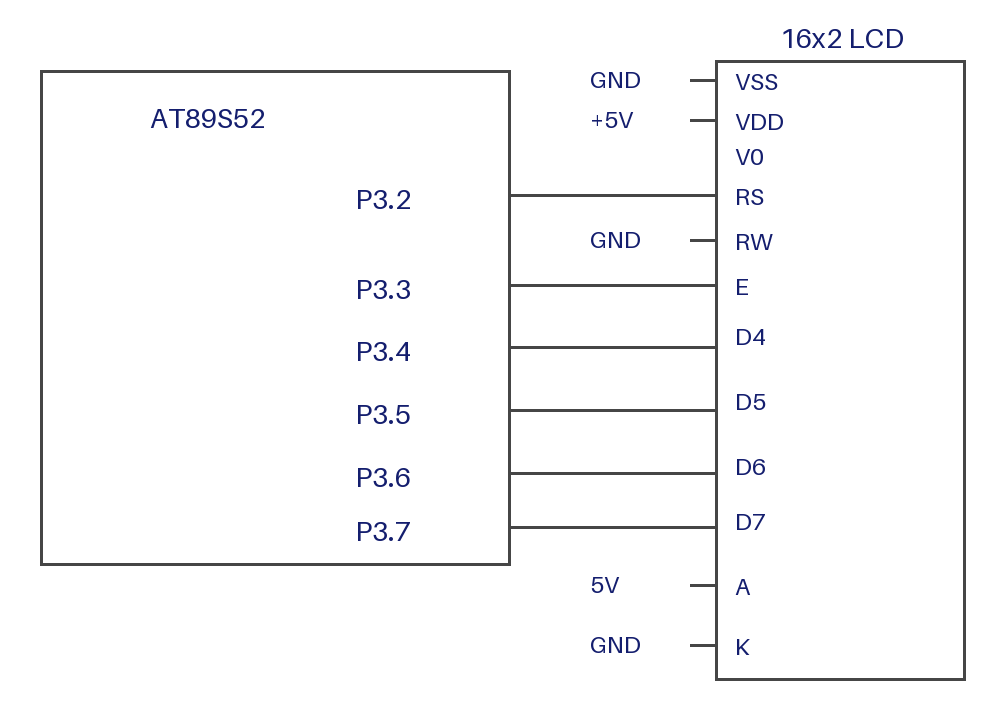

# EXPERIMENT DETAILS

**EXP:** CONTINUOUS LAB EVALUATION-7

**DATE:** 24/08/2026

**NAME OF EXP:** 4-bit LCD Initialization and Character Display

**HARDWARE SETUP / PLATFORM:** AT89S52 Development Board + 16x2 HD44780-Compatible LCD + Keil µVision

---

## 1. Circuit Diagram

The experiment initializes a 16x2 character LCD in 4-bit mode and displays characters on the first row.

* Microcontroller: AT89S52 (8051 core)
* LCD: 16x2 HD44780-compatible, 4-bit interface
* Data Lines: D4 to D7 on P3.4 to P3.7 (upper nibble of Port 3)
* Register Select (RS): P3.2
* Enable (EN): P3.3
* R/W: tied to GND (write-only operation)
* Contrast: variable resistor on the LCD VO pin
* Power Supply: 5V DC

---

## 2. Core Logic / Pseudocode / Code Base

**Working Principle:**
Each byte is sent as two 4-bit nibbles on P3.4 to P3.7, latched by a pulse on EN. RS selects command (0) or data (1).

**Initialization Sequence:**

* Wait 50 ms after power-up.
* Send 0x3 three times, with the required delays between them.
* Send 0x2 to enter 4-bit mode.
* Function set: 0x28 (4-bit, 2 lines, 5x8 font).
* Display on/off: 0x08 (display off).
* Clear display: 0x01 (2 ms delay).
* Entry mode: 0x06 (cursor increments, no shift).
* Display on: 0x0F (display on, cursor on, blink on).

**Pseudocode:**

1. Include the 8051 register definition header file (`reg51.h`).
2. Define RS on P3.2, EN on P3.3, and the LCD data port as P3.
3. Create delay functions for microseconds and milliseconds.
4. Create `lcd_nibble()` to place the upper nibble on P3.4 to P3.7 without changing P3.0 to P3.3, pulse EN, and wait.
5. Create `lcd_cmd()` to send a command with RS = 0, as two nibbles.
6. Create `lcd_data()` to send a character with RS = 1, as two nibbles.
7. In `lcd_init()`, run the initialization sequence above.
8. In `main()`:
   1. Call `lcd_init()`.
   2. Set entry mode to increment (0x06).
   3. Move the cursor to row 1, column 6 (address 0x85).
   4. Send the characters F, I, O, T, −, and A in order.
9. Loop indefinitely.

**Code Base:**
The program is written in Embedded C using Keil C51.

* `reg51.h` provides the 8051 register definitions.
* `sbit RS = P3^2` and `sbit EN = P3^3` assign the control lines.
* `#define LCD_PORT P3` assigns the data lines to Port 3.
* `delay_us()` and `delay_ms()` provide software delays for LCD timing.
* `lcd_nibble()` writes the upper nibble to P3.4 to P3.7, leaves the lower four bits unchanged, pulses EN, and waits 50 µs.
* `lcd_cmd()` sends a command as two nibbles with RS = 0. Commands 0x01 and 0x02 are followed by a 2 ms delay, and all others by 50 µs.
* `lcd_data()` sends a character as two nibbles with RS = 1.
* `lcd_init()` performs the 4-bit initialization sequence and sets the display configuration.
* `main()` initializes the LCD, sets the entry mode, moves the cursor to address 0x85, and displays "FIOT-A" one character at a time.

---

## 3. Inference

The experiment shows that a 16x2 LCD can be driven in 4-bit mode using only four data lines and two control lines. The program demonstrates the HD44780 initialization sequence, command and data transfer through nibbles, cursor positioning through DDRAM addresses, and character display on the 8051 microcontroller.
