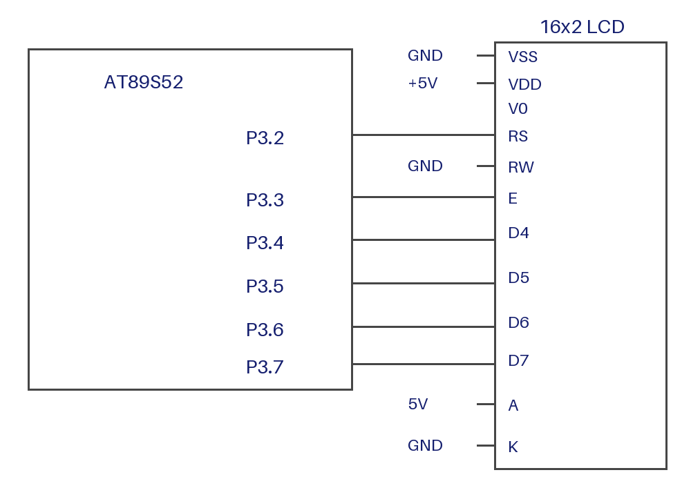

# EXPERIMENT DETAILS

**EXP:** CONTINUOUS LAB EVALUATION-7

**DATE:** 24/08/2026

**NAME OF EXP:** Cursor Positioning and Character Display

**HARDWARE SETUP / PLATFORM:** AT89S52 Development Board + 16x2 HD44780-Compatible LCD + Keil µVision

---

## 1. Circuit Diagram

* Microcontroller: AT89S52 (8051 core)
* LCD: 16x2 HD44780-compatible, 4-bit interface
* RS: P3.2
* EN: P3.3
* D4 to D7: P3.4 to P3.7
* R/W: GND (write-only)
* Contrast: variable resistor on VO
* Power Supply: 5V DC

---

## 2. Core Logic / Pseudocode / Code Base

**Working Principle:**
`lcd_goto()` sets the DDRAM address: 0x80 + column for row 0, 0xC0 + column for row 1. `lcd_data()` writes one character at the current address, and the cursor then advances by one.

**Pseudocode:**

1. Include `reg52.h`.
2. Define RS, E, and D4 to D7 on P3.
3. Initialize the LCD in 4-bit mode: 0x28 (2 lines, 5x8), 0x0C (display on), 0x06 (increment), 0x01 (clear).
4. In `main()`:
   1. Set CHAR_TO_DISPLAY, ROW, and COL.
   2. Call `lcd_goto(ROW, COL)`.
   3. Call `lcd_data(CHAR_TO_DISPLAY)`.
5. Halt.

**Code Base:**
The program is written in Embedded C using Keil C51.

* `lcd_write_nibble()` places 4 bits on D4 to D7, pulses E, and waits.
* `lcd_cmd()` sends a command with RS = 0 as two nibbles. Commands 0x01 and 0x02 are followed by a 2 ms delay.
* `lcd_data()` sends a character with RS = 1 as two nibbles.
* `lcd_init()` runs the 4-bit initialization sequence.
* `lcd_goto(row, col)` sends 0x80 + col for row 0 or 0xC0 + col for row 1.
* `main()` displays one character at the position set by ROW and COL.

**Example:** ROW = 0, COL = 3, CHAR_TO_DISPLAY = 'A' → address 0x83, displays "A" at row 1, column 4.

---

## 3. Inference

The experiment shows that the LCD cursor can be placed at any row and column by setting the DDRAM address, and that a character is written at the cursor position.
