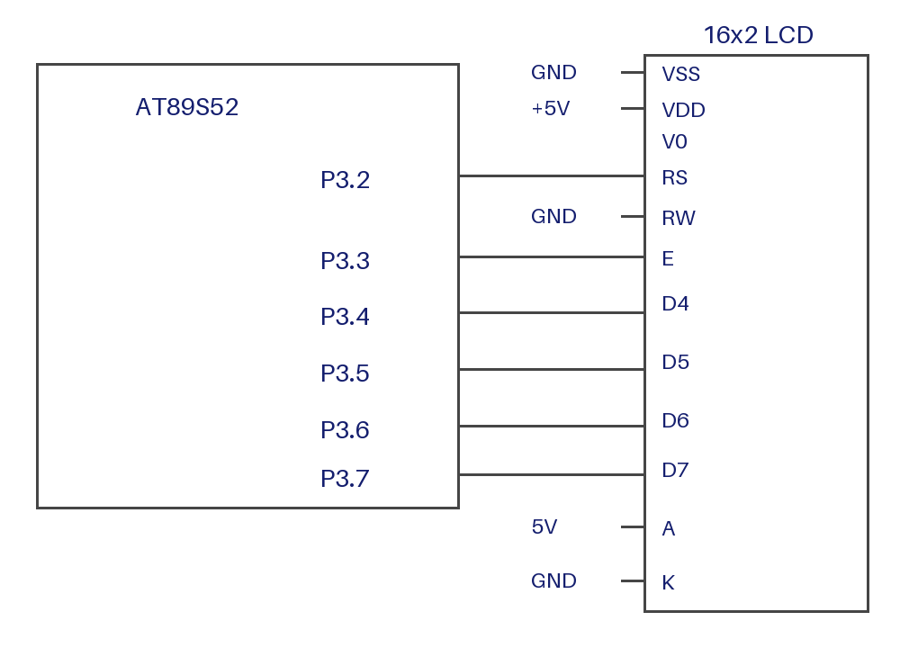

# EXPERIMENT DETAILS

**EXP:** CONTINUOUS LAB EVALUATION-7

**DATE:** 24/08/2026

**NAME OF EXP:** Keypad-Controlled Cursor Movement on 16x2 LCD

**HARDWARE SETUP / PLATFORM:** AT89S52 Development Board + 4x4 Matrix Keypad + 16x2 HD44780-Compatible LCD + Keil µVision

---

## 1. Circuit Diagram

* Microcontroller: AT89S52 (8051 core)
* LCD: 16x2 HD44780-compatible, 4-bit interface
* LCD RS: P3.2, EN: P3.3, D4 to D7: P3.4 to P3.7, R/W: GND
* Keypad Rows: R1 to R4 on P2.7, P2.6, P2.5, P2.4 (driven low one at a time)
* Keypad Columns: C1 to C4 on P2.3, P2.2, P2.1, P2.0 (read as inputs, internal pull-ups)
* Power Supply: 5V DC

**Keypad Functions:**

| Key | Action |
|:---:|:---|
| 2 | Move Up (row 0) |
| 8 | Move Down (row 1) |
| 4 | Move Left (column − 1) |
| 6 | Move Right (column + 1) |

---

## 2. Core Logic / Pseudocode / Code Base

**Working Principle:**
Keypad rows are driven low one at a time, and the columns are read. A low column identifies the pressed key. The key moves a `*` marker on the LCD: the marker is erased at its current position, the position is updated within the limits (row 0 to 1, column 0 to 15), and the marker is redrawn. A 15 ms debounce is applied, and the program waits for release before the next key.

**Pseudocode:**

1. Include `reg52.h`.
2. Define the LCD pins and the 4x4 key map.
3. Initialize the LCD and set row = 0, column = 0.
4. Draw `*` at (row, column).
5. Repeat:
   1. Scan the keypad. If a key is pressed:
      1. Erase `*` at (row, column).
      2. Update row or column for keys 2, 8, 4, 6, if within limits.
      3. Draw `*` at the new (row, column).
      4. Wait until the key is released.

**Code Base:**
The program is written in Embedded C using Keil C51.

* `lcd_write_nibble()`, `lcd_cmd()`, `lcd_data()`, `lcd_init()`, and `lcd_goto()` drive the 4-bit LCD (same as Task 7B).
* `keymap[4][4]` maps each row and column to its key character.
* `row_mask[4]` holds the P2 bit for each row (0x80, 0x40, 0x20, 0x10).
* `keypad_scan()` sets P2 high, drives one row low, reads P2.0 to P2.3, debounces for 15 ms, and returns the key character or 0 if no key is pressed.
* `wait_key_release()` repeats the scan until no key is pressed, then waits 15 ms.
* `main()` runs the cursor-movement loop described in the working principle.

---

## 3. Inference

The experiment shows that a 4x4 matrix keypad can be scanned with row-driven and column-read logic, and that the key result can control the cursor position on an LCD. Bounds checking keeps the marker within the 16x2 display.
