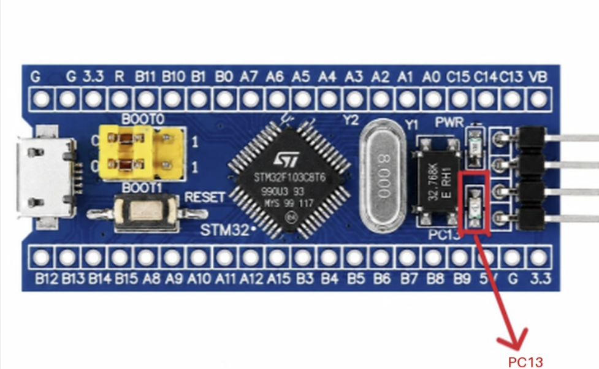

# EXPERIMENT DETAILS

**EXP:** CONTINUOUS LAB EVALUATION-8

**DATE:** 18/09/2026

**NAME OF EXP:** STM32 GPIO Bring-Up and Switch-Controlled LED

**HARDWARE SETUP / PLATFORM:** CubeMX + Keil MDK + STM32 Development Board (STM32F103C8T6) + Push-Button + LED

**TASK NO:** Task 8A – GPIO Input/Output (the LED follows the switch state)

---

## 1. Circuit Diagram

The experiment uses a push-button as input and an external LED as output. The firmware reads the button continuously and drives the LED so that it always follows the state of the button.

* Microcontroller: STM32F103C8T6 development board (Blue Pill), 72 MHz system clock from the 8 MHz crystal (HSE) through the PLL (x9)
* Input: push-button on PB12 to GND, using the internal pull-up (pressed = LOW)
* Output: external LED on PB10 through a series resistor (LED ON when PB10 = LOW, LED OFF when PB10 = HIGH)
* Power Supply: 5V via USB

---

## 2. Core Logic / Pseudocode / Code Base

**Working Principle:**
PB12 is read continuously inside the main loop. While the button is pressed (PB12 reads LOW) the LED on PB10 is switched ON, and as soon as the button is released (PB12 reads HIGH because of the internal pull-up) the LED is switched OFF. No state is stored, so the LED simply mirrors the switch.

**Pseudocode:**

1. Initialize the HAL library and system clock (HSE + PLL, 72 MHz).
2. Enable the GPIO port clocks (GPIOA, GPIOB, GPIOD).
3. Configure PB12 as an input with pull-up and PB10 as a push-pull output (low speed).
4. Repeat continuously:
   1. Read PB12.
   2. If PB12 is LOW (button pressed), set PB10 LOW (LED ON).
   3. Otherwise (button released), set PB10 HIGH (LED OFF).

**Code Base:**
The program is written in C using the STM32 HAL library and generated with STM32CubeMX.

* `HAL_GPIO_ReadPin(GPIOB, GPIO_PIN_12)` returns GPIO_PIN_RESET when the button is pressed.
* `HAL_GPIO_WritePin(GPIOB, GPIO_PIN_10, GPIO_PIN_RESET)` turns the LED ON (active-low).
* `HAL_GPIO_WritePin(GPIOB, GPIO_PIN_10, GPIO_PIN_SET)` turns the LED OFF.
* `MX_GPIO_Init()` configures PB12 as input with pull-up (`GPIO_PULLUP`) and PB10 as push-pull output (`GPIO_MODE_OUTPUT_PP`, low speed).
* `SystemClock_Config()` sets HSE on with PLL x9 as the system clock (72 MHz), AHB = 72 MHz, APB1 = 36 MHz, APB2 = 72 MHz, with 2 flash wait states.

**Pin Summary:**

| Pin  | Mode                  | Function                          |
|------|-----------------------|-----------------------------------|
| PB12 | Input, internal pull-up | Push-button (pressed = LOW)     |
| PB10 | Output, push-pull     | External LED (LOW = ON, HIGH = OFF) |

---

## 3. Inference

The LED follows the push-button directly: it is ON for exactly as long as the button is held and turns OFF when the button is released. The internal pull-up keeps PB12 at a defined HIGH level when the button is open, so no external pull-up resistor is needed and the input never floats. This demonstrates basic GPIO configuration, reading a digital input and driving a digital output using STM32 HAL functions, and forms the base for the later tasks (toggle with debounce in Task 8B and short/long press detection in Task 8C).
