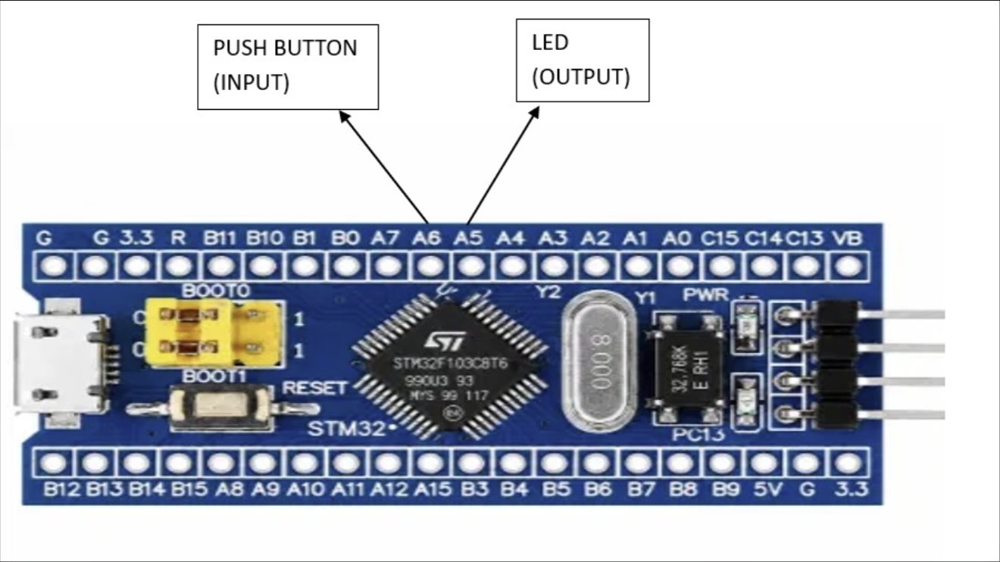

# EXPERIMENT DETAILS

**EXP:** CONTINUOUS LAB EVALUATION-8

**DATE:** 18/09/2026

**NAME OF EXP:** STM32 GPIO Bring-Up and Switch-Controlled LED

**HARDWARE SETUP / PLATFORM:** CubeMX + Keil MDK + STM32 Development Board (STM32F103C8T6) + Push-Button + LED

**TASK NO:** Task 8B – Event-Based Control (each valid switch press toggles the LED, switch bounce handled in software)

---

## 1. Circuit Diagram

The experiment uses a push-button as input and an external LED as output. Each valid press of the button toggles the LED, and a software debounce makes sure that one press produces exactly one toggle.

* Microcontroller: STM32F103C8T6 development board (Blue Pill), 72 MHz system clock from the 8 MHz crystal (HSE) through the PLL (x9)
* Input: push-button on PA6 to GND, using the internal pull-up (pressed = LOW)
* Output: external LED on PB0 through a series resistor to GND (HIGH = ON)
* Power Supply: 5V via USB

---

## 2. Core Logic / Pseudocode / Code Base

**Working Principle:**
PA6 is read continuously. A change of the button level is accepted only after it has stayed the same for 30 ms (software debounce), so contact bounce is ignored. Every accepted press toggles the LED on PB0, and releasing the button does nothing. The LED is OFF at start-up.

**Pseudocode:**

1. Initialize the HAL library and system clock (HSE + PLL, 72 MHz).
2. Configure PA6 as an input with pull-up and PB0 as a push-pull output.
3. Set PB0 LOW (LED off). Set `raw_prev = 0`, `stable = 0`.
4. Repeat continuously:
   1. Read the time `now` with `HAL_GetTick()` and read PA6 (`raw = 1` when PA6 is LOW, i.e. pressed).
   2. If `raw` differs from `raw_prev`, save `raw_prev = raw` and note the change time `t_change = now`.
   3. If `raw` differs from `stable` and the level has been steady for at least 30 ms (`now - t_change >= DEBOUNCE_MS`):
      1. Set `stable = raw`.
      2. If `stable` is 1 (button pressed), toggle PB0.

**Code Base:**
The program is written in C using the STM32 HAL library and generated with STM32CubeMX.

* `DEBOUNCE_MS` is defined as 30 (milliseconds).
* `HAL_GPIO_ReadPin(GPIOA, GPIO_PIN_6)` returns GPIO_PIN_RESET when the button is pressed.
* `HAL_GetTick()` returns the millisecond tick count, so the debounce time is measured without blocking the loop (no `HAL_Delay`).
* `HAL_GPIO_TogglePin(GPIOB, GPIO_PIN_0)` toggles the LED on every accepted press.
* `MX_GPIO_Init()` configures PA6 as input with pull-up and PB0 as push-pull output (low speed).
* `SystemClock_Config()` sets HSE on with PLL x9 as the system clock (72 MHz).

---

## 3. Inference

The LED toggles exactly once for every button press and keeps its state after the button is released, unlike Task A where the LED followed the button directly. The 30 ms debounce check accepts a level change only after it has been stable, so contact bounce does not cause extra toggles. Because the debounce time is measured with `HAL_GetTick()` instead of a blocking delay, the main loop keeps running while it waits. This demonstrates GPIO input reading, software debouncing and output toggling using STM32 HAL functions.
