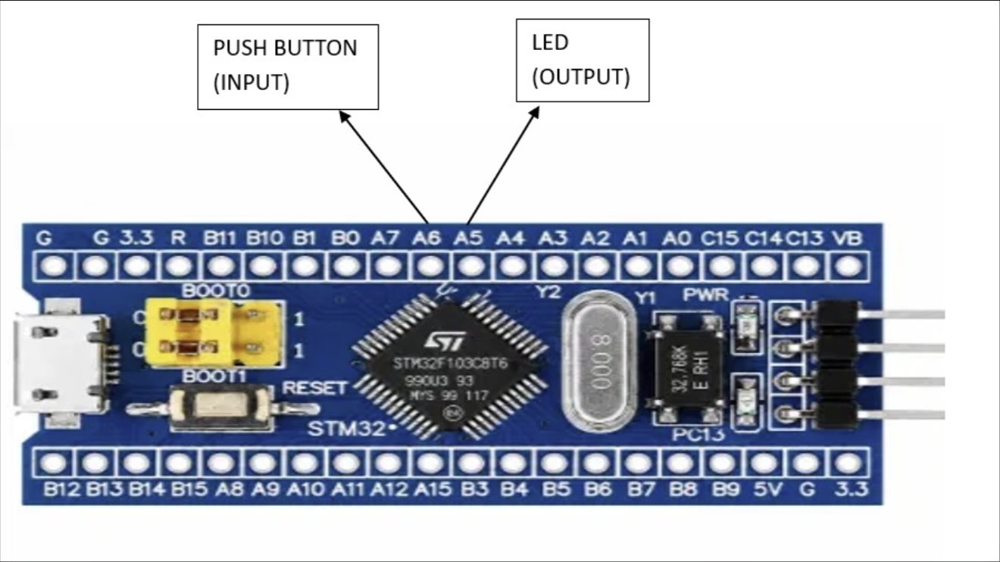

# EXPERIMENT DETAILS

**EXP:** CONTINUOUS LAB EVALUATION-8

**DATE:** 18/09/2026

**NAME OF EXP:** STM32 GPIO Bring-Up and Switch-Controlled LED

**HARDWARE SETUP / PLATFORM:** CubeMX + Keil MDK + STM32 Development Board (STM32F103C8T6) + Push-Button + LED

**TASK NO:** Task 8C – Short Press vs Long Press (a short press toggles the LED, a long press starts continuous blinking, press duration measured without a blocking delay)

---

## 1. Circuit Diagram

The experiment uses a push-button as input and an external LED as output. The firmware measures how long the button is held and responds differently to a short press and a long press.

* Microcontroller: STM32F103C8T6 development board (Blue Pill), 72 MHz system clock from the 8 MHz crystal (HSE) through the PLL (x9)
* Input: push-button on PA6 to GND, using the internal pull-up (pressed = LOW)
* Output: external LED on PB0 through a 330 ohm series resistor to GND (HIGH = ON)
* Power Supply: 5V via USB

| Component | Connection |
|---|---|
| Push-button, pin 1 | PA6 (`BTN`) |
| Push-button, pin 2 | GND |
| PB0 (`LED`) | 330 ohm resistor, then LED anode (+) |
| LED cathode (-) | GND |

---

## 2. Core Logic / Pseudocode / Code Base

**Working Principle:**
PA6 is read continuously and debounced in software: a change of the button level is accepted only after it has stayed the same for 30 ms. When a press is accepted, its start time is recorded. When the button is released, the press duration (release time minus start time) is calculated and classified. No blocking delay is used to decide between short and long press, so the loop keeps running while the button is held.

| User action | System response |
|---|---|
| Short press (< 1 s) | Toggle LED |
| Long press (>= 1 s) | LED enters continuous blinking mode (250 ms toggle) |
| Next short press | Stop blinking (LED turned OFF) |
| Long press again | Return to blinking mode |

The LED is OFF at start-up and the program starts in steady mode (`MODE_STEADY`).

**Pseudocode:**

1. Initialize the HAL library and system clock (HSE + PLL, 72 MHz).
2. Configure PA6 as an input with pull-up and PB0 as a push-pull output.
3. Set PB0 LOW (LED off). Set `mode = MODE_STEADY`, `raw_prev = 0`, `stable = 0`.
4. Repeat continuously:
   1. Read the time `now` with `HAL_GetTick()` and read PA6 (`raw = 1` when PA6 is LOW, i.e. pressed).
   2. If `raw` differs from `raw_prev`, save `raw_prev = raw` and note the change time `t_change = now`.
   3. If `raw` differs from `stable` and the level has been steady for at least 30 ms (`now - t_change >= DEBOUNCE_MS`):
      1. Set `stable = raw`.
      2. If `stable` is 1 (button pressed), record the press start time `t_press = t_change`.
      3. Otherwise (button released), calculate `duration = t_change - t_press`:
         * If `duration >= LONG_PRESS_MS` (1000 ms): set `mode = MODE_BLINK` and `t_blink = now`.
         * Else (short press): if `mode == MODE_BLINK`, set `mode = MODE_STEADY` and turn the LED OFF; otherwise toggle the LED.
   4. If `mode == MODE_BLINK` and `now - t_blink >= BLINK_MS` (250 ms), set `t_blink = now` and toggle PB0.

**Code Base:**
The program is written in C using the STM32 HAL library and generated with STM32CubeMX.

* `LedMode` is an enum with two states: `MODE_STEADY` and `MODE_BLINK`.
* `DEBOUNCE_MS` = 30, `LONG_PRESS_MS` = 1000 and `BLINK_MS` = 250 (all in milliseconds).
* `HAL_GPIO_ReadPin(GPIOA, GPIO_PIN_6)` returns GPIO_PIN_RESET when the button is pressed.
* `HAL_GetTick()` is the millisecond time base used for debouncing, for measuring the press duration and for the blink timing, so `HAL_Delay()` is never used.
* `HAL_GPIO_TogglePin(GPIOB, GPIO_PIN_0)` toggles the LED on a short press and on every blink interval.
* `HAL_GPIO_WritePin(GPIOB, GPIO_PIN_0, GPIO_PIN_RESET)` switches the LED off at start-up and when blinking is stopped.
* `MX_GPIO_Init()` configures PA6 as input with pull-up and PB0 as push-pull output (low speed).
* `SystemClock_Config()` sets HSE on with PLL x9 as the system clock (72 MHz).

**Note:** A long press is recognized when the button is released, because the duration is only known at that moment. Blinking therefore starts on release, not after one second of holding.

---

## 3. Inference

A quick tap toggles the LED, while holding the button for one second or more and releasing it starts continuous blinking. The next short press stops the blinking and turns the LED off, and another long press starts it again. The press duration is measured by storing the time at press and release with `HAL_GetTick()` instead of waiting in a blocking delay, so the main loop is never stalled and the 250 ms blinking continues while the button is still being checked. The 30 ms debounce makes sure contact bounce is not counted as extra presses. This demonstrates GPIO input reading, software debouncing, non-blocking timing and a simple two-state machine using STM32 HAL functions.
