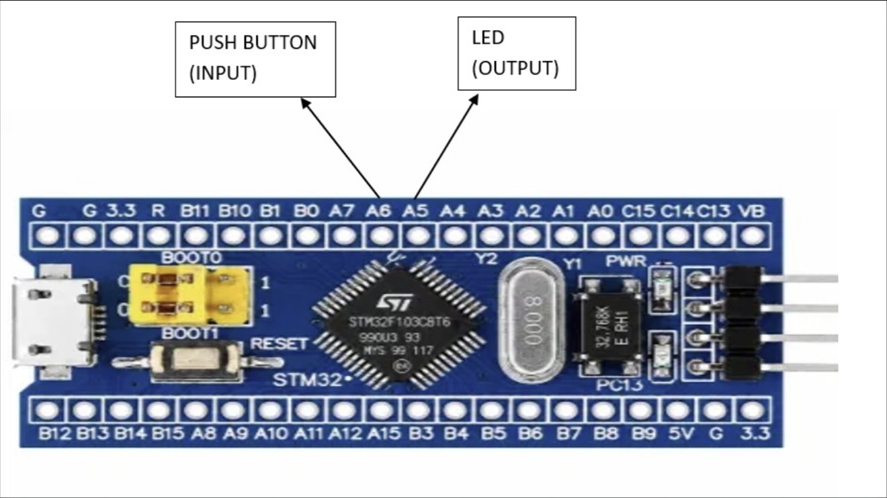

# EXPERIMENT DETAILS

**EXP:** CONTINUOUS LAB EVALUATION-8

**DATE:** 18/09/2026

**NAME OF EXP:** STM32 GPIO Bring-Up and Switch-Controlled LED

**HARDWARE SETUP / PLATFORM:** CubeMX + Keil MDK + STM32 Development Board (STM32F103C8T6) + Push-Button + LED

**TASK NO:** Task 8C – Short Press vs Long Press (short press toggles the LED, long press starts continuous blinking, no blocking delay)

---

## 1. Circuit Diagram

The experiment uses a push-button as input and an external LED as output. The firmware measures how long the button is held and classifies each press as a short press (< 1 second) or a long press (>= 1 second).

* Microcontroller: STM32F103C8T6 development board (Blue Pill), 72 MHz system clock from the 8 MHz crystal (HSE) through the PLL (x9)
* Input: push-button on PA6 to GND, using the internal pull-up (pressed = LOW)
* Output: external LED on PB0 through a series resistor to GND (HIGH = ON)
* Power Supply: 5V via USB

---

## 2. Core Logic / Pseudocode / Code Base

**Working Principle:**
PA6 is read continuously. A change of the button level is accepted only after it has stayed the same for 30 ms (software debounce). When a press is accepted, its start time is recorded. When the release is accepted, the press duration (`release time - start time`) is calculated and the press is classified. The LED starts OFF and the program is always in one of two modes: steady or blinking.

| User action | System response |
|---|---|
| Short press (< 1 s) in steady mode | Toggle LED |
| Long press (>= 1 s) | LED enters continuous blinking mode |
| Next short press (while blinking) | Stop blinking (LED turned OFF) |
| Long press again | Return to blinking mode |

**Pseudocode:**

1. Initialize the HAL library and system clock (HSE + PLL, 72 MHz).
2. Configure PA6 as an input with pull-up and PB0 as a push-pull output.
3. Set PB0 LOW (LED off). Set `mode = STEADY`, `raw_prev = 0`, `stable = 0`.
4. Repeat continuously:
   1. Read the time `now` with `HAL_GetTick()` and read PA6 (`raw = 1` when PA6 is LOW, i.e. pressed).
   2. If `raw` differs from `raw_prev`, save `raw_prev = raw` and note the change time `t_change = now`.
   3. If `raw` differs from `stable` and the level has been steady for at least 30 ms (`now - t_change >= DEBOUNCE_MS`):
      1. Set `stable = raw`.
      2. If `stable` is 1 (button pressed), record the press start time `t_press = t_change`.
      3. Otherwise (button released), calculate `duration = t_change - t_press`:
         * If `duration >= 1000 ms` (long press), set `mode = BLINK` and restart the blink timer.
         * Else (short press): if `mode` is BLINK, set `mode = STEADY` and turn the LED off; otherwise toggle PB0.
   4. If `mode` is BLINK and `now - t_blink >= 250 ms`, toggle PB0 and restart the blink timer.

**Code Base:**
The program is written in C using the STM32 HAL library and generated with STM32CubeMX.

* `LedMode` is an enum with two states: `MODE_STEADY` and `MODE_BLINK`.
* `DEBOUNCE_MS` is 30 ms, `LONG_PRESS_MS` is 1000 ms and `BLINK_MS` is 250 ms.
* `HAL_GPIO_ReadPin(GPIOA, GPIO_PIN_6)` returns GPIO_PIN_RESET when the button is pressed.
* `HAL_GetTick()` returns the millisecond tick count, used for debouncing, measuring the press duration and timing the blink, so no `HAL_Delay` is used anywhere.
* `HAL_GPIO_TogglePin(GPIOB, GPIO_PIN_0)` toggles the LED on a short press and on every blink interval.
* `HAL_GPIO_WritePin(GPIOB, GPIO_PIN_0, GPIO_PIN_RESET)` turns the LED off at start-up and when blinking is stopped.
* `MX_GPIO_Init()` configures PA6 (`BTN_Pin`) as input with pull-up and PB0 (`LED_Pin`) as push-pull output (low speed).
* `SystemClock_Config()` sets HSE on with PLL x9 as the system clock (72 MHz).

**Pin Summary:**

| Pin | Mode | Function |
|---|---|---|
| PA6 | Input, internal pull-up | Push-button (pressed = LOW) |
| PB0 | Output, push-pull | External LED (HIGH = ON, LOW = OFF) |

---

## 3. Inference

The application classifies every button press by its duration. A press shorter than 1 second toggles the LED, while a press of 1 second or more puts the LED into continuous blinking at 250 ms intervals (2 Hz). The next short press stops the blinking, and another long press starts it again. Because the press start time and release time are both taken from `HAL_GetTick()` and the duration is simply their difference, the long press is detected without any blocking delay, so the main loop keeps running and the blinking continues while the button is being handled. The 30 ms debounce ensures that contact bounce is not counted as extra presses. This demonstrates GPIO input reading, software debouncing, non-blocking timing and a simple two-state machine using STM32 HAL functions.
