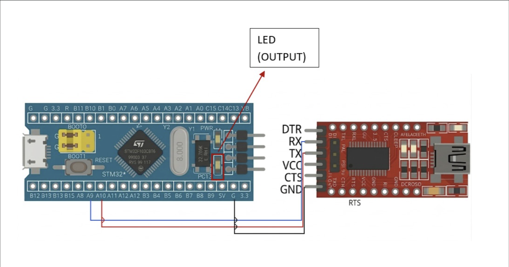

# EXPERIMENT DETAILS

**EXP:** CONTINUOUS LAB EVALUATION-9

**DATE:** 28/09/2026

**NAME OF EXP:** STM32 UART Command Controlled LED

**HARDWARE SETUP / PLATFORM:** CubeMX + Keil MDK + STM32 Development Board (STM32F103C8T6) + USB-to-Serial (FTDI) Adapter + PC Terminal (PuTTY)

**TASK NO:** Task 9A – Basic UART Communication (transmit a character repeatedly to a PC terminal)

---

## 1. Circuit Diagram

The experiment connects the STM32 USART1 peripheral to a PC through a USB-to-serial (FTDI) adapter. The STM32 transmits a character over UART and the PC terminal displays it.

* Microcontroller: STM32F103C8T6 development board (Blue Pill), 72 MHz system clock from the 8 MHz crystal (HSE) through the PLL (x9)
* UART peripheral: USART1, PA9 = TX, PA10 = RX
* PA9 (STM32 TX) is connected to the RX pin of the FTDI adapter
* PA10 (STM32 RX) is connected to the TX pin of the FTDI adapter
* GND of the STM32 board is connected to GND of the FTDI adapter (common ground)
* Power Supply: 5V via USB
* PC terminal: PuTTY (serial mode) at 115200 baud

The TX of one device always goes to the RX of the other (crossed connection).

---

## 2. Core Logic / Pseudocode / Code Base

**Working Principle:**
USART1 is configured through STM32CubeMX for a standard serial format: 115200 baud, 8 data bits, no parity, 1 stop bit (8N1) and no hardware flow control. In the main loop the character `'A'` is transmitted to the PC terminal once every second using `HAL_UART_Transmit()`, and each character appears in PuTTY on the PC.

**UART Configuration:**

| Parameter | Value |
|---|---|
| Peripheral | USART1 (PA9 = TX, PA10 = RX) |
| Baud rate | 115200 |
| Word length | 8 bits |
| Parity | None |
| Stop bits | 1 |
| Mode | TX and RX |
| Hardware flow control | None |
| Oversampling | 16 |

**Pseudocode:**

1. Initialize the HAL library and system clock (HSE + PLL, 72 MHz).
2. Initialize the GPIO clocks and the USART1 peripheral (115200, 8N1) with `HAL_UART_Init()`.
3. Repeat continuously:
   1. Load the character to send (`data = 'A'`).
   2. Transmit 1 byte over USART1 with `HAL_UART_Transmit()` (timeout 100 ms).
   3. Wait 1000 ms with `HAL_Delay()`.

**Code Base:**
The program is written in C using the STM32 HAL library and generated with STM32CubeMX.

* `MX_USART1_UART_Init()` sets up USART1 with 115200 baud, 8 data bits, no parity, 1 stop bit, TX + RX mode, and calls `HAL_UART_Init()`.
* `HAL_UART_Transmit(&huart1, (uint8_t*)&data, 1, 100)` sends one byte: `huart1` is the UART handle, `&data` points to the character, `1` is the number of bytes and `100` is the timeout in milliseconds.
* `HAL_Delay(1000)` creates a 1 second gap between two transmissions.
* `SystemClock_Config()` sets HSE on with PLL x9 as the system clock (72 MHz), with APB2 (which clocks USART1) at 72 MHz.

**PuTTY Settings:**

| Setting | Value |
|---|---|
| Connection type | Serial |
| Serial line | COM port of the FTDI adapter (check in Device Manager) |
| Speed (baud) | 115200 |

---

## 3. Inference

The STM32 sends the character `'A'` to the PC terminal every second, and PuTTY shows a new `A` each time, confirming that the UART link works. This works only when the baud rate, data bits, parity and stop bits are the same on the STM32 and on the terminal, and when TX and RX are crossed between the two devices. Since only the character `'A'` is sent and no carriage return or line feed is added, all the characters appear one after another on the same line in the terminal. This demonstrates UART configuration with CubeMX and character transmission using the STM32 HAL functions `HAL_UART_Init()` and `HAL_UART_Transmit()`.
