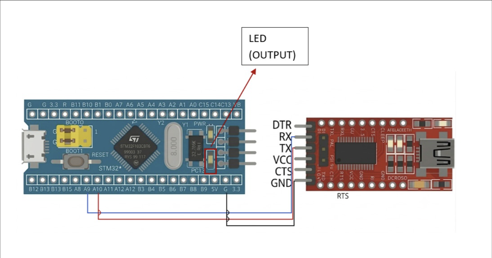

# EXPERIMENT DETAILS

**EXP:** CONTINUOUS LAB EVALUATION-9

**DATE:** 28/09/2026

**NAME OF EXP:** STM32 UART Command Controlled LED

**HARDWARE SETUP / PLATFORM:** CubeMX + Keil MDK + STM32 Development Board (STM32F103C8T6) + USB-to-Serial (FTDI) Adapter + PC Terminal (PuTTY)

**TASK NO:** Task 9B – String-Based Application Logic (UART command interface controlling the on-board LED)

---

## 1. Circuit Diagram

The experiment connects the STM32 USART1 peripheral to a PC through a USB-to-serial (FTDI) adapter. Text commands typed in the PC terminal are received by the STM32, which controls the on-board LED and sends a reply back to the terminal.

* Microcontroller: STM32F103C8T6 development board (Blue Pill), 64 MHz system clock from the internal oscillator (HSI/2 x 16 through the PLL), so no external crystal is needed
* UART peripheral: USART1, PA9 = TX, PA10 = RX
* PA9 (STM32 TX) is connected to the RX pin of the FTDI adapter
* PA10 (STM32 RX) is connected to the TX pin of the FTDI adapter
* GND of the STM32 board is connected to GND of the FTDI adapter (common ground)
* Output: on-board LED on PC13 (active-low: LOW = ON, HIGH = OFF)
* Power Supply: 5V via USB
* PC terminal: PuTTY (serial mode) at 115200 baud

The TX of one device always goes to the RX of the other (crossed connection).



---

## 2. Core Logic / Pseudocode / Code Base

**Working Principle:**
The firmware receives characters from the PC one at a time with `HAL_UART_Receive()` and stores them in a 32-byte buffer while echoing each typed character back so that the user can see what is being typed. When Enter (`\r` or `\n`) is received, the buffer is terminated with `'\0'`, converted to uppercase (so `led on` also works) and compared with the known commands. The LED is controlled accordingly and a reply message is sent back. Backspace is supported, and any other text gives an "Unknown command" message.

**Supported Commands:**

| Command typed in terminal | System response on terminal | LED action (PC13) |
|---|---|---|
| `LED ON` | LED turned ON | PC13 set LOW |
| `LED OFF` | LED turned OFF | PC13 set HIGH |
| `LED TOGGLE` | LED toggled | PC13 toggled |
| anything else | Unknown command | No change |

**UART Configuration:**

| Parameter | Value |
|---|---|
| Peripheral | USART1 (PA9 = TX, PA10 = RX) |
| Baud rate | 115200 |
| Word length | 8 bits |
| Parity | None |
| Stop bits | 1 |
| Mode | TX and RX |
| Hardware flow control | None |

**Pseudocode:**

1. Initialize the HAL library and system clock (HSI/2 x 16 = 64 MHz).
2. Initialize PC13 as a push-pull output (LED off) and USART1 (115200, 8N1).
3. Blink the LED 3 times to show that the firmware is running, then turn the LED off.
4. Print the welcome message, the list of commands and the `> ` prompt.
5. Repeat continuously:
   1. Wait for one character from the PC with `HAL_UART_Receive()`.
   2. If the character is Enter (`\r` or `\n`): print a new line, end the buffer with `'\0'`, call `process_command()`, reset the buffer index and print the `> ` prompt.
   3. Else if the character is Backspace (`0x08` or `0x7F`) and the buffer is not empty: decrease the buffer index and erase the character on the terminal.
   4. Else if the buffer is not full: store the character in the buffer and echo it back to the terminal.

`process_command()`:

1. Convert the received string to uppercase.
2. If it equals `LED ON`, set PC13 LOW and reply "LED turned ON".
3. If it equals `LED OFF`, set PC13 HIGH and reply "LED turned OFF".
4. If it equals `LED TOGGLE`, toggle PC13 and reply "LED toggled".
5. Otherwise, if the string is not empty, reply "Unknown command".

**Code Base:**
The program is written in C using the STM32 HAL library and generated with STM32CubeMX.

* `RX_BUF_SIZE` is defined as 32, the maximum command length (31 characters plus the terminating `'\0'`).
* `rx_buf`, `rx_idx` and `rx_char` hold the received command, the current position in the buffer and the latest received character.
* `HAL_UART_Receive(&huart1, &rx_char, 1, HAL_MAX_DELAY)` waits for one received byte.
* `HAL_UART_Transmit()` sends the echo and the reply messages. `uart_print()` is a small helper that sends a whole string using `strlen()`.
* `process_command()` converts the command to uppercase, compares it with `strcmp()` and controls the LED using `HAL_GPIO_WritePin()` and `HAL_GPIO_TogglePin()`.
* `MX_USART1_UART_Init()` sets up USART1 with 115200 baud, 8 data bits, no parity, 1 stop bit and TX + RX mode.
* `MX_GPIO_Init()` configures PC13 as push-pull output (low speed) and starts it HIGH (LED off).
* `SystemClock_Config()` runs the PLL from the internal HSI oscillator (HSI/2 x 16 = 64 MHz), with AHB = 64 MHz, APB1 = 32 MHz and APB2 = 64 MHz.

**Example Terminal Session:**

```
STM32 LED Command Interface
Commands: LED ON | LED OFF | LED TOGGLE
> LED ON
LED turned ON
> LED OFF
LED turned OFF
> LED TOGGLE
LED toggled
> HELLO
Unknown command
>
```

**PuTTY Settings:**

| Setting | Value |
|---|---|
| Connection type | Serial |
| Serial line | COM port of the FTDI adapter (check in Device Manager) |
| Speed (baud) | 115200 |

---

## 3. Inference

The STM32 works as a simple command-line interface: commands typed in the PC terminal control the on-board LED and the board confirms each action with a text reply. Characters are collected in a buffer until Enter is pressed and then the whole string is compared with the known commands, which shows how string-based application logic is built on top of single-character UART reception. Converting the input to uppercase makes the commands case-insensitive, the buffer size check prevents overflow, and backspace handling makes typing comfortable. The PC13 LED is active-low, so the code writes LOW to turn it ON and HIGH to turn it OFF. The 3 start-up blinks confirm that the firmware is running before any command is entered. This demonstrates UART configuration with CubeMX, character reception and transmission with `HAL_UART_Receive()` and `HAL_UART_Transmit()`, string handling in C and GPIO output control using STM32 HAL functions.
