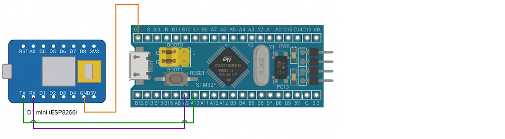

# EXPERIMENT DETAILS

**EXP:** CONTINUOUS LAB EVALUATION-10

**DATE:** 05/10/2026

**NAME OF EXP:** STM32–Wemos Wi-Fi Modem Interface Using AT Commands

**HARDWARE SETUP / PLATFORM:** CubeMX + Keil MDK + STM32 Development Board (STM32F103C8T6) + Wemos D1 mini (ESP8266) Wi-Fi Module + PC Terminal (PuTTY / Tera Term)

**TASK NO:** Task 10A – Establish STM32 ↔ Wemos UART Communication (send `AT` and display the response on the PC terminal)

---

## 1. Circuit Diagram

Before using Wi-Fi, the two boards must prove that they can communicate. The STM32 is connected to the Wemos D1 mini (ESP8266) through UART with a crossed TX/RX connection and a common ground. The STM32 sends the `AT` command to the Wemos, and the reply is shown on the PC terminal.

* Microcontroller: STM32F103C8T6 development board (Blue Pill), running on its default internal clock (no clock configuration in the program)
* Wemos link: USART1 at 115200 baud (8N1), PA9 = TX, PA10 = RX
* PC terminal link: USART2 at 115200 baud (8N1), PA2 = TX, PA3 = RX (through a USB-to-serial adapter)
* Power Supply: 5V via USB

| Wemos D1 mini pin | STM32 pin | Description |
|---|---|---|
| TX | PA10 (USART1 RX) | Data from Wemos to STM32 |
| RX | PA9 (USART1 TX) | Data from STM32 to Wemos |
| GND | GND | Common ground reference |
| 5V / 3V3 | 5V / 3.3V | Power source for the Wemos |

| STM32 pin | USB-to-serial adapter | Description |
|---|---|---|
| PA2 (USART2 TX) | RX | Messages from STM32 to the PC terminal |
| PA3 (USART2 RX) | TX | Not used by this program |
| GND | GND | Common ground reference |

The TX of one device always goes to the RX of the other (crossed connection).



---

## 2. Core Logic / Pseudocode / Code Base

**Working Principle:**
Every 2 seconds the STM32 sends the command `AT` followed by CR and LF (`AT\r\n`) to the Wemos on USART1. It then waits for the response of the Wemos, collects all received bytes into a buffer and forwards them to the PC terminal through USART2. A working link is shown by an `OK` in the response (the ESP8266 normally also echoes the command). If nothing is received within 1 second, the message "No response from Wemos!" is shown instead.

**Expected Terminal Output:**

```
********************************
 STM32 - Wemos UART Communication
********************************

STM32 -> Wemos: AT
Wemos -> STM32: AT
OK
```

**UART Configuration (both UARTs):**

| Parameter | Value |
|---|---|
| Baud rate | 115200 |
| Word length | 8 bits |
| Parity | None |
| Stop bits | 1 |
| Mode | TX and RX |
| Hardware flow control | None |

| UART | Pins | Connected to |
|---|---|---|
| USART1 (`uart_wemos`) | PA9 (TX), PA10 (RX) | Wemos D1 mini |
| USART2 (`uart_pc`) | PA2 (TX), PA3 (RX) | PC terminal |

**Pseudocode:**

1. Initialize the HAL library.
2. Enable the GPIOA, USART1 and USART2 clocks and configure PA9 and PA2 as alternate-function push-pull outputs and PA10 and PA3 as inputs.
3. Initialize USART1 (Wemos) and USART2 (PC) at 115200, 8N1.
4. Print the start message on the PC terminal.
5. Repeat continuously:
   1. Print "STM32 -> Wemos: AT" on the PC terminal and send `AT\r\n` to the Wemos.
   2. Clear the receive buffer.
   3. Wait up to 1000 ms for the first byte from the Wemos.
      * If a byte arrives, keep reading bytes (100 ms timeout per byte) until no more arrive or the buffer is full, then end the string with `'\0'`.
      * Print "Wemos -> STM32: " followed by the received bytes on the PC terminal.
      * If no byte arrives, print "No response from Wemos!".
   4. Wait 2000 ms.

**Code Base:**
The program is written in C using the STM32 HAL library.

* `uart_wemos` and `uart_pc` are the UART handles for USART1 (Wemos) and USART2 (PC terminal).
* `rxBuf[64]` and `rxLen` hold the response received from the Wemos.
* `pc_print()` is a helper function that sends a string to the PC terminal with `HAL_UART_Transmit()` on USART2.
* `GPIO_Init_Custom()` enables the clocks and sets up the UART pins: PA9 and PA2 as alternate-function push-pull (TX), PA10 and PA3 as inputs (RX).
* `UART_Init_Custom()` configures both UARTs with `HAL_UART_Init()`.
* `HAL_UART_Transmit(&uart_wemos, "AT\r\n", ...)` sends the command to the Wemos.
* `HAL_UART_Receive(&uart_wemos, ...)` receives the response one byte at a time, using a short timeout to detect the end of the reply.
* `HAL_Delay(2000)` creates a 2 second gap between two commands.

**PuTTY / Tera Term Settings:**

| Setting | Value |
|---|---|
| Connection type | Serial |
| Serial line | COM port of the USB-to-serial adapter on PA2/PA3 |
| Speed (baud) | 115200 |

---

## 3. Inference

The STM32 sends `AT\r\n` to the Wemos every 2 seconds and the PC terminal shows the reply containing `OK`, which proves that the UART link between the two boards works in both directions. The TX and RX lines must be crossed, the grounds must be common and both sides must use the same baud rate, otherwise no response or unreadable characters appear. The reply is collected byte by byte with a short timeout, so the program does not have to know the length of the response in advance. Using a second UART (USART2) for the PC terminal keeps the debug messages separate from the communication with the Wemos. This demonstrates UART configuration with STM32 HAL, communication with a Wi-Fi modem using AT commands and the first step towards configuring the ESP8266 and sending sensor data over Wi-Fi.
