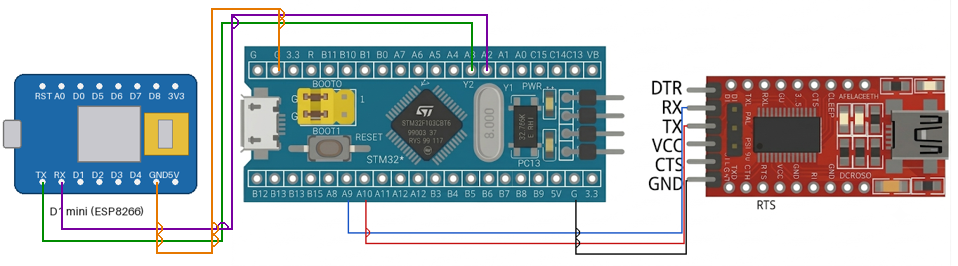

# EXPERIMENT DETAILS

**EXP:** CONTINUOUS LAB EVALUATION-10

**DATE:** 05/10/2026

**NAME OF EXP:** STM32–Wemos Wi-Fi Modem Interface Using AT Commands

**HARDWARE SETUP / PLATFORM:** CubeMX + Keil MDK + STM32 Development Board (STM32F103C8T6) + Wemos D1 mini (ESP8266) Wi-Fi Module + USB-to-Serial (FTDI) Adapter + PC Terminal (PuTTY / Tera Term)

**TASK NO:** Task 10B – Configure the Wemos with AT commands, connect it to a Wi-Fi network and read its IP address

---

## 1. Circuit Diagram

The STM32 talks to the Wemos D1 mini (ESP8266) through UART and controls it with AT commands. A second UART connected to a USB-to-serial (FTDI) adapter shows every response on the PC terminal.

* Microcontroller: STM32F103C8T6 development board (Blue Pill), 72 MHz system clock from the 8 MHz crystal (HSE) through the PLL (x9)
* Wemos link: USART2 at 115200 baud (8N1), PA2 = TX, PA3 = RX
* PC terminal link: USART1 at 115200 baud (8N1), PA9 = TX, PA10 = RX, through the FTDI adapter
* Power Supply: 5V via USB

| Wemos D1 mini pin | STM32 pin | Description |
|---|---|---|
| TX | PA3 (USART2 RX) | Data from Wemos to STM32 |
| RX | PA2 (USART2 TX) | Data from STM32 to Wemos |
| GND | GND | Common ground reference |
| 5V / 3V3 | 5V / 3.3V | Power source for the Wemos |

| STM32 pin | FTDI adapter pin | Description |
|---|---|---|
| PA9 (USART1 TX) | RX | Messages from STM32 to the PC terminal |
| PA10 (USART1 RX) | TX | Not used by this program |
| GND | GND | Common ground reference |

The TX of one device always goes to the RX of the other (crossed connection).



---

## 2. Core Logic / Pseudocode / Code Base

**Working Principle:**
The STM32 sends a fixed sequence of AT commands to the Wemos on USART2 and, after each command, collects the response of the Wemos and forwards it unchanged to the PC terminal on USART1. The sequence checks the modem, sets station mode, enables DHCP, joins the Wi-Fi network and finally reads the IP address of the Wemos. After the last command the program has nothing more to do and stays in an empty loop.

**AT Command Sequence:**

| Step | Command | Purpose | Wait for response |
|---|---|---|---|
| 1 | `AT` | Check that the modem responds | 1 s |
| 2 | `AT+CWMODE=1` | Set Wi-Fi station mode | 2 s |
| 3 | `AT+CWDHCP=1,1` | Enable DHCP in station mode (IP address is assigned by the router) | 2 s |
| 4 | `AT+CWJAP="<ssid>","<password>"` | Join the Wi-Fi network | 15 s |
| 5 | `AT+CIFSR` | Read the local IP address (and MAC address) | 2 s |

The Wi-Fi name and password are written inside the `AT+CWJAP` command string in `main.c` (they are not listed here).

**Example Terminal Output:**

```
=== Connect to Wi-Fi ===
AT
OK
AT+CWMODE=1
OK
AT+CWDHCP=1,1
OK
AT+CWJAP="<ssid>","<password>"
WIFI CONNECTED
WIFI GOT IP
OK

--- IP address ---
AT+CIFSR
+CIFSR:STAIP,"192.168.x.x"
+CIFSR:STAMAC,"xx:xx:xx:xx:xx:xx"
OK
```

The exact text depends on the ESP8266 firmware. The modem normally echoes each command before its reply.

**UART Configuration (both UARTs):**

| Parameter | Value |
|---|---|
| Baud rate | 115200 |
| Word length | 8 bits |
| Parity | None |
| Stop bits | 1 |
| Mode | TX and RX |
| Hardware flow control | None |

| UART | Pins | Connected to |
|---|---|---|
| USART1 (`huart1`) | PA9 (TX), PA10 (RX) | PC serial monitor (through FTDI) |
| USART2 (`huart2`) | PA2 (TX), PA3 (RX) | Wemos D1 mini |

**Pseudocode:**

1. Initialize the HAL library, system clock (HSE + PLL, 72 MHz), GPIO, USART1 and USART2.
2. Wait 2 s so that the Wemos can boot, then print the title on the PC terminal.
3. For each command in the sequence above (`AT`, `AT+CWMODE=1`, `AT+CWDHCP=1,1`, `AT+CWJAP`, `AT+CIFSR`):
   1. Clear the receive buffer.
   2. Send the command followed by CR and LF to the Wemos (USART2).
   3. Receive the response from the Wemos (until the buffer is full or the timeout passes).
   4. Send the response to the PC terminal (USART1). For the last command, print the heading "--- IP address ---" first.
4. Stay in an endless loop.

**Code Base:**
The program is written in C using the STM32 HAL library and generated with STM32CubeMX.

* `huart1` is the UART handle for the PC serial monitor and `huart2` is the handle for the Wemos.
* `rxAT`, `rxMode`, `rxDhcp`, `rxJoin` and `rxIP` are separate receive buffers for the responses of the five commands (the Wi-Fi join and IP responses have 200 bytes, the others 100 bytes).
* `HAL_UART_Transmit(&huart2, ...)` sends each AT command to the Wemos and `HAL_UART_Transmit(&huart1, ...)` shows the response on the PC terminal.
* `HAL_UART_Receive(&huart2, buffer, size - 1, timeout)` collects the response. The timeout is longer for `AT+CWJAP` (15 s) because joining a network takes time.
* `memset()` clears each buffer before use and `strlen()` is used to send only the received text to the PC.
* `HAL_Delay(2000)` at the start gives the Wemos time to boot.
* `SystemClock_Config()` sets HSE on with PLL x9 as the system clock (72 MHz), with APB1 = 36 MHz and 2 flash wait states.

**PuTTY / Tera Term Settings:**

| Setting | Value |
|---|---|
| Connection type | Serial |
| Serial line | COM port of the FTDI adapter on PA9/PA10 |
| Speed (baud) | 115200 |

---

## 3. Inference

The STM32 successfully configures the Wemos with AT commands: it sets station mode, enables DHCP, joins the Wi-Fi network and reads the IP address assigned by the router, and every response is displayed on the PC terminal. Seeing `OK` after each command shows that the modem accepted it, and the `WIFI GOT IP` message and the `+CIFSR:STAIP` line show that the connection was successful and that the Wemos now has an IP address, which is the starting point for sending sensor data over Wi-Fi. A longer timeout is used for the join command because connecting to the router can take several seconds. The program waits for the full timeout after each command, which is simple but slow, and it does not check the response text for `OK` or an error before moving to the next command. Using one UART for the modem and another for the PC keeps the debug output separate from the modem communication. This demonstrates AT command based control of an ESP8266 Wi-Fi modem, UART communication with STM32 HAL and the Wi-Fi connection steps (mode, DHCP, join, IP address).
