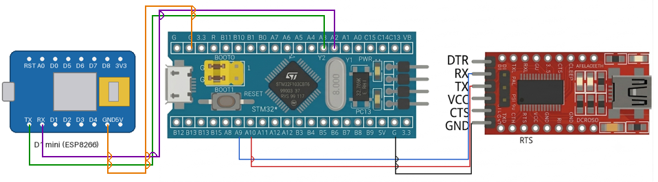

# EXPERIMENT DETAILS

**EXP:** CONTINUOUS LAB EVALUATION-10

**DATE:** 05/10/2026

**NAME OF EXP:** STM32–Wemos Wi-Fi Modem Interface Using AT Commands

**HARDWARE SETUP / PLATFORM:** CubeMX + Keil MDK + STM32 Development Board (STM32F103C8T6) + Wemos D1 mini (ESP8266) Wi-Fi Module + USB-to-Serial (FTDI) Adapter + PC Terminal (PuTTY / Tera Term)

**TASK NO:** Task 10C – Configure the Wemos as a Wi-Fi station, join the access point, query the network status and report it on the PC terminal

---

## 1. Circuit Diagram

The STM32 talks to the Wemos D1 mini (ESP8266) through UART and controls it with AT commands. A second UART connected to a USB-to-serial (FTDI) adapter shows the commands, the replies and the final network status on the PC terminal.

* Microcontroller: STM32F103C8T6 development board (Blue Pill), 72 MHz system clock from the 8 MHz crystal (HSE) through the PLL (x9)
* Wemos link: USART2 at 115200 baud (8N1), PA2 = TX, PA3 = RX
* PC terminal link: USART1 at 115200 baud (8N1), PA9 = TX, PA10 = RX, through the FTDI adapter
* Power Supply: 5V via USB

| Wemos D1 mini pin | STM32 pin | Description |
|---|---|---|
| TX | PA3 (USART2 RX) | Data from Wemos to STM32 |
| RX | PA2 (USART2 TX) | Data from STM32 to Wemos |
| GND | GND | Common ground reference |
| 5V / 3V3 | 5V / 3.3V | Power source for the Wemos |

| STM32 pin | FTDI adapter pin | Description |
|---|---|---|
| PA9 (USART1 TX) | RX | Messages from STM32 to the PC terminal |
| PA10 (USART1 RX) | TX | Not used by this program |
| GND | GND | Common ground reference |

The TX of one device always goes to the RX of the other (crossed connection).



---

## 2. Core Logic / Pseudocode / Code Base

**Working Principle:**
The STM32 sends AT commands to the Wemos on USART2 and collects each reply byte by byte until the reply ends with `OK`, `ERROR` or `FAIL`, or until a timeout passes. The commands and replies are shown on the PC terminal on USART1 in the form `>> command` and `<< reply`. The Wemos is first checked with `AT`, set to station mode and told to join the Wi-Fi network. Then three query commands are sent and the replies are checked in the program, so the final report shows the Wi-Fi mode, the connection status and the IP address in a short readable form.

**AT Command Sequence:**

| Step | Command | Purpose | Maximum wait |
|---|---|---|---|
| 1 | `AT` | Check that the modem responds | 2 s |
| 2 | `AT+CWMODE=1` | Set Wi-Fi station mode | 2 s |
| 3 | `AT+CWJAP="<ssid>","<password>"` | Join the Wi-Fi access point (can take several seconds) | 20 s |
| 4 | `AT+CWMODE?` | Query the Wi-Fi mode | 2 s |
| 5 | `AT+CWJAP?` | Query the connection status | 2 s |
| 6 | `AT+CIFSR` | Read the IP address | 2 s |

The Wi-Fi name and password are set in the `WIFI_SSID` and `WIFI_PASSWORD` defines at the top of `main.c` (they are not listed here).

**How the Status Report is Decided:**

| Report line | Condition checked in the reply |
|---|---|
| `WIFI MODE    : STATION` | The reply to `AT+CWMODE?` contains `+CWMODE:1` (otherwise `NOT STATION`) |
| `WIFI STATUS  : CONNECTED` | The reply to `AT+CWJAP?` contains `+CWJAP:` (otherwise `DISCONNECTED`) |
| `IP ADDRESS    : <ip>` | The text between `STAIP,"` and the next `"` in the reply to `AT+CIFSR` (`NOT FOUND` if it is missing) |

If the Wemos is not connected, the program also prints "Result: not connected (check SSID/password)".

**Example Terminal Output:**

```
STM32-WiFi MODEM TEST
>> AT
<< OK
>> AT+CWMODE=1
<< OK
>> AT+CWJAP="<ssid>","<password>"
<< WIFI CONNECTED
WIFI GOT IP

OK
WIFI MODE    : STATION
WIFI STATUS  : CONNECTED
IP ADDRESS    : 192.168.x.x
```

The exact text depends on the ESP8266 firmware. The modem may also echo each command before its reply.

**UART Configuration (both UARTs):**

| Parameter | Value |
|---|---|
| Baud rate | 115200 |
| Word length | 8 bits |
| Parity | None |
| Stop bits | 1 |
| Mode | TX and RX |
| Hardware flow control | None |

| UART | Pins | Connected to |
|---|---|---|
| USART1 (`huart1`) | PA9 (TX), PA10 (RX) | PC serial monitor (through FTDI) |
| USART2 (`huart2`) | PA2 (TX), PA3 (RX) | Wemos D1 mini |

**Pseudocode:**

1. Initialize the HAL library, system clock (HSE + PLL, 72 MHz), GPIO (UART pins), USART1 and USART2.
2. Wait 2 s so that the Wemos can boot, then print "STM32-WiFi MODEM TEST" on the PC terminal.
3. Send `AT`, `AT+CWMODE=1` and `AT+CWJAP="<ssid>","<password>"` to the Wemos. After each one, show the command and its reply on the PC terminal.
4. Send `AT+CWMODE?` and print `WIFI MODE    : STATION` if the reply contains `+CWMODE:1`, otherwise `NOT STATION`.
5. Send `AT+CWJAP?` and print `WIFI STATUS  : CONNECTED` if the reply contains `+CWJAP:`, otherwise `DISCONNECTED`.
6. Send `AT+CIFSR`, extract the station IP address from the reply and print `IP ADDRESS    : <ip>`.
7. If the status was not connected, print "Result: not connected (check SSID/password)".
8. Stay in an endless loop.

`at_cmd(cmd, timeout)`:

1. Clear the response buffer and send the command to the Wemos.
2. Until the timeout passes or the buffer is full: receive one byte (100 ms wait), add it to the buffer and stop as soon as the buffer contains `OK`, `ERROR` or `FAIL` followed by CR LF.

**Code Base:**
The program is written in C using the STM32 HAL library.

* `huart1` is the UART handle for the PC serial monitor and `huart2` is the handle for the Wemos.
* `resp[300]` holds the reply of the last command.
* `at_cmd()` sends one AT command and collects the reply with `HAL_UART_Receive()`, one byte at a time, using `HAL_GetTick()` to stop at the timeout. It stops early when `OK`, `ERROR` or `FAIL` is found with `strstr()`, so the program does not wait longer than needed.
* `show()` prints `>> command` and `<< reply` on the PC terminal and skips the CR and LF characters that the Wemos sends before its reply. It prints `<< (no reply)` if nothing was received.
* `pc_print()` is a helper function that sends a string to the PC terminal.
* `snprintf()` builds the join command from the SSID and password defines and the report lines.
* `strstr()` checks the replies for `+CWMODE:1`, `+CWJAP:` and `STAIP,"`. The IP address is copied character by character up to the closing quote.
* `MX_GPIO_Init()` enables the GPIOA clock and sets PA2 and PA9 as alternate-function push-pull (TX) and PA3 and PA10 as inputs (RX).
* `SystemClock_Config()` sets HSE on with PLL x9 as the system clock (72 MHz), with APB1 = 36 MHz and 2 flash wait states.

**PuTTY / Tera Term Settings:**

| Setting | Value |
|---|---|
| Connection type | Serial |
| Serial line | COM port of the FTDI adapter on PA9/PA10 |
| Speed (baud) | 115200 |

---

## 3. Inference

The STM32 configures the Wemos as a Wi-Fi station, joins the access point and then asks the modem for its mode, connection status and IP address, so the result is checked with query commands and not only assumed from the join command. The program decides the report lines by searching for fixed text in the replies (`+CWMODE:1`, `+CWJAP:` and `STAIP,"`), which shows how AT command replies can be parsed in C. Because the reply is collected until `OK`, `ERROR` or `FAIL` appears, each command finishes as soon as the modem answers, and the longer 20 second limit is only used up when joining the network takes that long. If the network cannot be joined, the status reads `DISCONNECTED`, the IP address stays `NOT FOUND` and the program tells the user to check the SSID and password. This demonstrates AT command based control of an ESP8266 Wi-Fi modem, UART communication with STM32 HAL and simple string parsing to report the network status.
