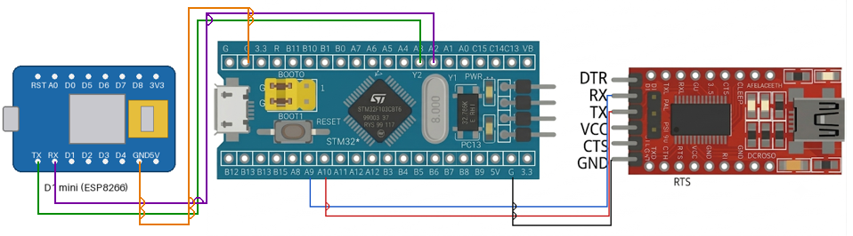

# EXPERIMENT DETAILS

**EXP:** CONTINUOUS LAB EVALUATION-11

**DATE:** 14/10/2026

**NAME OF EXP:** STM32–Wemos Wi-Fi Web Server Using AT Commands

**HARDWARE SETUP / PLATFORM:** CubeMX + Keil MDK + STM32 Development Board (STM32F103C8T6) + Wemos D1 mini (ESP8266) Wi-Fi Module + USB-to-Serial (FTDI) Adapter + PC Terminal (PuTTY / Tera Term) + Web Browser

**TASK NO:** Task A – Connect the Wemos to a Wi-Fi network and run a simple web server using AT commands

---

## 1. Circuit Diagram

The STM32 talks to the Wemos D1 mini (ESP8266) through UART and controls it with AT commands. A second UART connected to a USB-to-serial (FTDI) adapter shows the replies and the received web requests on the PC terminal. Once the Wemos has joined the Wi-Fi network and started the server, a web browser on the same network can open the IP address of the Wemos and receive a web page.

* Microcontroller: STM32F103C8T6 development board (Blue Pill), 72 MHz system clock from the 8 MHz crystal (HSE) through the PLL (x9)
* Wemos link: USART2 at 115200 baud (8N1), PA2 = TX, PA3 = RX
* PC terminal link: USART1 at 115200 baud (8N1), PA9 = TX, PA10 = RX, through the FTDI adapter
* Power Supply: 5V via USB

| Wemos D1 mini pin | STM32 pin | Description |
|---|---|---|
| TX | PA3 (USART2 RX) | Data from Wemos to STM32 |
| RX | PA2 (USART2 TX) | Data from STM32 to Wemos |
| GND | GND | Common ground reference |
| 5V / 3V3 | 5V / 3.3V | Power source for the Wemos |

| STM32 pin | FTDI adapter pin | Description |
|---|---|---|
| PA9 (USART1 TX) | RX | Messages from STM32 to the PC terminal |
| PA10 (USART1 RX) | TX | Not used by this program |
| GND | GND | Common ground reference |

The TX of one device always goes to the RX of the other (crossed connection).



---

## 2. Core Logic / Pseudocode / Code Base

**Working Principle:**
The STM32 first configures the Wemos with AT commands: it checks the modem, sets station mode, enables DHCP, joins the Wi-Fi network and reads the IP address. It then allows multiple connections (`AT+CIPMUX=1`) and starts a TCP server on port 80 (`AT+CIPSERVER=1,80`). After that the program waits for a browser request. When the Wemos receives a request, it reports it as `+IPD,...` text. The STM32 shows this request on the PC terminal, announces the length of the web page with `AT+CIPSEND`, sends a short HTTP response and closes the connection so that the browser can finish loading the page.

**AT Command Sequence (setup):**

| Step | Command | Purpose | Wait for response |
|---|---|---|---|
| 1 | `AT` | Check that the modem responds | 1 s |
| 2 | `AT+CWMODE=1` | Set Wi-Fi station mode | 2 s |
| 3 | `AT+CWDHCP=1,1` | Enable DHCP in station mode | 2 s |
| 4 | `AT+CWJAP="<ssid>","<password>"` | Join the Wi-Fi network | 15 s |
| 5 | `AT+CIFSR` | Read the IP address (to be typed in the browser) | 2 s |
| 6 | `AT+CIPMUX=1` | Allow multiple connections (needed for server mode) | 2 s |
| 7 | `AT+CIPSERVER=1,80` | Start a TCP server on port 80 | 2 s |

The Wi-Fi name and password are written inside the `AT+CWJAP` command string in `main.c` (they are not listed here).

**AT Command Sequence (for every web request):**

| Step | Command | Purpose |
|---|---|---|
| 1 | (request arrives) `+IPD,0,<length>:GET / HTTP/1.1 ...` | The Wemos reports the received browser request |
| 2 | `AT+CIPSEND=0,<length>` | Announce the number of bytes to send on connection 0 |
| 3 | HTTP response text | Sent after the Wemos answers with the `>` prompt |
| 4 | `AT+CIPCLOSE=0` | Close connection 0 so the browser finishes loading |

**HTTP Response sent to the Browser:**

```
HTTP/1.1 200 OK
Content-Type: text/html
Connection: close

<h1>Hi from IOT-A LAB </h1>
```

The browser shows the text "Hi from IOT-A LAB" as a large heading.

**How to Test:**
1. Connect the board and the FTDI adapter and open the PC terminal at 115200 baud.
2. Reset the board and wait until the setup replies and the IP address (`+CIFSR:STAIP,"..."`) appear on the terminal.
3. On a phone or PC connected to the same Wi-Fi network, open `http://<IP address of the Wemos>/` in a browser.
4. The browser shows the heading, and the PC terminal shows the received request (`+IPD,0,...:GET / HTTP/1.1 ...`) and `SEND OK`.

**UART Configuration (both UARTs):**

| Parameter | Value |
|---|---|
| Baud rate | 115200 |
| Word length | 8 bits |
| Parity | None |
| Stop bits | 1 |
| Mode | TX and RX |
| Hardware flow control | None |

| UART | Pins | Connected to |
|---|---|---|
| USART1 (`huart1`) | PA9 (TX), PA10 (RX) | PC serial monitor (through FTDI) |
| USART2 (`huart2`) | PA2 (TX), PA3 (RX) | Wemos D1 mini |

**Pseudocode:**

1. Initialize the HAL library, system clock (HSE + PLL, 72 MHz), GPIO, USART1 and USART2.
2. Wait 2 s so that the Wemos can boot, then print the title on the PC terminal.
3. Send the setup commands (`AT`, `AT+CWMODE=1`, `AT+CWDHCP=1,1`, `AT+CWJAP`, `AT+CIFSR`, `AT+CIPMUX=1`, `AT+CIPSERVER=1,80`) to the Wemos (USART2) one by one. After each one, receive the reply and send it to the PC terminal (USART1).
4. Repeat continuously:
   1. Clear the request buffer and receive bytes from the Wemos: wait up to 60 s for the first byte, then keep reading until the line has been quiet for 300 ms.
   2. If the received text contains `+IPD` (a browser request):
      1. Show the request on the PC terminal.
      2. Send `AT+CIPSEND=0,<length of the HTTP response>` and wait for the `>` prompt.
      3. Send the HTTP response and show the reply (`SEND OK`) on the PC terminal.
      4. Send `AT+CIPCLOSE=0` to close the connection.

**Code Base:**
The program is written in C using the STM32 HAL library and generated with STM32CubeMX.

* `huart1` is the UART handle for the PC serial monitor and `huart2` is the handle for the Wemos.
* `rxAT`, `rxMode`, `rxDhcp`, `rxJoin`, `rxIP`, `rxMux` and `rxServer` are separate buffers for the replies of the setup commands, so each reply can be used on its own. `rxReq[700]` holds the browser request and `rxTmp` is used for the short replies during sending.
* `httpResp` holds the complete HTTP response (status line, headers, blank line and the HTML text).
* `HAL_UART_Transmit(&huart2, ...)` sends each AT command to the Wemos and `HAL_UART_Transmit(&huart1, ...)` shows replies on the PC terminal.
* `HAL_UART_Receive(&huart2, ...)` collects the replies. The wait is longer for `AT+CWJAP` (15 s) because joining a network takes time, and for the first byte of a browser request (60 s).
* `strstr(rxReq, "+IPD")` detects that the Wemos has received a request.
* `sprintf()` builds the `AT+CIPSEND=0,<length>` command, where the length comes from `strlen(httpResp)`.
* `memset()` clears the buffers before use.
* `SystemClock_Config()` sets HSE on with PLL x9 as the system clock (72 MHz), with APB1 = 36 MHz and 2 flash wait states.

**PuTTY / Tera Term Settings:**

| Setting | Value |
|---|---|
| Connection type | Serial |
| Serial line | COM port of the FTDI adapter on PA9/PA10 |
| Speed (baud) | 115200 |

---

## 3. Inference

The STM32 turns the Wemos into a small web server using only AT commands: it joins the Wi-Fi network, enables multiple connections, listens on port 80 and answers a browser request with a short HTML page. The `+IPD` text from the Wemos tells the STM32 that a request has arrived, `AT+CIPSEND` announces the number of bytes to send, and `AT+CIPCLOSE` ends the connection so that the browser stops loading. The length given to `AT+CIPSEND` is calculated with `strlen()`, so it always matches the response text. The program always answers on connection 0 and waits for fixed times instead of checking each reply, which is simple and works for one browser request at a time, but a browser that opens a second connection at the same time (for example for the page icon) is not answered on that connection. This demonstrates AT command based control of an ESP8266 Wi-Fi modem, TCP server mode (`CIPMUX` and `CIPSERVER`), the basic HTTP request and response format and UART communication with STM32 HAL.
