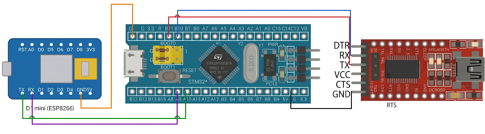

# EXPERIMENT DETAILS

**EXP:** CONTINUOUS LAB EVALUATION-11

**DATE:** 14/10/2026

**NAME OF EXP:** STM32–Wemos Wi-Fi Dynamic Web Server Using AT Commands

**HARDWARE SETUP / PLATFORM:** CubeMX + Keil MDK + STM32 Development Board (STM32F103C8T6) + Wemos D1 mini (ESP8266) Wi-Fi Module + USB-to-Serial (FTDI) Adapter + PC Terminal (PuTTY / Tera Term) + Web Browser

**TASK NO:** Task B – Web server that returns a dynamic page (system uptime) to a browser, using AT commands

---

## 1. Circuit Diagram

The STM32 talks to the Wemos D1 mini (ESP8266) through UART and controls it with AT commands. A second UART connected to a USB-to-serial (FTDI) adapter shows everything that is sent to and received from the Wemos on the PC terminal. After the setup, a web browser on the same Wi-Fi network can open the IP address of the Wemos and receive a web page that shows the live system uptime of the STM32.

* Microcontroller: STM32F103C8T6 development board (Blue Pill), 72 MHz system clock from the 8 MHz crystal (HSE) through the PLL (x9)
* Wemos link: USART1 at 115200 baud (8N1), PA9 = TX, PA10 = RX
* PC terminal link: USART3 at 115200 baud (8N1), PB10 = TX, PB11 = RX, through the FTDI adapter
* Power Supply: 5V via USB

| Wemos D1 mini pin | STM32 pin | Description |
|---|---|---|
| TX | PA10 (USART1 RX) | Data from Wemos to STM32 |
| RX | PA9 (USART1 TX) | Data from STM32 to Wemos |
| GND | GND | Common ground reference |
| 5V / 3V3 | 5V / 3.3V | Power source for the Wemos |

| STM32 pin | FTDI adapter pin | Description |
|---|---|---|
| PB10 (USART3 TX) | RX | Log messages from STM32 to the PC terminal |
| PB11 (USART3 RX) | TX | Not used by this program |
| GND | GND | Common ground reference |

The TX of one device always goes to the RX of the other (crossed connection).



---

## 2. Core Logic / Pseudocode / Code Base

**Working Principle:**
The program has two parts. First, `wifi_connection()` sets up the Wemos with AT commands: it checks the modem, sets station mode, joins the Wi-Fi network, reads the IP address, enables multiple connections and starts a TCP server on port 80. Every command and every reply is also copied to the PC terminal, so the whole conversation can be followed there. Second, the main loop calls `http_server_connection_dynamic()` again and again. It listens to the Wemos for 200 ms, and when a browser request arrives (`+IPD,<link id>,...`), it reads the system uptime, builds an HTML page containing it, announces the length with `AT+CIPSEND` and sends the HTTP response. The page refreshes itself every 2 seconds, so the uptime on the screen keeps counting up.

**AT Command Sequence (setup):**

| Step | Command | Purpose | Maximum wait |
|---|---|---|---|
| 1 | `AT` | Check that the modem responds | 1 s |
| 2 | `AT+CWMODE=1` | Set Wi-Fi station mode | 1 s |
| 3 | `AT+CWJAP="<ssid>","<password>"` | Join the Wi-Fi network | 12 s |
| 4 | `AT+CIFSR` | Read the IP address (to be typed in the browser) | 3 s |
| 5 | `AT+CIPMUX=1` | Allow multiple connections (needed for server mode) | 1 s |
| 6 | `AT+CIPSERVER=1,80` | Start a TCP server on port 80 | 3 s |

A pause of 1 second follows each command, and "Setup Complete" is printed on the PC terminal at the end. The Wi-Fi name and password are written inside the `AT+CWJAP` command string in `main.c` (they are not listed here).

**Handling of a Web Request:**

| Step | Action | Purpose |
|---|---|---|
| 1 | Receive `+IPD,<link id>,<length>:GET / HTTP/1.1 ...` | The Wemos reports the browser request |
| 2 | Read the link id with `sscanf()` | Reply on the same connection |
| 3 | Read the uptime: `HAL_GetTick() / 1000` | Dynamic data for the page |
| 4 | Build the HTML page and the HTTP response | The page contains the uptime and a 2 second auto-refresh |
| 5 | `AT+CIPSEND=<link id>,<length>`, wait 50 ms | Announce the number of bytes to send |
| 6 | Send the HTTP response, wait 50 ms | The browser receives the page |
| 7 | Build `AT+CIPCLOSE=<link id>` | Close command (see the note in the Code Base section) |

**Web Page Sent to the Browser:**

```
STM32 & ESP8266 Web Server
Status: Static & Dynamic Data Working!
System Uptime: <n> seconds
```

The page is sent with the headers `HTTP/1.1 200 OK`, `Content-Type: text/html` and a `Content-Length` that is calculated from the page text. The `<meta http-equiv="refresh" content="2">` tag makes the browser request the page again every 2 seconds, so `<n>` increases.

**How to Test:**
1. Connect the board and the FTDI adapter and open the PC terminal at 115200 baud.
2. Reset the board and wait until the setup replies, the IP address (`+CIFSR:STAIP,"..."`) and "Setup Complete" appear on the terminal.
3. On a phone or PC connected to the same Wi-Fi network, open `http://<IP address of the Wemos>/` in a browser.
4. The browser shows the page, and the uptime value increases every 2 seconds.

**UART Configuration (both UARTs):**

| Parameter | Value |
|---|---|
| Baud rate | 115200 |
| Word length | 8 bits |
| Parity | None |
| Stop bits | 1 |
| Mode | TX and RX |
| Hardware flow control | None |

| UART | Pins | Connected to |
|---|---|---|
| USART1 (`huart1`) | PA9 (TX), PA10 (RX) | Wemos D1 mini |
| USART3 (`huart3`) | PB10 (TX), PB11 (RX) | PC serial monitor (through FTDI) |

**Pseudocode:**

1. Initialize the HAL library, system clock (HSE + PLL, 72 MHz), GPIO, USART1 and USART3.
2. Call `wifi_connection()`:
   1. Wait 2 s for the Wemos to boot.
   2. Send each setup command with `send_cmds()` and wait 1 s after it.
   3. Print "Setup Complete" on the PC terminal.
3. Repeat continuously, with `http_server_connection_dynamic()`:
   1. Collect bytes from the Wemos for 200 ms into a 100-byte buffer.
   2. If the buffer contains `+IPD,` (a browser request): read the link id, read the uptime, build the HTML page and the HTTP response, send `AT+CIPSEND=<link id>,<length>`, send the response, then build the close command.

`send_cmds(cmd, total_wait_time)`:

1. Print the command on the PC terminal (USART3) and send it to the Wemos (USART1).
2. Receive bytes from the Wemos one at a time and copy each one to the PC terminal.
3. Stop when no byte has arrived for 50 ms, or when `total_wait_time` has passed.

**Code Base:**
The program is written in C using the STM32 HAL library and generated with STM32CubeMX.

* `huart1` is the UART handle for the Wemos and `huart3` is the handle for the PC serial monitor.
* `send_cmds()` is a reusable function that sends one AT command, shows the reply live on the PC terminal and ends as soon as the Wemos has been quiet for 50 ms (so it does not always wait for the full time).
* `wifi_connection()` contains the complete setup sequence.
* `http_server_connection_dynamic()` is the server function used in the main loop. A static-page version, `http_server_connection_static()`, is included as a comment (it sends fixed text) and can be used instead by switching the two calls in the main loop.
* `strstr(rx_data, "+IPD,")` detects a request and `sscanf()` reads the link id from it.
* `snprintf()` builds the HTML page (with the uptime inserted), the HTTP response (with `Content-Length`) and the `AT+CIPSEND` and `AT+CIPCLOSE` commands.
* `HAL_GetTick() / 1000` gives the uptime in seconds, which stands for any value that could be read here, such as a sensor reading.
* Note: in the current code the `AT+CIPCLOSE` command is transmitted on `huart3`, so it appears on the PC terminal and is not sent to the Wemos. The page is still delivered because the response carries a `Content-Length`.
* `SystemClock_Config()` sets HSE on with PLL x9 as the system clock (72 MHz), with APB1 = 36 MHz and 2 flash wait states.

**PuTTY / Tera Term Settings:**

| Setting | Value |
|---|---|
| Connection type | Serial |
| Serial line | COM port of the FTDI adapter on PB10/PB11 |
| Speed (baud) | 115200 |

---

## 3. Inference

The STM32 serves a web page that changes with time: the uptime is read when each request arrives and inserted into the HTML, so every refresh of the browser shows a new value. The same method can be used to show any live value, such as a sensor reading. The reusable `send_cmds()` function sends a command and shows the reply on the PC terminal as it arrives, which makes the setup easy to follow and to debug, and it finishes as soon as the Wemos goes quiet instead of always waiting the maximum time. The `Content-Length` header tells the browser where the page ends, and `AT+CIPSEND` needs the exact number of bytes, both of which are calculated with `snprintf()` so that they always match the page. The program only looks at the first 100 bytes of a request, which is enough to find `+IPD`, and it handles one request at a time, polling the UART in a loop. This demonstrates AT command based control of an ESP8266 in server mode, building dynamic HTTP responses in C, and using two UARTs (one for the modem and one for debugging) with STM32 HAL.
