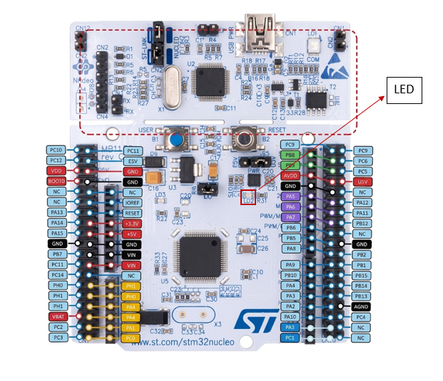

# EXPERIMENT DETAILS

**EXP:** FPIoT LAB EVALUATION - CAT 12

**DATE:** 23/10/2026

**NAME OF EXP:** STM32 On-Board LED Blink Pattern

**HARDWARE SETUP / PLATFORM:** CubeMX + Keil MDK + STM32 Nucleo-64 Development Board (NUCLEO-F401RE) + On-board LED (LD2)

**TASK NO:** Task B – GPIO Output (fast blinks followed by slow blinks using a reusable blink function)

---

## 1. Circuit Diagram

This task uses only the on-board user LED (LD2) of the Nucleo board, so no external components or wiring are needed. The board is powered and programmed through the USB (ST-LINK) connector.

* Platform: NUCLEO-F401RE board, 84 MHz system clock from the internal oscillator (HSI) through the PLL
* Output: on-board user LED LD2 on PA5 (HIGH = ON, LOW = OFF)
* Power Supply: 5V via the ST-LINK USB connector

---

## 2. Core Logic / Pseudocode / Code Base

**Working Principle:**
The LED LD2 on PA5 blinks in a repeating pattern: three fast blinks followed by three slow blinks, forever. A helper function `blink(n, ms)` produces `n` blinks, where each blink keeps the LED ON for `ms` milliseconds and then OFF for `ms` milliseconds. The fast and slow patterns therefore only differ in the value passed to this function. The LED is OFF at start-up.

**Blink Pattern:**

| Phase | Function call | LED ON time | LED OFF time | Duration |
|---|---|---|---|---|
| Three fast blinks | `blink(3, 100)` | 100 ms | 100 ms | 0.6 s |
| Three slow blinks | `blink(3, 500)` | 500 ms | 500 ms | 3.0 s |

One full cycle takes 3.6 seconds and then repeats.

**Pseudocode:**

1. Initialize the HAL library and system clock (HSI + PLL, 84 MHz).
2. Enable the GPIOA clock and configure PA5 as a push-pull output, set LOW (LED off).
3. Repeat continuously:
   1. Call `blink(3, 100)` (fast blinks).
   2. Call `blink(3, 500)` (slow blinks).

`blink(n, ms)`:

1. Repeat `n` times:
   1. Set PA5 HIGH (LED ON).
   2. Wait `ms` milliseconds.
   3. Set PA5 LOW (LED OFF).
   4. Wait `ms` milliseconds.

**Code Base:**
The program is written in C using the STM32 HAL library.

* `blink(int n, int ms)` is a small helper function that blinks the LED `n` times with `ms` milliseconds ON and `ms` milliseconds OFF, so the code is not repeated for the fast and slow patterns.
* `HAL_GPIO_WritePin(GPIOA, GPIO_PIN_5, GPIO_PIN_SET)` turns the LED ON and `GPIO_PIN_RESET` turns it OFF.
* `HAL_Delay(ms)` creates the ON and OFF times using the millisecond SysTick time base.
* `MX_GPIO_Init()` enables the GPIOA clock and configures PA5 as push-pull output (low speed), starting LOW (LED off).
* `SystemClock_Config()` runs the PLL from the internal HSI oscillator (16 MHz / 16 x 336 / 4 = 84 MHz), with AHB = 84 MHz, APB1 = 42 MHz, APB2 = 84 MHz and 2 flash wait states.

**Pin Summary:**

| Pin | Mode | Function |
|---|---|---|
| PA5 (LD2) | Output, push-pull | On-board LED (HIGH = ON, LOW = OFF) |

---

## 3. Inference

The on-board LED shows three fast blinks (100 ms) followed by three slow blinks (500 ms), and the pattern repeats continuously. Putting the blinking into one function with the blink count and the time as parameters keeps the main loop short and makes it easy to change the pattern by only changing the numbers. The timing is created with `HAL_Delay()`, which blocks the processor, which is acceptable for this simple task. This demonstrates GPIO output configuration, clock configuration and writing reusable code with STM32 HAL functions.
