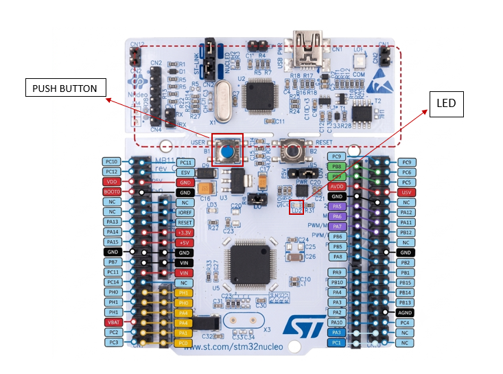

# EXPERIMENT DETAILS

**EXP:** FPIoT LAB EVALUATION - CAT 12

**DATE:** 23/10/2026

**NAME OF EXP:** STM32 Button-Controlled LED (Short Press vs Long Press)

**HARDWARE SETUP / PLATFORM:** CubeMX + Keil MDK + STM32 Nucleo-64 Development Board (NUCLEO-F401RE) + On-board Push-Button (B1) + On-board LED (LD2)

**TASK NO:** Task C – Short Press vs Long Press (short press toggles the LED, long press starts blinking)

---

## 1. Circuit Diagram

This task uses the on-board user push-button (B1) as input and the on-board user LED (LD2) as output, so no external components or wiring are needed. The board is powered and programmed through the USB (ST-LINK) connector.

* Platform: NUCLEO-F401RE board, 84 MHz system clock from the internal oscillator (HSI) through the PLL
* Input: on-board user push-button B1 on PC13 (pressed = LOW, the board already has a pull-up on this pin)
* Output: on-board user LED LD2 on PA5 (HIGH = ON, LOW = OFF)
* Power Supply: 5V via the ST-LINK USB connector

---

## 2. Core Logic / Pseudocode / Code Base

**Working Principle:**
The program reads the push-button B1 on PC13. When a press is detected, the start time is saved with `HAL_GetTick()`, the program waits until the button is released and the press duration is calculated as `release time - start time`. A press of 1 second or longer is a long press and a shorter press is a short press. The LED is OFF at start-up and the program keeps a `blinking` flag that tells whether the LED is in blinking mode.

| User action | System response |
|---|---|
| Short press (< 1 s), not blinking | Toggle LED |
| Long press (>= 1 s) | LED enters continuous blinking mode (toggles every 200 ms) |
| Short press (< 1 s), while blinking | Stop blinking |
| Long press again | Blinking mode continues |

**Pseudocode:**

1. Initialize the HAL library and system clock (HSI + PLL, 84 MHz).
2. Configure PA5 as a push-pull output (LED off) and PC13 as an input. Set `blinking = 0`.
3. Repeat continuously:
   1. If the button is pressed (PC13 reads LOW):
      1. Save the press start time: `pressTime = HAL_GetTick()`.
      2. Wait until the button is released.
      3. If `HAL_GetTick() - pressTime >= 1000 ms` (long press), set `blinking = 1`.
      4. Else if `blinking` is 1 (short press), set `blinking = 0`.
      5. Else (short press), toggle PA5.
      6. Wait 50 ms (debounce).
   2. If `blinking` is 1 and 200 ms have passed since the last toggle, toggle PA5 and save the time.

**Code Base:**
The program is written in C using the STM32 HAL library.

* `LONG_PRESS_MS` is defined as 1000 (a press of this length or longer is a long press).
* `BLINK_MS` is defined as 200 (the LED toggles every 200 ms in blinking mode, so one full blink takes 400 ms).
* `HAL_GPIO_ReadPin(GPIOC, GPIO_PIN_13)` returns GPIO_PIN_RESET when the button is pressed (active-low).
* `HAL_GetTick()` returns the millisecond tick count and is used to measure the press duration and the blink interval. The long press is detected by comparing the time stamps, not by a delay.
* `HAL_GPIO_TogglePin(GPIOA, GPIO_PIN_5)` toggles the LED on a short press and on every blink interval.
* `HAL_Delay(50)` after a press gives a simple debounce time.
* `MX_GPIO_Init()` enables the GPIOA and GPIOC clocks, configures PA5 as push-pull output (low speed, starting LOW) and PC13 as input with no internal pull (the board already has a pull-up).
* `SystemClock_Config()` runs the PLL from the internal HSI oscillator (16 MHz / 16 x 336 / 4 = 84 MHz), with AHB = 84 MHz, APB1 = 42 MHz, APB2 = 84 MHz and 2 flash wait states.

**Pin Summary:**

| Pin | Mode | Function |
|---|---|---|
| PC13 (B1) | Input, board pull-up | On-board push-button (pressed = LOW) |
| PA5 (LD2) | Output, push-pull | On-board LED (HIGH = ON, LOW = OFF) |

---

## 3. Inference

The press duration decides what the LED does: a short press toggles the LED, and a press of 1 second or more starts continuous blinking. A short press while the LED is blinking stops the blinking, and the LED is left in the state it had at that moment. The duration is calculated from `HAL_GetTick()` time stamps taken at the start and at the end of the press, so no delay function is used to decide between a short and a long press, and the blinking is timed with `HAL_GetTick()` instead of `HAL_Delay()`. The button is read in a waiting loop while it is held, so the blinking pauses during a press and resumes after the button is released. This demonstrates GPIO input reading, press-duration measurement, a simple two-state (steady or blinking) control and time-based output toggling using STM32 HAL functions.
