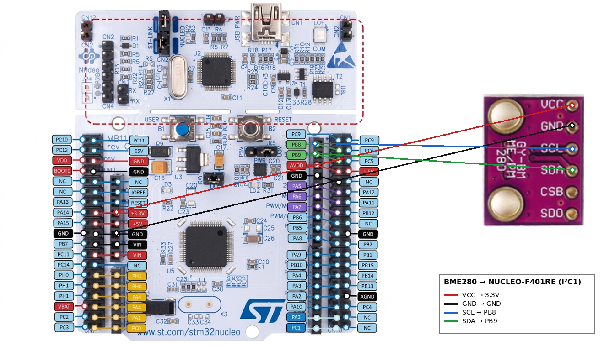

# EXPERIMENT DETAILS

**EXP:** FPIoT LAB EVALUATION - CAT 13

**DATE:** <DD/MM/2026>

**NAME OF EXP:** BME280 Sensor Interfacing over I2C using the Bosch Driver

**HARDWARE SETUP / PLATFORM:** CubeMX + Keil MDK + STM32 Nucleo-64 Development Board (NUCLEO-F401RE) + BME280 Sensor Module (GY-BME280)

**TASK NO:** BME280 temperature, pressure and humidity readings over I2C using the Bosch BME280 API (values viewed in the debugger)

---

## 1. Circuit Diagram

The BME280 sensor module is connected to the I2C1 peripheral of the NUCLEO-F401RE board. The board is powered and programmed through the USB (ST-LINK) connector, and the sensor is powered from the 3.3V pin of the board.

| BME280 pin | NUCLEO-F401RE pin |
|---|---|
| VCC | 3.3V |
| GND | GND |
| SCL | PB8 (I2C1_SCL) |
| SDA | PB9 (I2C1_SDA) |

* Platform: NUCLEO-F401RE board, 84 MHz system clock from the internal oscillator (HSI) through the PLL
* Interface: I2C1 in standard mode (100 kHz), 7-bit addressing
* Sensor I2C address: 0x76 (primary address, `BME280_I2C_ADDR_PRIM`)
* Power Supply: 5V via the ST-LINK USB connector, sensor on 3.3V

---

## 2. Core Logic / Pseudocode / Code Base

**Working Principle:**
The Bosch BME280 driver does all the sensor calculations (compensation), so the program only has to give the driver three STM32-specific functions: a register read, a register write and a delay. These are written with the STM32 HAL I2C functions. After the chip ID is checked, the sensor is initialized, configured and set to normal mode, so it measures continuously. The main loop reads the compensated temperature, pressure and humidity once every second and stores them in the variables `temperature` (degrees C), `pressure` (hPa) and `humidity` (%RH), which are viewed in the debugger.

**Hardware Abstraction Functions:**

| Driver needs | Function in the program | STM32 HAL used |
|---|---|---|
| Read registers | `user_i2c_read()` | `HAL_I2C_Mem_Read()` |
| Write registers | `user_i2c_write()` | `HAL_I2C_Mem_Write()` |
| Delay | `user_delay_us()` | `HAL_Delay()` (microseconds rounded up to milliseconds) |

The device address is shifted left by one bit (`dev_addr << 1`) because the HAL expects the 7-bit address in the upper bits.

**Sensor Settings:**

| Parameter | Value |
|---|---|
| Temperature oversampling | 1x |
| Pressure oversampling | 1x |
| Humidity oversampling | 1x |
| IIR filter | Off |
| Standby time | 1000 ms |
| Sensor mode | Normal (continuous measurement) |

**Pseudocode:**

1. Initialize the HAL library, system clock (HSI + PLL, 84 MHz), GPIO, I2C1 and USART2.
2. Read the chip ID from register 0xD0. If it is not 0x60 (`BME280_CHIP_ID`), stop in an endless loop (wrong sensor or no response).
3. Link the driver to the STM32 functions: `intf_ptr`, `intf = BME280_I2C_INTF`, `read`, `write` and `delay_us`.
4. Initialize the sensor with `bme280_init()`, which resets it and loads the calibration (trim) data. Stop if it fails.
5. Set the oversampling, filter and standby time with `bme280_set_sensor_settings()`.
6. Set the sensor to normal mode with `bme280_set_sensor_mode()`.
7. Repeat continuously:
   1. Read the compensated data with `bme280_get_sensor_data(BME280_ALL, ...)`.
   2. If the read was successful, store the temperature (degrees C), the pressure converted from Pa to hPa (divide by 100) and the humidity (%RH).
   3. Wait 1000 ms.

**Code Base:**
The program is written in C using the STM32 HAL library, generated with STM32CubeMX, and the Bosch BME280 sensor API (`bme280.h`).

* `struct bme280_dev dev` holds the driver state and the links to the read, write and delay functions.
* `struct bme280_settings settings` holds the oversampling, filter and standby settings.
* `struct bme280_data comp_data` receives the compensated temperature, pressure and humidity from the driver, so the compensation equations do not have to be written again.
* `rslt` stores the return code of the last driver call (`BME280_OK` on success).
* `temperature`, `pressure` and `humidity` are global float variables, so they can be added to the debugger Watch window.
* `MX_I2C1_Init()` configures I2C1 with 100 kHz clock, 7-bit addressing and no dual address.
* `SystemClock_Config()` runs the PLL from the internal HSI oscillator (16 MHz / 16 x 336 / 4 = 84 MHz), with AHB = 84 MHz, APB1 = 42 MHz, APB2 = 84 MHz and 2 flash wait states.
* USART2 is also configured by CubeMX (115200 baud), but it is not used in this program.

**Viewing the Output:**
Start a debug session in Keil, add `temperature`, `pressure` and `humidity` (and `rslt`) to the Watch window and run the program. The values update once every second.

---

## 3. Inference

The BME280 sensor is read successfully over I2C, and the compensated temperature, pressure and humidity values are available in the program once per second. Using the Bosch driver means only three small interface functions have to be written for the STM32, while the calibration and the compensation calculations are done inside the driver. Checking the chip ID (0x60) before starting the driver confirms that the sensor is connected and answers at address 0x76. The pressure is returned by the driver in pascals, so it is divided by 100 to get hectopascals. This demonstrates I2C communication with STM32 HAL functions, connecting a third-party sensor driver to the hardware through function pointers, and reading environmental data from a digital sensor.
