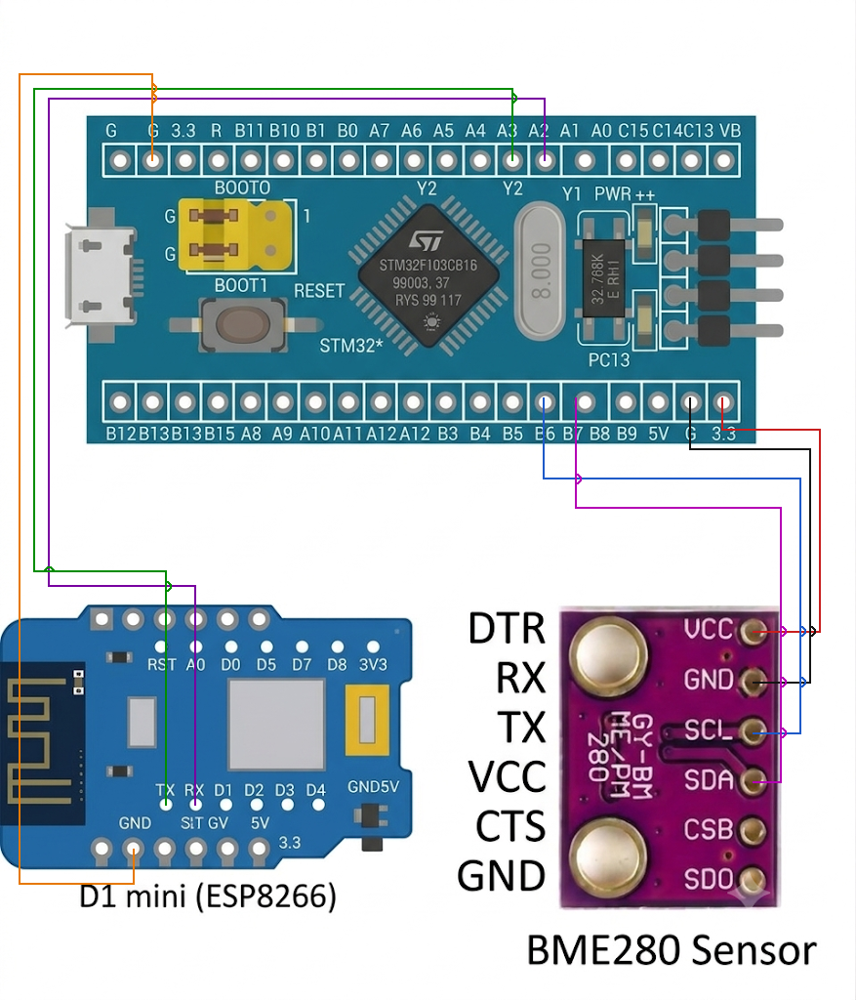

# PROJECT DETAILS

**PROJECT:** IoT Weather Station – BME280 → STM32 → Wi-Fi (Wemos AT) → MQTT → Node-RED Dashboard

**DATE:** <DD/MM/2026>

**NAME OF PROJECT:** Wireless Weather Station using STM32 Blue Pill, BME280 and MQTT

**HARDWARE SETUP / PLATFORM:** CubeMX + Keil MDK + STM32 Blue Pill (STM32F103C8T6) + BME280 Sensor Module (GY-BME280) + Wemos D1 mini (ESP8266 with AT firmware)

**SOFTWARE / CLOUD:** Bosch BME280 API, EMQX public MQTT broker (`broker.emqx.io`), MQTTX, Node-RED (Dashboard 2.0)

---

## 1. Circuit Diagram

The BME280 sensor is read by the Blue Pill over I2C. The Blue Pill then sends the readings to a Wemos D1 mini (ESP8266 running AT firmware) over UART, and the Wemos publishes them to an MQTT broker over Wi-Fi.

| Connection | Blue Pill (STM32F103C8T6) | Other end |
|---|---|---|
| BME280 VCC | 3.3V | VCC |
| BME280 GND | G | GND |
| BME280 SCL | PB6 (I2C1_SCL) | SCL |
| BME280 SDA | PB7 (I2C1_SDA) | SDA |
| Wemos link, STM32 TX | PA2 (USART2_TX) | Wemos RX |
| Wemos link, STM32 RX | PA3 (USART2_RX) | Wemos TX |
| Wemos GND | G | GND |
| Debug output (optional) | PA9 (USART1_TX) | Arduino / USB-serial bridge RX |
| Status LED | PC13 (on-board, active low) | – |

* Microcontroller: STM32F103C8T6 (Blue Pill), 72 MHz system clock from the 8 MHz crystal (HSE) through the PLL (x9)
* Sensor: BME280 at I2C address 0x76, I2C1 in standard mode (100 kHz)
* Wi-Fi module: Wemos D1 mini (ESP8266) with AT firmware, 115200 baud on USART2
* Debug serial: USART1 at 9600 baud
* Power Supply: 5V via USB, sensor on 3.3V



---

## 2. Core Logic / Pseudocode / Code Base

**Working Principle:**
The BME280 measures temperature, humidity and pressure. The STM32 reads the compensated values using the Bosch driver and builds a small JSON message. Since the STM32 has no Wi-Fi, it controls the Wemos with AT commands: the Wemos joins the Wi-Fi network, opens a TCP socket to the MQTT broker and sends hand-built MQTT 3.1.1 packets (CONNECT and PUBLISH, QoS 0). A new reading is published every 8 seconds. The Node-RED dashboard subscribes to the same topic and shows the live values together with a weather rating.

**Data Flow:**

```
BME280 --I2C--> STM32 Blue Pill --UART (AT commands)--> Wemos D1 mini --Wi-Fi--> MQTT Broker --> MQTTX / Node-RED Dashboard
```

**MQTT Details:**

| Item | Value |
|---|---|
| Broker | `broker.emqx.io` (port 1883) |
| Topic | `snuc/fpiot/yellow/bme280` |
| Client ID | `bluepill-weather` |
| QoS | 0 |
| Publish period | 8000 ms |
| Payload | `{"t":<temperature °C>,"h":<humidity %RH>,"p":<pressure hPa>}` |

Example payload: `{"t":28.45,"h":71.20,"p":1008.35}`

**Pseudocode:**

1. Initialize the HAL library, system clock (HSE + PLL, 72 MHz), GPIO, I2C1, USART1 and USART2.
2. Initialize the BME280 (Bosch driver), set oversampling 1x for temperature, pressure and humidity, filter off, and normal mode. If it fails, blink the on-board LED fast and stop.
3. Join Wi-Fi through the Wemos:
   1. Send `AT` until the Wemos answers.
   2. `ATE0` (echo off), `AT+CWMODE=1` (station mode).
   3. `AT+CWJAP` with the SSID and password, then `AT+CIPMUX=0` (single connection).
4. Repeat continuously:
   1. If MQTT is not connected: join Wi-Fi again if needed, open the TCP connection with `AT+CIPSTART`, send the MQTT CONNECT packet and wait for the CONNACK. After 3 failed tries, force a fresh Wi-Fi join and retry after 3 s.
   2. Read the sensor with `bme280_get_sensor_data()`.
   3. Convert the pressure from Pa to hPa (divide by 100) and build the JSON string.
   4. Build the MQTT PUBLISH packet and send it with `AT+CIPSEND`. If sending fails, reconnect on the next loop.
   5. Toggle the on-board LED (PC13) and wait 8 seconds.

**Code Base:**
The program is written in C using the STM32 HAL library, generated with STM32CubeMX, and the Bosch BME280 sensor API (`bme280.h`).

* `bme_read()`, `bme_write()`, `bme_delay()` connect the Bosch driver to the STM32 HAL (`HAL_I2C_Mem_Read`, `HAL_I2C_Mem_Write`, `HAL_Delay`).
* `esp_cmd()`, `esp_wait()`, `esp_collect()` send AT commands and wait for the expected reply (`OK`, `ERROR`, `>` or `SEND OK`) without blocking forever.
* `esp_send_bytes()` uses `AT+CIPSEND=<len>` to send raw binary MQTT packets through the Wemos.
* `mqtt_build_connect()` and `mqtt_build_publish()` build the MQTT 3.1.1 packets by hand (fixed header, remaining-length encoding, topic and payload), so no MQTT library is needed.
* `wifi_join()` and `mqtt_connect()` handle the Wi-Fi and broker connection, with automatic reconnection.
* `dbg()` prints status messages on USART1 for debugging.
* `WIFI_SSID`, `WIFI_PASS`, `MQTT_HOST`, `MQTT_PORT`, `MQTT_TOPIC` and `PUBLISH_PERIOD_MS` are defined at the top of `main.c` and can be changed easily.

**LED Status (PC13):**

| LED behaviour | Meaning |
|---|---|
| Toggles once per publish cycle | Normal operation |
| Fast blinking (100 ms) | BME280 initialization failed (check I2C wiring) |

---

## 3. Node-RED Dashboard

Node-RED subscribes to `snuc/fpiot/yellow/bme280` on `broker.emqx.io`, parses the JSON and shows the temperature, humidity and pressure on Dashboard 2.0 widgets. A function node rates the current weather as **GOOD / BETTER / BAD** and shows the percentage for each rating. MQTTX can be used to subscribe to the same topic to check the raw messages.

---

## 4. Inference

The weather station reads temperature, humidity and pressure from the BME280 over I2C and sends them wirelessly to an MQTT broker every 8 seconds, where they can be viewed live in MQTTX and in the Node-RED dashboard. The STM32 has no built-in Wi-Fi, so the Wemos is controlled with AT commands over UART, and the MQTT packets are built manually in code. The program checks every step (sensor, Wi-Fi, TCP, CONNACK, publish) and reconnects automatically when something fails, so it keeps running without a reset. This demonstrates I2C sensor interfacing with a third-party driver, UART communication with AT commands, the MQTT protocol, and IoT data visualization with Node-RED.
